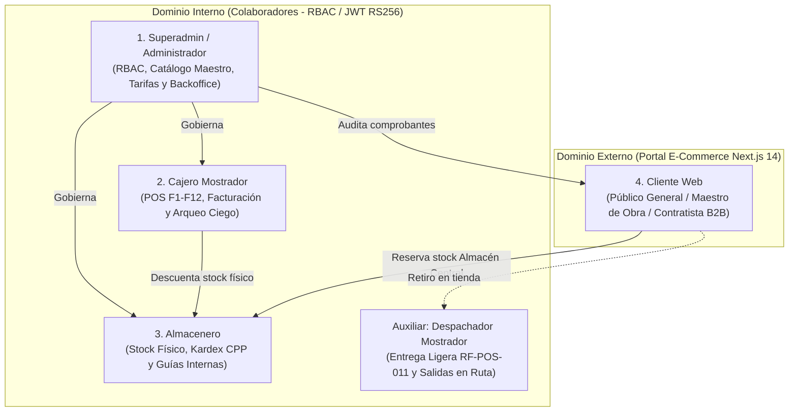

# Especificación Formal de Actores del Sistema (SIGIC Ferretería v2.2)

> **Documento:** `01-analisis-de-sistema/01-actores.md`  
> **Versión de Especificación:** 2.2 (Oficial – SIGIC Ferretería)  
> **Área:** Análisis de Sistema, Modelado de Seguridad RBAC y Estándar IS-488 UNSCH  
> **Estado:** VALIDADO_PARA_EXPOSICION  

---

## 1. Introducción y Enfoque de Seguridad

El sistema **SIGIC Ferretería v2.2** establece un modelo de seguridad basado en la **segregación estricta de dominios de identidad**:

1. **Dominio Interno (Colaboradores y Personal Operativo):** Administrado mediante un esquema de Control de Acceso Basado en Roles (**RBAC** – *Role-Based Access Control*), donde cada usuario pertenece a un directorio centralizado, autenticado mediante tokens **JWT firmados asimétricamente con algoritmo RS256** (RSA 2048 bits) con expiración de 15 minutos y almacenamiento de contraseñas bajo derivación criptográfica **Argon2id** ($m=65536, t=3, p=4$).
2. **Dominio Externo (Clientes Web B2B/B2C):** Autenticado en un almacén de identidades independiente para el portal e-commerce (Público General, Maestro de Obra y Contratista), con tokens desacoplados (`Audience: SIGIC_WebClient`) que impiden de forma absoluta cualquier invocación a las APIs internas de mostrador, inventario físico o tesorería.

---

## 1.1 Ficha de Relevamiento Operativo y Problemática Real de Retail Ferretero

Para anclar las especificaciones en la realidad operativa del negocio comercial en Huamanga (Ayacucho), se formaliza la siguiente ficha de relevamiento técnico-operativo:

| Variable Operativa | Relevamiento de Campo (Ferretería Real) | Impacto Arquitectónico y Dolor de Negocio |
| :--- | :--- | :--- |
| **Volumen Transaccional Diario** | **~150 comprobantes por turno** (boletas, facturas electrónicas y notas de venta rápida). | Exige que la captura de ítems sea $\le 1.0\text{ s}$ por código de barras y el cierre de cobro $\le 2.0\text{ s}$ en mostrador para evitar colas de contratistas en horas punta. |
| **Materiales Críticos de Alta Rotación** | **Cemento Portland Tipo I (bolsas de 42.5 kg)** y **Fierro corrugado de 1/2" (varillas de 9 m)**. | Artículos con margen estrecho, alta demanda matutina y gran volumen físico, donde cualquier sobreventa o quiebre de stock paraliza cuadrillas de obra y genera reclamos legales severos. |
| **Conflicto Concurrente Mostrador vs. Web** | Un cliente web en Huanta reserva **40 bolsas de cemento** vía e-commerce a las 09:15 h; a las 09:16 h, un maestro de obra se presenta en ventanilla intentando pagar en efectivo las últimas **40 bolsas físicas** existentes en tienda. | Si el sistema consultara únicamente el `stock_fisico`, ambas ventas procederían, generando una **sobreventa crítica de 40 bolsas**. Resuelto mediante la ecuación inviolable $\text{Stock Disponible} = \text{Stock Físico} - \text{Stock Comprometido}$ y bloqueos pesimistas ordenados en PostgreSQL 16. |
| **Cuadre de Caja Manual Tradicional** | Cuadre manual en papel y calculadora al cierre de turno sobre las 150 ventas del día (mezclando efectivo, Yape, Plin y tarjetas). | Altamente propenso a errores humanos, encubrimiento de faltantes cuando el cajero conoce previamente el saldo teórico, y retrasos de hasta 45 minutos en el cierre. Resuelto mediante el **Arqueo Ciego Append-Only** (`REVOKE UPDATE, DELETE ON caja_arqueo`). |

---

## 2. Cuatro Actores Principales del Sistema

De acuerdo con el modelo de operación ferretera y el estándar de evaluación IS-488 UNSCH, se identifican **cuatro actores rectores**, complementados por roles operativos auxiliares:

---

### 2.1. Actor 1: Superadmin / Administrador del Sistema

- **Identificador de Rol RBAC:** `ROLE_SUPERADMIN` / `ROLE_ADMIN`
- **Descripción del Rol:** Máxima autoridad operativa y directiva de la empresa ferretera. Responsable de la gobernanza de identidades, configuración del catálogo maestro, fijación de políticas de precios multiescala y validación financiera en la consola de Backoffice.
- **Responsabilidades Principales:**
  1. **Control de Acceso y Seguridad RBAC (`RNF-SEG-003`):** Alta, baja y asignación de permisos de colaboradores, habilitación de turnos y forzado de rotación de credenciales criptográficas.
  2. **Gobernanza de Catálogo Maestro y Medidas Complejas (`RF-INV-001`, `RF-INV-005`):** Creación y mantenimiento de la jerarquía de artículos (Familia $\rightarrow$ Subfamilia $\rightarrow$ Marca), definición de unidades base y factores de conversión multiescala (unidad, docena, bolsa, caja master, millar).
  3. **Control Estricto de Visibilidad Web (`RF-INV-001`):** Asignación manual del flag `disponible_en_web` (`true`/`false`). Garantiza que artículos fraccionados, cortes de cable o pernería a granel permanezcan exclusivos de mostrador.
  4. **Motor de Tarifas y Listas de Precios (`RF-PRE-001`, `RF-PRE-002`):** Configuración de Lista 1 (Público General), Lista 2 (Maestro de Obra) y Lista 3 (Contratista / Mayorista B2B), con políticas de margen mínimo sobre el Costo Promedio Ponderado (CPP).
  5. **Cola de Validación de Pagos Web (Consola Backoffice - `RF-WEB-003`):** Inspección de constancias de transferencia y capturas Yape/Plin (hasta 5 MB en formato JPG, PNG, PDF), verificación contra extractos de cuenta bancaria corporativa y aprobación/rechazo de pagos para habilitar el despacho.
  6. **Auditoría Integral y Reportería Analítica (`RF-REP-001`, `RNF-SEG-004`):** Acceso al Datamart analítico (`sigic_olap`), inspección de diferencias de arqueo ciego de caja y revisión de la bitácora inmutable `Audit_Log`.
- **Límites de Acceso:** No opera terminales de cobro POS en simultáneo con funciones de tesorería para evitar conflictos de interés. Toda modificación de precios o anulación queda auditada con marca de tiempo UTC.
- **Interfaz Utilizada:** SPA React 18 – Consola Integral de Administración, Catálogo y Backoffice.

---

### 2.2. Actor 2: Cajero Mostrador

- **Identificador de Rol RBAC:** `ROLE_CAJERO`
- **Descripción del Rol:** Colaborador operativo responsable directo de la atención transaccional y recaudación económica en el punto de venta presencial.
- **Responsabilidades Principales:**
  1. **Apertura de Turno de Caja (`RF-CAJ-001`):** Registro de fondo inicial de sencillo y vinculación de terminal física a su identidad.
  2. **Facturación Rápida por Teclado y Lector Láser (`RF-POS-003`, `RNF-PERF-001`):** Captura ágil de artículos por código de barras (EAN-13/SKU) y atajos de función `F1`–`F12`, operando al 100 % sin ratón con latencia sub-segundo ($P95 < 250\text{ ms}$ en API local).
  3. **Gestión de Pagos Mixtos y Unicidad de Operación (`RF-POS-006`):** Cobro combinando efectivo, tarjetas POS y billeteras digitales (Yape/Plin). Registro manual obligatorio del código de operación bancaria de 4 a 12 dígitos, validando no duplicidad diaria.
  4. **Gestión de Ventas en Espera (`RF-POS-005`):** Retención temporal de canastas activas (`F9`) para descongestionar colas, con límite de 2 horas sin afectar Kardex.
  5. **Arqueo Ciego de Caja al Cierre de Turno (`RF-CAJ-002`, AC03):** Declaración física obligatoria de billetes y monedas por denominación sin conocer el saldo teórico del sistema. El sistema persiste el registro en formato inmutable *append-only*.
- **Límites de Acceso:**
  - Acceso restringido exclusivamente a su terminal asignada y a su turno vigente.
  - Prohibido anular comprobantes emitidos en turnos cerrados (requiere clave de Superadmin).
  - Cero acceso a la cola de validación de comprobantes de pago del canal web.
- **Interfaz Utilizada:** SPA React 18 – Módulo POS Mostrador (optimizada para viewport $1024 \times 768$ sin scroll horizontal).

---

### 2.3. Actor 3: Almacenero

- **Identificador de Rol RBAC:** `ROLE_ALMACENERO`
- **Descripción del Rol:** Responsable del control físico de existencias, recepción de proveedores, despacho logístico y transferencias entre almacenes.
- **Responsabilidades Principales:**
  1. **Recepción de Mercadería contra Órdenes de Compra (`RF-INV-006`):** Confirmación física de insumos en Almacén Central, generando el incremento de existencias y recalculando automáticamente el Costo Promedio Ponderado (CPP).
  2. **Emisión y Recepción de Guías Internas de Traslado (`RF-INV-003`):** Gestión de traslados inter-almacén (Central $\rightarrow$ Mostrador 1 / Mostrador 2) a través de la máquina de estados: `Borrador` $\rightarrow$ `En Tránsito` $\rightarrow$ `Recibido` / `Rechazado`.
  3. **Preparación y Picking de Pedidos Web (`RF-WEB-002`):** Armado físico de bultos originados en el canal digital cuyo pago haya sido formalmente confirmado por Superadmin/Tesorería.
  4. **Emisión Automática de Guías para Retiro en Tienda (`RF-INV-003`, `RF-WEB-002`):** Traslado automático desde Almacén Central hacia la tienda de destino elegida por el cliente web.
- **Límites de Acceso:**
  - Sin facultades para realizar cobros de ventas ni arqueos de caja.
  - No puede alterar listas de precios, márgenes de ganancia ni modificar el flag `disponible_en_web`.
- **Interfaz Utilizada:** SPA React 18 – Módulo de Inventarios, Kardex y Guías de Remisión Interna.

---

### 2.4. Actor 4: Cliente Web (Canal Digital E-Commerce)

- **Identificador de Rol:** Dominio Externo (`Audience: SIGIC_WebClient`)
- **Descripción del Rol:** Usuario externo que accede a la plataforma a través de Internet para cotizar, adquirir y reservar materiales de ferretería pesada y herramientas.
- **Perfiles Especializados:**
  1. **Público General (B2C - `Customer_Retail`):** Cliente particular que consulta el catálogo público, visualiza precios de Lista 1 (con IGV) y realiza compras al por menor.
  2. **Maestro de Obra (`Customer_Pro`):** Profesional técnico independiente homologado por la administración. Tras autenticarse, accede a la **Lista 2 (Tarifa Técnica Preferencial)** y reserva materiales para retiro temprano en tienda.
  3. **Contratista B2B (`Customer_B2B`):** Empresa constructora o consorcio con RUC validado. Accede a la **Lista 3 (Tarifa Mayorista B2B)**, solicita cotizaciones por volumen y programa despachos de carga pesada a obra o recojo en Almacén Central.
- **Responsabilidades y Operaciones en Plataforma:**
  - Navegación de catálogo responsivo filtrado estrictamente por `disponible_en_web == true` (`RF-WEB-001`).
  - Checkout atómico con revalidación de precio vigente y stock disponible (`RF-WEB-005`).
  - Reserva dinámica de inventario con temporizador según medio de pago: 20 minutos para pasarela de tarjetas; hasta 4 horas para pagos manuales con 1 hora máxima para adjuntar el comprobante (`RF-WEB-002`).
  - Carga de constancias de transferencia bancaria / Yape (archivos hasta 5 MB en JPG, PNG, PDF) (`RF-WEB-003`).
  - Trazabilidad en tiempo real del estado de su orden: `Pendiente de Validación` $\rightarrow$ `En Preparación` $\rightarrow$ `Listo para Retiro` / `En Ruta` $\rightarrow$ `Entregado` (`RF-WEB-004`).
- **Límites de Acceso:** Endpoints internos de caja, inventario y administración deniegan el acceso con código `HTTP 403 Forbidden`. No visualiza artículos de venta exclusiva en mostrador (`disponible_en_web == false`), recibiendo `HTTP 404 Not Found` ante intentos directos.
- **Interfaz Utilizada:** Portal Web E-Commerce responsivo en Next.js 14 SSR.

---

### 2.5. Actor Auxiliar: Despachador Mostrador

- **Identificador de Rol RBAC:** `ROLE_DESPACHADOR`
- **Descripción del Rol:** Colaborador asignado a la bahía de despacho de tienda física o patio de maniobras.
- **Responsabilidad Focalizada (`RF-POS-011` / Atajo `F6`):**
  - Pantalla ligera de entrega en mostrador: escaneo del código QR o código alfanumérico del pedido web y validación del DNI del receptor.
  - **Frontera de Seguridad Estricta:** Solo procesa pedidos que ya se encuentren en estado `Listo para Retiro`. **No descarga comprobantes de pago de 5 MB**, no valida transferencias bancarias y no tiene acceso a cuentas financieras. Confirmación en $\le 1$ segundo.
- **Interfaz Utilizada:** SPA React 18 – Vista Ligera de Despacho Mostrador.

---

## 3. Matriz de Autorización RBAC y Trazabilidad de Interfaces

| Actor / Rol | Dominio de Identidad | Credenciales / Token | Interfaz de Software | Módulos y Capacidades Autorizadas |
| :--- | :--- | :--- | :--- | :--- |
| **Superadmin / Administrador** | Interno (Colaborador) | JWT RS256 (`Audience: SIGIC_InternalStaff`, Rol: `Admin`) | Consola Backoffice (React 18) | Gobernanza RBAC, Catálogo Maestro, Flag Web (`RF-INV-001`), Tarifas 1/2/3, Cola Backoffice Vouchers 5MB (`RF-WEB-003`), Reportes Datamart (`sigic_olap`). |
| **Cajero Mostrador** | Interno (Colaborador) | JWT RS256 (`Audience: SIGIC_InternalStaff`, Rol: `Cajero`) | SPA POS Mostrador (React 18, 1024x768) | Apertura/Cierre de Turno, Venta Rápida `F1`–`F12`, Pagos Mixtos con Validación de Operación, Arqueo Ciego Append-Only (`RF-CAJ-002`). |
| **Almacenero** | Interno (Colaborador) | JWT RS256 (`Audience: SIGIC_InternalStaff`, Rol: `Almacenero`) | SPA Gestión Interna (React 18) | Recepción de Compras contra OC, Kardex CPP, Guías Internas de Traslado (`RF-INV-003`), Picking de Órdenes Web en Almacén Central. |
| **Despachador Mostrador** | Interno (Colaborador) | JWT RS256 (`Audience: SIGIC_InternalStaff`, Rol: `Despachador`) | Vista Despacho F6 (React 18) | Entrega Ágil de Pedidos Web `Listo para Retiro` cotejando DNI (`RF-POS-011`), Marcación de Despacho en Ruta. Cero acceso a vouchers. |
| **Cliente Web (B2C/Pro/B2B)** | Externo (Cliente) | JWT Web (`Audience: SIGIC_WebClient`) | Portal E-Commerce (Next.js 14 SSR) | Catálogo Filtrado (`disponible_en_web = true`), Precios Dinámicos según Perfil, Checkout Atómico con Bloqueo de Fila, Carga de Vouchers, Trazabilidad. |
