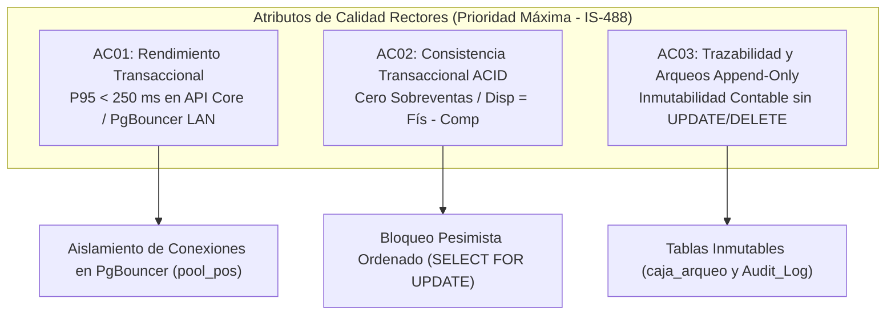

# Atributos de Calidad y Requerimientos No Funcionales (SIGIC Ferretería v2.2)

> **Documento:** `01-analisis-de-sistema/04-atributos-de-calidad.md`  
> **Versión de Especificación:** 2.2 (Oficial – SIGIC Ferretería)  
> **Estándar:** ISO/IEC 25010 (System and Software Quality Requirements and Evaluation) & IS-488 UNSCH  
> **Estado:** VALIDADO_PARA_EXPOSICION  

---

## 1. Priorización Estratégica de Atributos de Calidad (IS-488 UNSCH)

Para responder a las tensiones inherentes entre la atención física de alta velocidad en mostrador POS y la concurrencia remota del comercio electrónico B2B/B2C, la arquitectura de **SIGIC Ferretería v2.2** prioriza formalmente tres Atributos de Calidad Rectores:

### Tabla de Priorización de Atributos de Calidad Rectores

| ID Prioritario | Atributo Rector | Métrica Verificable Cuantificable | Mecanismo Arquitectónico de Implementación |
| :--- | :--- | :--- | :--- |
| **AC01** | **Rendimiento Transaccional y Latencia de API** | Latencia en percentil 95 ($P95 < 250\text{ ms}$) en endpoints transaccionales de cobro en red local (LAN). Adición de ítem por escáner $\le 1.0\text{ s}$; cierre total de venta $\le 2.0\text{ s}$ en mostrador POS. | Conexiones persistentes dedicadas en PgBouncer (`pool_pos`, 50 conexiones), llamadas en memoria sin saltos de red inter-servicio ($< 1\text{ ms}$ intra-monolito) y consultas asíncronas optimizadas con Dapper para lecturas. |
| **AC02** | **Consistencia Transaccional ACID y Cero Sobreventas** | Cero ($0$) sobreventas y cero ($0$) saldos negativos en pruebas continuas de concurrencia con 100 hilos simultáneos compitiendo por el mismo SKU ferretero. | Fórmula matemática inmutable: $\text{Stock Disponible} = \text{Stock Físico} - \text{Stock Comprometido}$, aislamiento relacional en PostgreSQL 16 con bloqueo pesimista `SELECT ... FOR UPDATE` ordenado por `producto_id ASC` para erradicar *deadlocks*. |
| **AC03** | **Trazabilidad y Auditoría de Arqueos Append-Only** | Cien por ciento ($100\text{ \%}$) de arqueos de caja y operaciones sensibles auditadas sin posibilidad de modificación o eliminación retroactiva. Cero discrepancias forenses. | Estructura de almacenamiento estrictamente **append-only** en las tablas `caja_arqueo`, `caja_arqueo_detalle` y `Audit_Log`, respaldada por permisos de base de datos que deniegan `UPDATE` y `DELETE` para usuarios operativos. |

---

## 2. Categoría: Rendimiento y Eficiencia de Recursos (PERF / AC01)

| Código | Atributo de Calidad | Regla de Negocio y Mecanismo Arquitectónico | Métrica y Criterio de Aceptación |
| :--- | :--- | :--- | :--- |
| **RNF-PERF-001** | **Prioridad transaccional del Mostrador POS (AC01).** | La búsqueda de artículos por escáner óptico o teclado y la confirmación de cobro físico en mostrador tienen prioridad absoluta sobre el tráfico del portal web y sobre procesos de fondo. | Latencia de API Core en red LAN $P95 < 250\text{ ms}$. Búsqueda de artículo $\le 1$ s y confirmación de cobro $\le 2$ s (p95) operando simultáneamente bajo carga de 20 terminales POS y 200 sesiones web activas. |
| **RNF-PERF-002** | Aislamiento operativo entre carga transaccional (OLTP) y analítica (OLAP). | Todos los reportes gerenciales pesados, análisis de utilidades y cálculo de Kardex valorizado se ejecutan estrictamente contra el Datamart (`sigic_olap`), protegiendo el motor transaccional de bloqueos de lectura o sobrecarga de CPU. | Degradación del tiempo de confirmación de cobro en mostrador $\le 10$ % durante la ejecución concurrente del proceso de cálculo de Kardex valorizado mensual. |
| **RNF-PERF-003** | Rendimiento y velocidad de respuesta de consultas analíticas. | Las consultas de reportería de inteligencia de negocios operan sobre vistas materializadas indexadas y tablas de agregación del Datamart. | Consulta analítica histórica típica $\le 5$ s (p95) evaluando un histórico de 24 meses de transacciones comerciales. |
| **RNF-PERF-004** | Tráfico web concurrente de clientes externos en catálogo y fichas. | El portal e-commerce resuelve la navegación, búsqueda por categorías y visualización de fichas de producto mediante páginas pre-renderizadas en servidor (Next.js SSR) con caché intermedia en Nginx. | Carga de listado de catálogo $\le 1.5$ s y tiempo de respuesta de la API pública de consulta $\le 400$ ms (p95) bajo prueba de estrés sostenida de 200 sesiones web concurrentes y una tasa de 50 solicitudes por segundo. |
| **RNF-PERF-005** | Segregación de pools de conexiones en PgBouncer y protección del POS. | PgBouncer configurado en modo transacción con dos pools segregados: `pool_pos` (prioritario, reservado con conexiones persistentes dedicadas) y `pool_web` (limitado con política de contención). Las consultas de catálogo web leen del modelo de lectura desacoplado y nunca saturan el pool transaccional. | Degradación del tiempo de cobro en POS $\le 10$ % durante el pico máximo de estrés web (`RNF-PERF-004`). 0 incidentes de agotamiento de conexiones (*pool exhaustion*) en el `pool_pos`. |

---

## 3. Categoría: Concurrencia e Integridad Transaccional (CON / AC02)

| Código | Atributo de Calidad | Regla de Negocio y Mecanismo Arquitectónico | Métrica y Criterio de Aceptación |
| :--- | :--- | :--- | :--- |
| **RNF-CON-001** | **Integridad absoluta del inventario bajo concurrencia extrema (AC02).** | El inventario físico jamás puede admitir saldos negativos. Toda transacción de salida, reserva o checkout ejecuta un `UPDATE` condicionado atómico verificando la existencia de saldo disponible en la base de datos relacional. | 0 sobreventas y 0 saldos negativos en pruebas de estrés automatizadas con 100 hilos concurrentes compitiendo en el mismo milisegundo por las últimas unidades de un producto. |
| **RNF-CON-002** | Prevención y resolución de bloqueos mutuos (*Deadlocks*). | Para transacciones que afecten múltiples artículos (ventas de mostrador con varias líneas o pedidos web agrupados), los bloqueos pesimistas de fila (`SELECT ... FOR UPDATE`) se adquieren obligatoriamente en **orden ascendente determinista de identificador de artículo** (`ORDER BY product_id ASC`). En caso de excepción de timeout, la aplicación implementa reintento automático con *exponential backoff* y *jitter* (hasta 3 intentos). | 0 transacciones abortadas definitivamente o perdidas por condición de *deadlock* en pruebas continuas de carga transaccional. |
| **RNF-CON-003** | **Consistencia multicanal de Stock Disponible vs. Stock Comprometido (AC02).** | Regla matemática unificada:   $$\text{Stock Disponible} = \text{Stock Físico} - \text{Stock Comprometido}$$   Donde el *Stock Comprometido* incluye las reservas web vigentes con TTL activo y las cantidades asociadas a guías de salida internas en estado `En Tránsito`. Cualquier venta física o reserva web decrementa de inmediato el disponible de forma atómica. | En una prueba concurrente de 100 hilos (50 hilos desde terminales POS y 50 hilos desde el portal web) compitiendo por un saldo inicial de 5 unidades de material crítico: exactamente 5 unidades son procesadas (vendidas o reservadas) y las 95 restantes son rechazadas formalmente. Sobreventa = 0. |
| **RNF-CON-004** | Resolución idempotente de carreras entre expiración de reserva y confirmación de pago. | Cuando un cliente confirma un pago manual o la pasarela envía el webhook en el mismo instante en que el servicio en segundo plano (*BackgroundService*) evalúa el vencimiento del TTL de la reserva, el sistema adquiere un bloqueo pesimista sobre el registro de la orden. El primer proceso en adquirir la fila determina el estado final (`Pago Confirmado` o `Cancelado por Expiración`). Ambos manejadores están diseñados con lógica idempotente. | 0 registros de orden con estado ambiguo o inconsistente en una batería de 1 000 pruebas automatizadas de carreras simultáneas (*race conditions*) entre confirmación y expiración. |

---

## 4. Categoría: Seguridad, Auditoría y Trazabilidad (SEG / AC03)

| Código | Atributo de Calidad | Regla de Negocio y Mecanismo Arquitectónico | Métrica y Criterio de Aceptación |
| :--- | :--- | :--- | :--- |
| **RNF-SEG-001** | Autenticación basada en JSON Web Tokens (JWT) con firma asimétrica. | Token de acceso (*Access Token*) con vida útil máxima de 15 minutos, firmado digitalmente mediante algoritmo asimétrico **RS256** (clave privada en Servidor de Directorio, clave pública distribuida a las APIs). Renovación mediante *Refresh Tokens* revocables con rotación estricta y almacenamiento en cookies HTTP-Only seguras. | 100 % de solicitudes HTTP a rutas protegidas sin token válido o con firma expirada son rechazadas de inmediato con código `HTTP 401 Unauthorized`. |
| **RNF-SEG-002** | Almacenamiento y derivación criptográfica de contraseñas. | Empleo exclusivo de **Argon2id** (configuración recomendada: $m=65536$, $t=3$, $p=4$) con sal aleatoria criptográfica de 16 bytes por usuario. Prohibición absoluta de almacenamiento de credenciales en texto plano o cifrado reversible. | 0 contraseñas en claro en esquemas de base de datos, tablas de memoria, trazas de depuración o archivos de log del sistema. |
| **RNF-SEG-003** | Control de Acceso Basado en Roles (RBAC) validado en servidor. | Matriz de permisos RBAC para colaboradores internos: `Superadmin`, `Cajero`, `Almacenero`, `Despachador`. La validación de claims y políticas de autorización se ejecuta obligatoriamente en el servidor en cada endpoint (`AuthorizeAttribute`), impidiendo accesos por manipulación de UI en cliente. | 100 % de accesos no autorizados a rutas de API denegados con código `HTTP 403 Forbidden` en pruebas de penetración automatizadas. |
| **RNF-SEG-004** | **Pistas de auditoría inmutable y arqueos Append-Only (AC03).** | Registro automático en la tabla inmutable `Audit_Log` de toda operación crítica y persistencia inmutable en `caja_arqueo`. Prohibición de comandos `UPDATE` y `DELETE` en el esquema contable. Cada registro captura: `UsuarioID`, `Timestamp_UTC`, `IP_Cliente`, `Entidad`, `Accion`, `Valor_Anterior_JSON`, `Valor_Nuevo_JSON`. | 100 % de operaciones sensibles y arqueos trazados sin excepción. Integridad criptográfica verificable; 0 registros auditables modificados o eliminados. |
| **RNF-SEG-005** | Autenticación y protección de clientes web externos (Ley N.° 29733). | Registro y login de clientes web mediante correo electrónico o DNI/RUC con contraseñas en Argon2id. Emisión de JWT de ámbito público (*Audience: SIGIC_WebClient*) con claims estrictamente limitados que impiden la invocación de endpoints internos. Tráfico cifrado mediante TLS 1.2 o superior obligatorio. Limitación de tasa (*Rate Limiting*) de 5 intentos fallidos consecutivos con bloqueo temporal de cuenta de 15 minutos. | 100 % de endpoints internos rechazan tokens de cliente web (`HTTP 403`). 0 accesos permitidos bajo protocolo HTTP sin cifrar (redirección forzada 301 a HTTPS). Bloqueo automático de 15 min tras el quinto intento fallido verificado en pruebas de fuerza bruta. |

---

## 5. Categorías: Usabilidad, Compatibilidad y Disponibilidad (USA / DIS)

| Código | Atributo de Calidad | Regla de Negocio y Mecanismo Arquitectónico | Métrica y Criterio de Aceptación |
| :--- | :--- | :--- | :--- |
| **RNF-USA-001** | Compatibilidad multiplataforma y cero instalación local. | Las aplicaciones cliente operan como aplicaciones web estándar sobre Google Chrome, Microsoft Edge y Mozilla Firefox (versiones estables vigentes), sin requerir la instalación de plugins nativos, componentes ActiveX o dependencias locales en los puestos de venta. | 100 % de casos de prueba de navegación, facturación y consulta aprobados con paridad visual y funcional en los tres navegadores especificados. |
| **RNF-USA-002** | Diseño responsivo y visualización sin desbordamiento horizontal. | Las interfaces se adaptan formalmente a los estándares de pantalla del sector ferretero: $1024 \times 768$ (monitores de mostrador estándar POS), $1366 \times 768$ (laptops comerciales) y $1920 \times 1080$ (monitores de oficina y gerencia). Las tablas de cobro y acciones críticas se mantienen visibles en el primer viewport. | 0 desbordamientos (*overflow*) horizontales no controlados en las resoluciones evaluadas; el flujo completo de venta es operable sin necesidad de scroll horizontal. |
| **RNF-DIS-001** | Alta disponibilidad y política de respaldos (*Disaster Recovery*). | Disponibilidad operativa del sistema transaccional durante el horario comercial ferretero (lunes a sábado de 07:00 a 20:00 h). Ejecución diaria automatizada de copias de seguridad consistentes (*pg_dump* en frío y archivado de WAL para Point-In-Time Recovery) alojadas en almacenamiento secundario independiente. | Disponibilidad mensual $\ge 99.5$ % en horario comercial. Tiempo Objetivo de Recuperación (RTO) $\le 60$ minutos y Punto Objetivo de Recuperación (RPO) $\le 15$ minutos ante fallo de hardware en el servidor de base de datos. |
