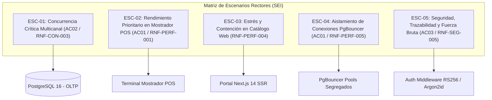

# Escenarios Formales de Atributos de Calidad (SIGIC Ferretería v2.2)

> **Documento:** `01-analisis-de-sistema/08-escenarios-atributos-calidad.md`  
> **Versión de Especificación:** 2.2 (Oficial – SIGIC Ferretería)  
> **Estándar:** Modelo Formal de 6 Partes del SEI (*Software Engineering Institute* - Carnegie Mellon / Bass, Clements & Kazman)  
> **Alineación con Atributos Rectores:** AC01 (Rendimiento P95 < 250ms), AC02 (Consistencia ACID Cero Sobreventas), AC03 (Trazabilidad Append-Only)  
> **Estado:** VALIDADO_PARA_EXPOSICION  

---

## 1. Fundamentación Metodológica y Estructura SEI

La especificación de Atributos de Calidad mediante **Escenarios Formales de Calidad** proporciona un mecanismo cuantitativo, no ambiguo y directamente verificable para evaluar la arquitectura del software. Conforme al estándar de ingeniería de software del **Software Engineering Institute (SEI)**, cada escenario se estructura estrictamente en seis dimensiones operativas:

1. **Fuente del Estímulo (*Source of Stimulus*):** La entidad o condición (interna o externa) que genera el evento (usuario web, cajero POS, temporizador de fondo, atacante).
2. **Estímulo (*Stimulus*):** La acción, petición o anomalía concreta que arriba al sistema.
3. **Artefacto (*Artifact*):** La porción o subsistema de software/infraestructura impactado directamente.
4. **Entorno (*Environment*):** Las condiciones operativas en las que ocurre el estímulo (operación pico simultánea, condiciones normales de red, estrés transaccional, degradación de servicios externos).
5. **Respuesta (*Response*):** La acción arquitectónica observable ejecutada por el sistema para responder al estímulo sin comprometer su integridad.
6. **Medida de Respuesta (*Response Measure*):** El criterio de aceptación métrico, cuantificable y reproducible que determina si la respuesta es satisfactoria.

---

## 2. Matriz Consolidada de Escenarios de Calidad

A continuación se presentan los cinco escenarios rectores que mitigan los riesgos arquitectónicos de mayor impacto en **SIGIC Ferretería v2.2**:



---

### Escenario 1: Concurrencia Crítica Multicanal en Materiales Pesados (AC02 / RNF-CON-003)

- **ID Escenario:** `ESC-CON-001`
- **Atributo de Calidad Rector:** **AC02 — Consistencia Transaccional ACID y Cero Sobreventas** (`RNF-CON-001`, `RNF-CON-002`, `RNF-CON-003`, `RF-WEB-005`).
- **Prioridad / Dificultad:** Alta (Misión Crítica) / Alta.

| Dimensión SEI | Especificación Formal |
| :--- | :--- |
| **Fuente del Estímulo** | Múltiples clientes externos en el portal web (contratistas finalizando checkout) y cajeros internos en terminales de mostrador POS. |
| **Estímulo** | Envío concurrente y simultáneo de 100 solicitudes transaccionales (50 hilos desde POS y 50 hilos desde el checkout Web) intentando reservar o cobrar las últimas 5 unidades disponibles de un material de construcción de alta rotación (cemento Portland Tipo I o varillas de fierro de 1/2"). |
| **Artefacto** | Módulo de Dominio `Inventario`, Servicio `ReservaDinamicaService`, Repositorio de Persistencia transaccional y tablas relacionales `inventario_stock` y `reserva_stock_pedido` en PostgreSQL 16. |
| **Entorno** | Modo de producción en hora punta comercial de sábado por la mañana (08:30 a 11:30 h), con alta concurrencia en LAN de mostrador y tráfico activo en Internet. |
| **Táctica Arquitectónica de Contención** | **Pessimistic Locking** (Bloqueo Pesimista a nivel de fila) + **Ordered Resource Locking** (Orden Determinista anti-deadlock) + **Resource Partitioning** (Partición y Segregación de Conexiones). |
| **Tecnología de Contención** | **PostgreSQL 16** ejecutando cerrojos pesimistas de fila indexados mediante sentencias `SELECT ... FOR UPDATE` ordenadas deterministamente por `producto_id ASC` dentro de transacciones cortas con nivel de aislamiento `Read Committed`, combinado con **Transaction Pooling en PgBouncer 1.22** (`sigic_pos_pool` de 50 conexiones dedicadas fijas vs `sigic_web_pool` de 30 conexiones limitadas con *queue timeout*). |
| **Respuesta** | El sistema encola y serializa los bloqueos de fila aplicando de forma determinista `ORDER BY producto_id ASC` mediante `SELECT ... FOR UPDATE` y verifica atómicamente la condición estricta: `(stock_fisico - stock_comprometido) >= @CantidadSolicitada`. Autoriza exactamente la cantidad cubierta por el stock real e incrementa `stock_comprometido` (para web) o descuenta `stock_fisico` (para POS). Las transacciones excedentes son abortadas limpiamente con reversión de transacción (*ROLLBACK*) e informadas a la capa de presentación. |
| **Medida de Respuesta** | **1.** Sobreventa (*overselling*) = 0 unidades (saldo disponible resultante jamás es inferior a cero).<br>**2.** Exactamente 5 unidades vendidas/reservadas y las 95 restantes formalmente rechazadas (`HTTP 409 Conflict` en Web y advertencia inmediata en POS).<br>**3.** Tasa de deadlocks detectados por el motor de base de datos = 0 % (cero excepciones `40P01 deadlock_detected`).<br>**4.** Tiempo total de resolución de la contención transaccional $\le 400\text{ ms}$ (p95).<br>**5. Instrumental Técnico de Medición:** Verificación y telemetría de bloqueos pesimistas en PostgreSQL 16 mediante consultas continuas a las vistas de catálogo `pg_stat_activity` y `pg_locks` durante transacciones activas `SELECT ... FOR UPDATE` ordenadas por `producto_id ASC` (inspeccionando que `granted = true` en cerrojos de fila exclusivos sin ciclos de espera circular ni deadlocks). |

#### 2.1.1. Justificación Técnica: Descarte de Concurrencia Optimista (OCC) frente a Bloqueo Pesimista (PCC)

Para fundamentar con máximo rigor técnico la evaluación de **IS-488 UNSCH**, se sustenta la decisión por la cual se **descarta la Concurrencia Optimista (OCC - *Optimistic Concurrency Control*)** y se adopta el **Bloqueo Pesimista (PCC - *Pessimistic Concurrency Control*)** para la contención transaccional de inventario:

1. **Naturaleza del Dominio Ferretero y Alta Contención Concentrada:**
   En una ferretería mediana en Ayacucho, la facturación no se distribuye homogéneamente entre los 12,000 SKUs del catálogo. El **80% del volumen transaccional en horas pico se concentra en materiales pesados críticos**: Cemento Portland Tipo I (bolsas de 42.5 kg) y Varillas de Fierro Corrugado de 1/2". En momentos de alta demanda (sábado por la mañana o inicio de obras), decenas de peticiones compiten simultáneamente por el stock remanente del mismo artículo en el almacén.

2. **Falla Crítica de la Concurrencia Optimista (OCC) bajo Alta Contención:**
   - La Concurrencia Optimista (basada en columnas de versión `RowVersion`, marcas temporales o `xmin` de PostgreSQL) asume como premisa operativa una **baja probabilidad de colisión**.
   - Bajo un escenario de alta contención (ej. 100 transacciones concurrentes compitiendo por las últimas 5 unidades disponibles), OCC permite que los 100 hilos lean la versión inicial sin bloquear. Al momento del commit, **la primera transacción tiene éxito y las 99 restantes colapsan en cascada por conflicto de versión** (*Optimistic Concurrency Conflict / DbUpdateConcurrencyException*).
   - Para resolver estos 99 fallos, una arquitectura OCC se ve forzada a implementar políticas de reintento (*Retry Loops* con *Exponential Backoff*). Esto desencadena una **tormenta de reintentos (*Retry Storm*)** que satura el CPU de la API, multiplica las lecturas a la base de datos, agota las conexiones del pool y degrada severamente el percentil 95 de latencia ($P95 \gg 2.0\text{ s}$), paralizando la atención en el mostrador físico frente a clientes en cola.

3. **Ventajas Deterministas del Bloqueo Pesimista (PCC) con Orden Ascendente:**
   - **Serialización en Memoria del Motor:** Al ejecutar `SELECT ... FOR UPDATE` ordenado por `producto_id ASC`, PostgreSQL encola de manera nativa y atómica las transacciones sobre el puntero de la fila en `shared_buffers`, sin desperdicio de ciclos de CPU en la aplicación ni tormentas de reintentos.
   - **Transacciones de Ultra-Corta Duración:** El hilo que adquiere el cerrojo evalúa en nanosegundos la regla inviolable `(Stock Físico - Stock Comprometido) >= Solicitado`, muta la fila y ejecuta `COMMIT` en menos de 5 ms, cediendo el testigo inmediatamente al siguiente hilo encolado.
   - **Terminación Rápida y Limpia (*Fail-Fast*):** Cuando las 5 unidades se agotan, las solicitudes subsecuentes que adquieren el cerrojo comprueban al instante que el disponible es 0 y abortan con `HTTP 409 Conflict`, sin reintentos ciegos ni lecturas repetidas.
   - **Prevención Matemática de Deadlocks:** El orden determinista (`ORDER BY producto_id ASC` / `.OrderBy(p => p.ProductoId)`) garantiza una jerarquía estricta de adquisición de recursos (algoritmo de Havender), haciendo matemáticamente imposible la inversión de cerrojos y eliminando al 100% las excepciones de *deadlock* (código PostgreSQL `40P01`).

---

### Escenario 2: Rendimiento y Prioridad de Atención en Mostrador POS (AC01 / RNF-PERF-001)

- **ID Escenario:** `ESC-PERF-001`
- **Atributo de Calidad Rector:** **AC01 — Rendimiento Transaccional y Latencia de API (P95 < 250ms)** (`RNF-PERF-001`, `RF-POS-001`, `RF-POS-003`, `RF-POS-004`).
- **Prioridad / Dificultad:** Alta / Media-Alta.

| Dimensión SEI | Especificación Formal |
| :--- | :--- |
| **Fuente del Estímulo** | Cajeros operando simultáneamente terminales de mostrador POS mediante escáneres láser y teclado físico. |
| **Estímulo** | Registro continuo de ítems de compra por código de barras (EAN-13/SKU) y solicitud de cierre de cobro con emisión de ticket/boleta electrónica. |
| **Artefacto** | SPA React 18 Mostrador, Backend ASP.NET Core 8 Web API (`VentasPOSController`, `CrearVentaCommandHandler`) y conexión de base de datos a través del `pool_pos` en PgBouncer. |
| **Entorno** | Concurrencia máxima sostenida de 20 terminales de mostrador operando en red local (LAN) en paralelo con un pico de tráfico en el portal e-commerce (200 sesiones web activas realizando consultas intensivas de catálogo). |
| **Táctica Arquitectónica de Contención** | **Resource Partitioning** (Partición Estricta de Recursos y Conexiones) + **Connection Throttling / Backpressure** (Control de Flujo Web) + **Short-Lived Transactions** (Transacciones Cortas de Mínimo Aislamiento). |
| **Tecnología de Contención** | **PgBouncer 1.22** configurado en modo *Transaction Pooling* con pool dedicado de alta prioridad `sigic_pos_pool` (50 conexiones fijas reservadas en LAN con latencia de adquisición $< 1\text{ ms}$) segregado del `sigic_web_pool` (30 conexiones compartidas con *queue timeout* de 3 s y rechazo por saturación), respaldado por cerrojos pesimistas de fila indexados en **PostgreSQL 16** sobre la tabla `inventario_stock`. |
| **Respuesta** | El sistema despacha las solicitudes de mostrador a través de conexiones persistentes dedicadas del `pool_pos` con prioridad transaccional. La resolución de cálculo de IGV, validación de inventario en memoria y registro de pagos mixtos se procesa en el servidor con latencia ultrabaja, sin que las peticiones web compitan por las conexiones de mostrador. |
| **Medida de Respuesta** | **1.** Latencia de backend API Core en red LAN $P95 < 250\text{ ms}$, validada cuantitativamente mediante pruebas de estrés automatizadas con **k6** (`tests/k6/checkout-stress-test.js`), evaluando `http_req_duration{quantile:0.95} < 250ms` con 100 usuarios virtuales (VUs) durante 30s y **tasa de error HTTP 500 = 0%**.<br>**2.** Latencia de consultas de persistencia Dapper sub-15ms, recolectada e instrumentada en tiempo real mediante **MiniProfiler** y exportadores de trazas **OpenTelemetry** en ASP.NET Core 8 para asegurar latencias de acceso a datos $\le 15\text{ ms}$.<br>**3.** Tiempo de respuesta para adición de ítem por escáner $\le 1.0\text{ segundo}$ (p95) en UI.<br>**4.** Tiempo total de confirmación y cierre de venta con emisión de comprobante $\le 2.0\text{ segundos}$ (p95).<br>**5.** La degradación de latencia en mostrador atribuible al tráfico web no supera el $10\text{ \%}$ frente a condiciones de reposo web.<br>**6.** 0 bloqueos de UI o caídas de conexión en los puestos de caja. |

---

### Escenario 3: Picos de Tráfico Web Concurrente y Contención en Catálogo (RNF-PERF-004)

- **ID Escenario:** `ESC-PERF-002`
- **Atributo de Calidad Asociado:** Rendimiento y Escalabilidad Web (`RNF-PERF-004`, `RF-WEB-001`, `RF-WEB-005`).
- **Prioridad / Dificultad:** Media-Alta / Media.

| Dimensión SEI | Especificación Formal |
| :--- | :--- |
| **Fuente del Estímulo** | Múltiples contratistas, maestros de obra y público general navegando el portal e-commerce desde dispositivos móviles y navegadores de escritorio. |
| **Estímulo** | Ráfaga repentina de tráfico web entrante equivalente a 200 sesiones de usuario activas simultáneas generando una tasa sostenida de 50 solicitudes HTTP GET por segundo (`req/s`) sobre el catálogo, filtros por categoría y fichas técnicas. |
| **Artefacto** | Proxy Inverso Nginx, Frontend Next.js 14 SSR, endpoints públicos de catálogo en ASP.NET Core 8 y vistas materializadas/consultas optimizadas de lectura en PostgreSQL. |
| **Entorno** | Concurrencia web máxima durante campañas de descuento o inicio de jornada laboral de proyectos de construcción en la provincia de Huamanga. |
| **Respuesta** | Nginx sirve las páginas y recursos estáticos pre-renderizados desde su caché perimetral con cabeceras `stale-while-revalidate`. Las consultas dinámicas de artículos leen de una proyección optimizada desacoplada de la base transaccional (con desfase controlado de hasta 30 segundos). Ninguna consulta de lectura de catálogo adquiere bloqueos pesimistas (`FOR UPDATE`) sobre las tablas operativas de la ferretería. |
| **Medida de Respuesta** | **1.** Tiempo de renderizado inicial de página de catálogo $\le 1.5\text{ segundos}$ (p95) en conexión móvil de referencia (4G).<br>**2.** Tiempo de respuesta de la API pública de productos $\le 400\text{ ms}$ (p95).<br>**3.** Tasa de errores HTTP 5xx = $0\text{ \%}$.<br>**4.** Consumo de CPU del servidor transaccional por consultas de catálogo $\le 30\text{ \%}$. |

---

### Escenario 4: Aislamiento de Conexiones en PgBouncer ante Sobrecarga Web (AC01 / RNF-PERF-005)

- **ID Escenario:** `ESC-PERF-003`
- **Atributo de Calidad Asociado:** Resiliencia y Aislamiento de Recursos (`RNF-PERF-005`, `RNF-CON-001`, `DA-02`, AC01).
- **Prioridad / Dificultad:** Alta / Alta.

| Dimensión SEI | Especificación Formal |
| :--- | :--- |
| **Fuente del Estímulo** | Sobrecarga extrema o avalancha de conexiones concurrentes originadas en el portal público e-commerce (clientes abriendo múltiples pestañas o scripts automatizados de consulta). |
| **Estímulo** | El volumen de peticiones web supera la capacidad asignada al pool web en PgBouncer, demandando más de 100 conexiones simultáneas sobre la base de datos relacional. |
| **Artefacto** | Pooler de conexiones PgBouncer, configurado en Transaction Pooling con dos pools lógicos: `pool_pos` y `pool_web`. |
| **Entorno** | Incidente de tráfico o evento masivo de consulta digital durante la operación comercial regular de la ferretería física. |
| **Respuesta** | PgBouncer aplica contención estricta (*backpressure*): encola las conexiones web entrantes en el `pool_web` y rechaza con `timeout` aquellas que superen los umbrales configurados, impidiendo que el portal web tome conexiones adicionales. Las conexiones del `pool_pos` permanecen 100 % reservadas y aisladas físicamente para el tráfico del mostrador físico. |
| **Medida de Respuesta** | **1.** El número de conexiones activas asignadas a `pool_pos` (50 fijas) se mantiene constante y disponible en todo momento (cero incidentes de *pool exhaustion* para el POS).<br>**2.** La degradación del tiempo de confirmación de cobro en POS es $\le 10\text{ \%}$ durante el incidente, manteniendo latencia API $P95 < 250\text{ ms}$.<br>**3.** PostgreSQL 16 no supera su límite máximo de conexiones de motor (`max_connections = 150`), evitando caídas por falta de memoria *work_mem*. |

---

### Escenario 5: Seguridad, Trazabilidad Append-Only y Resistencia a Fuerza Bruta (AC03 / RNF-SEG-005)

- **ID Escenario:** `ESC-SEG-001`
- **Atributo de Calidad Rector:** **AC03 — Trazabilidad y Auditoría de Arqueos Append-Only** y Seguridad de Identidad (`RNF-SEG-001`, `RNF-SEG-002`, `RNF-SEG-004`, `RNF-SEG-005`, Ley N.° 29733).
- **Prioridad / Dificultad:** Alta / Media.

| Dimensión SEI | Especificación Formal |
| :--- | :--- |
| **Fuente del Estímulo** | Agente malicioso intentando vulnerar credenciales de clientes web, o intento de manipulación retroactiva de un arqueo de caja por un colaborador. |
| **Estímulo** | Envío consecutivo de solicitudes HTTP POST al endpoint `/api/v1/auth/login` con contraseñas aleatorias (fuerza bruta), o intento de emisión de sentencias `UPDATE` o `DELETE` sobre registros de arqueo contable. |
| **Artefacto** | Middleware de Rate Limiting en ASP.NET Core / Nginx, Servicio de Autenticación (`IdentityService`), algoritmo de hashing **Argon2id**, tablas relacionales `caja_arqueo` y tabla de auditoría `Audit_Log`. |
| **Entorno** | Sistema en producción expuesto públicamente sobre Internet bajo protocolo cifrado TLS 1.3 y operación interna en LAN. |
| **Respuesta** | 1. Para fuerza bruta: al detectarse el quinto ($5^{\circ}$) intento fallido en 15 minutos, el middleware bloquea la cuenta por 15 minutos y retorna `HTTP 429 Too Many Requests`. Se genera una entrada inmutable en `Audit_Log`.<br>2. Para arqueos: el sistema procesa el arqueo mediante inserción pura **append-only**; los permisos del usuario de base de datos prohíben `UPDATE` y `DELETE` en el esquema contable. |
| **Medida de Respuesta** | **1.** Bloqueo efectivo de cuenta verificado en el $100\text{ \%}$ de los casos tras el 5.° intento fallido consecutivo.<br>**2.** Inmutabilidad contable y auditoría estricta de permisos SQL: cualquier intento de ejecución de sentencias `UPDATE` o `DELETE` sobre las tablas `caja_arqueo` o `caja_arqueo_detalle` es rechazado de inmediato por el motor PostgreSQL 16 con una excepción `PostgresException 42501 permission denied for table caja_arqueo` en el driver Npgsql de ASP.NET Core 8, garantizando cero ($0$) alteraciones retroactivas de arqueos.<br>**3.** Sobrecarga en CPU del servidor por cálculo de hashing Argon2id contenida ($\le 25\text{ \%}$ de CPU asignada a autenticación).<br>**4.** $0\text{ \%}$ de credenciales o montos comprometidos. |

---

## 3. Matriz de Trazabilidad: Requisitos vs. Escenarios SEI

| Escenario SEI | Atributo Calidad Rector | Requisitos Funcionales Afectados | Decisión Arquitectónica (ADR) |
| :--- | :--- | :--- | :--- |
| **ESC-CON-001** | **AC02** (`RNF-CON-003`, `RNF-CON-001`) | `RF-INV-001`, `RF-POS-001`, `RF-WEB-002`, `RF-WEB-005` | **ADR-001**, **ADR-003** |
| **ESC-PERF-001** | **AC01** (`RNF-PERF-001`) | `RF-POS-003`, `RF-POS-004`, `RF-POS-006`, `RF-POS-011` | **ADR-003**, **ADR-004**, **ADR-007** |
| **ESC-PERF-002** | **AC01** (`RNF-PERF-004`) | `RF-WEB-001`, `RF-WEB-005` | **ADR-004**, **ADR-007** |
| **ESC-PERF-003** | **AC01** (`RNF-PERF-005`) | `RF-POS-001`, `RF-WEB-005` | **ADR-004** |
| **ESC-SEG-001** | **AC03** (`RNF-SEG-004`, `RNF-SEG-005`) | `RF-CAJ-002`, `RF-PRE-002`, `RF-WEB-001`, `RF-CAJ-001` | **ADR-005**, **ADR-008** |

---

## 4. Instrumental Técnico de Medición y Telemetría de Calidad

Para garantizar que los atributos de calidad rectores sean auditables y reproducibles conforme a los criterios de evaluación de **IS-488 UNSCH**, el equipo de ingeniería de SIGIC utiliza el siguiente instrumental tecnológico especializado:

| Atributo Rector | Métrica Cuantitativa | Instrumental Técnico de Medición | Protocolo y Comando de Verificación | Criterio de Aceptación |
| :--- | :--- | :--- | :--- | :--- |
| **AC01: Rendimiento Transaccional en Checkout** | Latencia de API en red LAN **$P95 < 250\text{ ms}$**; Cobro en mostrador $\le 2.0\text{ s}$ y **tasa de error 500 = 0%**. | **k6 (Grafana Labs)** ejecutando suites de pruebas de estrés automatizadas (`tests/k6/checkout-stress-test.js`). | `k6 run tests/k6/checkout-stress-test.js`<br>Evaluando umbrales:<br>• `http_req_duration{quantile:0.95} < 250`<br>• `http_req_failed{rate < 0.05}` (tolerando 200/201 venta y 409 conflicto de stock)<br>• `sigic_500_errors: count == 0` | Percentil 95 de duración HTTP $\le 250\text{ ms}$ con 100 usuarios virtuales (VUs) durante 30s. Exactamente 0% de respuestas HTTP 500 (Internal Server Error) o deadlocks de base de datos. |
| **AC01: Latencia de Persistencia SQL** | Consultas Dapper de lectura de catálogo **$< 15\text{ ms}$** en base de datos. | **MiniProfiler** y exportadores de trazas **OpenTelemetry** en ASP.NET Core 8. | Interceptores `MiniProfiler.AspNetCore` integrados en el pipeline HTTP y exportadores OTLP hacia Jaeger/Prometheus inspeccionando tiempos de ejecución de consultas Dapper. | 100 % de consultas de catálogo indexadas resueltas en tiempo de CPU/red de motor $\le 15\text{ ms}$ sin overhead de tracking de entidades. |
| **AC02: Consistencia ACID en Reservas Concurrentes** | **0 sobreventas** y 0 saldos negativos bajo 100 hilos concurrentes compitiendo por los mismos SKUs ferreteros. | Vistas de catálogo administrativo de PostgreSQL 16: **`pg_stat_activity`** y **`pg_locks`** durante transacciones `SELECT ... FOR UPDATE`. | Inspección activa de bloqueos pesimistas de fila:<br>`SELECT locktype, relation::regclass, mode, granted, pid FROM pg_locks WHERE locktype = 'tuple' OR locktype = 'relation';`<br>Cruzado con `pg_stat_activity` para verificar serialización ordenada por `producto_id ASC`. | Cero registros con `stock_fisico - stock_comprometido < 0`. Ausencia total de ciclos de bloqueo mutuo (deadlocks PostgreSQL código `40P01`). |
| **AC03: Auditoría e Inmutabilidad de Arqueo Ciego** | Inmutabilidad estricta **Append-Only**; 0 modificaciones retroactivas en arqueos contables de caja. | Validación de restricciones de seguridad y permisos sobre el rol `rol_cajero` esperando excepción Npgsql específica. | Ejecución forzada en tests unitarios/integración:<br>`UPDATE caja_arqueo SET total_efectivo_declarado = 0 WHERE id = @Id;`<br>`DELETE FROM caja_arqueo WHERE id = @Id;` | El motor PostgreSQL 16 rechaza inmediatamente la operación y el driver Npgsql en .NET 8 arroja la excepción: `PostgresException 42501 permission denied for table caja_arqueo`. |

### 4.1 Scripts y Consultas Técnicas Utilizadas por el Equipo de Ingeniería

```sql
-- Verificación AC02: Monitoreo de bloqueos pesimistas ordenados en tiempo real (PostgreSQL 16)
SELECT 
    a.pid,
    a.usename,
    a.application_name,
    l.locktype,
    l.mode,
    l.granted,
    substring(a.query from 1 for 80) AS query_truncada
FROM pg_stat_activity a
JOIN pg_locks l ON a.pid = l.pid
WHERE a.query ILIKE '%inventario_stock%FOR UPDATE%'
  AND a.pid <> pg_backend_pid();
```

```csharp
// Verificación AC03: Test de Inmutabilidad Append-Only esperando PostgresException 42501
[Fact]
[Trait("Category", "Security")]
public async Task ArqueoCaja_IntentoModificacion_ArrojaPostgresException42501()
{
    using var connection = new NpgsqlConnection(_connectionStringCajero);
    await connection.OpenAsync();
    
    var sqlUpdate = "UPDATE caja_arqueo SET total_efectivo_declarado = 9999.00 WHERE id = @Id;";
    var ex = await Assert.ThrowsAsync<PostgresException>(() => 
        connection.ExecuteAsync(sqlUpdate, new { Id = Guid.NewGuid() }));
        
    // Código 42501: insufficient_privilege / permission denied
    Assert.Equal("42501", ex.SqlState);
}
```

