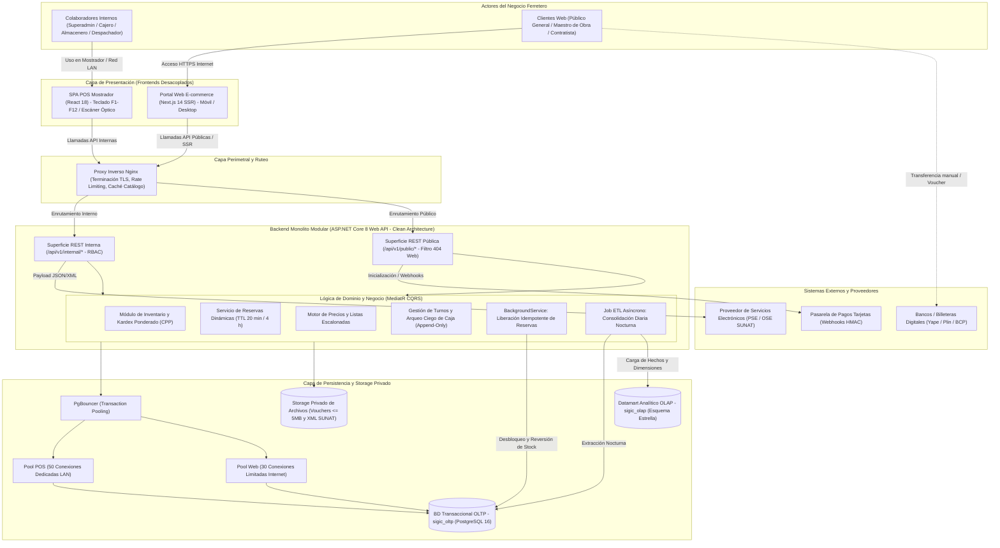
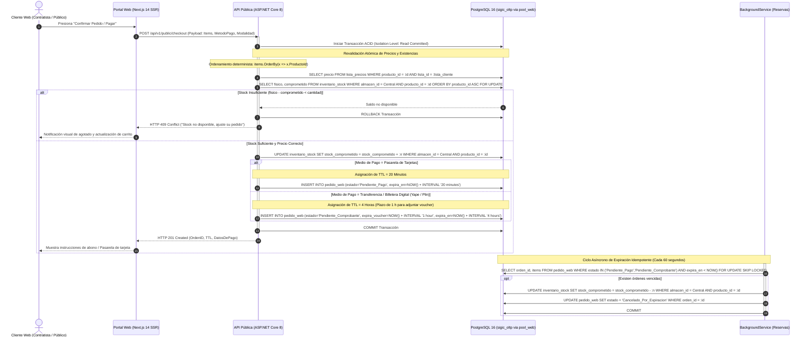

# Especificación Arquitectónica Inicial y Topología del Sistema (SIGIC Ferretería)

> **Documento:** `02-arquitectura-software/arquitectura-inicial.md`  
> **Versión de Especificación:** 2.2 (Oficial – SIGIC Ferretería)  
> **Disciplina:** Arquitectura de Software y Diseño de Infraestructura  
> **Modelado:** Clean Architecture, Diagramas C4 Conceptual / UML Sequence y Topología Física  
> **Evaluación Académica:** IS-488 Arquitectura de Software (UNSCH)

---

## 1. Visión General de la Arquitectura

La arquitectura de **SIGIC Ferretería v2.2** está concebida bajo el paradigma de **Clean Architecture** (Arquitectura Limpia) sobre un **Monolito Modular en ASP.NET Core 8 Web API**, con un desacoplamiento estricto entre el núcleo de dominio transaccional, los mecanismos de persistencia y las capas de presentación de los dos canales de captura comercial: el **Punto de Venta Mostrador (SPA React 18 en LAN)** y el **Portal Web E-commerce B2B/B2C (Next.js 14 SSR en Internet)**.

La plataforma garantiza de manera determinante:
1. **Rendimiento de Misión Crítica (AC01):** Tiempos de respuesta $P95 < 250\text{ ms}$ en la API transaccional Core, consultas de catálogo con Dapper sub-15 ms, y cobro en mostrador físico $P95 \le 1.0\text{ s}$ sin degradación por ráfagas web.
2. **Consistencia Transaccional ACID y Cero Sobreventas (AC02):** Toda mutación de existencias opera sobre PostgreSQL 16 con bloqueo pesimista a nivel de fila (`SELECT ... FOR UPDATE`) ordenado ascendentemente por ID (`ORDER BY producto_id ASC`) y la fórmula inviolable:
   $$\text{Stock Disponible} = \text{Stock Físico} - \text{Stock Comprometido}$$
3. **Trazabilidad y No Repudio Inmutable (AC03):** Registro inmutable en `Audit_Log` de toda operación sensible mediante Transactional Outbox, y política de **Arqueo Ciego de Caja** con persistencia estrictamente *append-only* en `caja_arqueo`.
4. **Prioridad Absoluta al Mostrador Físico:** Segregación de conexiones en PgBouncer mediante dos pools aislados: `pool_pos` (50 conexiones dedicadas de alta prioridad) y `pool_web` (30 conexiones limitadas con backpressure).
5. **Aislamiento Operacional vs. Analítico:** Segregación física entre la base de datos operacional (`sigic_oltp`) y el Datamart en esquema estrella (`sigic_olap`).
6. **Almacenamiento Seguro Privado:** Storage privado para comprobantes bancarios (vouchers $\le 5\text{ MB}$) y comprobantes electrónicos XML/CDR de SUNAT, inaccesibles directamente desde la web pública.

---

## 2. Diagrama Conceptual de Arquitectura

El siguiente diagrama modela la interacción integral de los componentes del sistema, desde los actores hasta los servicios externos y la capa de almacenamiento:

---

## 3. Diagrama de Secuencia: Checkout Web y Revalidación Atómica

El flujo crítico de compra digital modela cómo el sistema resuelve la revalidación atómica de existencias y precios frente a una capa de lectura en caché, garantizando cero sobreventas y el manejo del tiempo de vida (*TTL*) de la reserva:

---

## 4. Especificación de Topología de Infraestructura Real (Mononodo Docker Compose)

Aterrizando la infraestructura a la realidad operativa y económica de una ferretería mediana en Ayacucho (120 a 180 ventas/día, 2 cajas de mostrador LAN y catálogo web sincronizado), se sustituye cualquier sobredimensión de servidores distribuidos por una **Arquitectura Mononodo en Contenedores Docker Compose**, ejecutada sobre un único host de alto rendimiento:

### 4.1. Especificación del Host y Distribución de Recursos de Contenedores

* **Especificación del Host Físico / VPS:** **4 vCPU**, **8 GB RAM**, **100 GB SSD NVMe**, Sistema Operativo Ubuntu Server 22.04 LTS con Docker Engine 26+ y Docker Compose v2.

| Contenedor | Servicio y Rol | Imagen Base / Runtime | Límite CPU | Límite RAM | Justificación Técnica de Dimensionamiento |
| :--- | :--- | :--- | :---: | :---: | :--- |
| **`sigic-proxy`** | Proxy inverso perimetral, terminación SSL/TLS, compresión Brotli y Rate Limiting. | `nginx:1.25-alpine` | 0.5 vCPU | 256 MB | Ruteo de tráfico HTTPS hacia frontend y backend con consumo mínimo de recursos. |
| **`sigic-api`** | Backend Monolítico Modular (Clean Architecture, MediatR, CQRS, Dapper y EF Core 8). | `mcr.microsoft.com/dotnet/aspnet:8.0-alpine` | 1.5 vCPU | 2048 MB | Procesa la lógica transaccional de ventas POS, checkout web y trabajadores en segundo plano con $P95 < 250\text{ ms}$. |
| **`sigic-web`** | Portal E-commerce B2B/B2C con Renderizado del Lado del Servidor (SSR). | `node:20-alpine` (Next.js 14) | 1.0 vCPU | 1024 MB | Renderizado interactivo para móviles y desktop con caché de catálogo. |
| **`sigic-pgbouncer`** | Connection Pooler transaccional con pools segregados (`pool_pos` y `pool_web`). | `edoburu/pgbouncer:1.22` | 0.5 vCPU | 256 MB | Mantiene 50 conexiones reservadas para cajas físicas y 30 compartidas para la web, evitando contención. |
| **`sigic-postgres`** | Motor de base de datos relacional ACID (`sigic_oltp` y tablas analíticas). | `postgres:16-alpine` | 1.5 vCPU | 3072 MB | Memoria asignada para `shared_buffers = 1GB` y `work_mem = 32MB`, suficiente para 12,000 SKUs y 180 ventas/día. |
| **`sigic-storage`** | Custodia privada de comprobantes de pago (<= 5 MB) y XMLs tributarios. | Volumen local cifrado (LUKS / Docker Volume) | 0.2 vCPU | 512 MB | Almacenamiento desacoplado sin acceso web directo para máxima seguridad tributaria. |

---

### 4.2. Presupuesto Comparativo de Despliegue

La solución está diseñada para ser extraordinariamente costo-eficiente y sostenible para el comercio ferretero regional:

| Rubro / Concepto | Entorno Dev / Demo / Evaluación UNSCH | Entorno Producción Regional (Ferretería Ayacucho) | Proveedor Seleccionado y Detalle |
| :--- | :---: | :---: | :--- |
| **Cómputo en la Nube (VPS / Host)** | **S/. 0.00 / mes** | **~$16.00 USD / mes** (~S/. 60.00 PEN / mes) | **Dev:** Oracle Cloud Always Free (Instancia Ampere A1 ARM: 4 OCPU, 24 GB RAM, 200 GB Storage). **Prod:** VPS Cloud (Hetzner CPX21 o DigitalOcean Droplet: 4 vCPU, 8 GB RAM, 100 GB SSD). |
| **Nombre de Dominio Oficial** | **S/. 0.00 / mes** (Subdominio dinámico o IP) | **~S/. 9.17 PEN / mes** (S/. 110.00 PEN / año) | Dominio comercial oficial `.pe` registrado ante NIC.pe / Punto.pe para identidad corporativa local. |
| **Seguridad Perimetral, CDN y SSL** | **S/. 0.00 / mes** | **S/. 0.00 / mes** | Cloudflare Free Tier (Gestión DNS Anycast, Certificado SSL/TLS Universal, Edge Caching y Mitigación DDoS). |
| **Costos de Licenciamiento** | **S/. 0.00** | **S/. 0.00** | Stack 100% Open Source (.NET 8 SDK, PostgreSQL 16, PgBouncer, Linux Ubuntu, Next.js, React). |
| **PRESUPUESTO TOTAL MENSUAL** | **S/. 0.00 / mes** | **< S/. 70.00 PEN / mes** (~$18.50 USD / mes) | **Viabilidad Financiera Plena:** Representa menos del 0.2% del margen bruto mensual de una ferretería mediana en Ayacucho. |

---

## 5. Especificaciones de Terminales Cliente

Para garantizar el cumplimiento de los tiempos de respuesta definidos en los requerimientos funcionales y atributos de calidad (`AC01`, `RNF-USA-002`), se estandariza el equipamiento cliente en las sedes físicas:

### 5.1. Terminal de Mostrador (POS / Almacén / Despacho)
- **Sistema Operativo:** Windows 10/11 Pro (64 bits) o distribución Linux Desktop LTS.
- **Navegador Web:** Google Chrome, Microsoft Edge o Mozilla Firefox en versiones vigentes (cero instalación local de plugins).
- **Hardware Mínimo:** Procesador doble núcleo a 2.0 GHz, 4 GB de memoria RAM, monitor con resolución mínima nativa de $1024 \times 768$ píxeles sin desplazamiento horizontal (`RNF-USA-002`).
- **Periféricos de Mostrador:** Pistola lectora óptica de códigos de barras (1D/2D) con interfaz USB en modo emulación de teclado e impresora térmica de tickets de 80 mm (protocolo ESC/POS). Operación 100% por atajos de teclado (`F1`-`F12`).

### 5.2. Terminal de Cliente Externo (Portal Web)
- **Dispositivos Soportados:** Teléfonos inteligentes (iOS / Android) y computadoras personales / laptops.
- **Conectividad Mínima de Prueba:** Enlace móvil 4G comercial estándar en Huamanga, logrando renderizado interactivo completo de listados en menos de 1.5 segundos ($LCP \le 1.5\text{ s}$).
