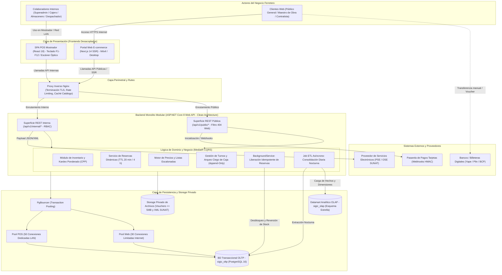
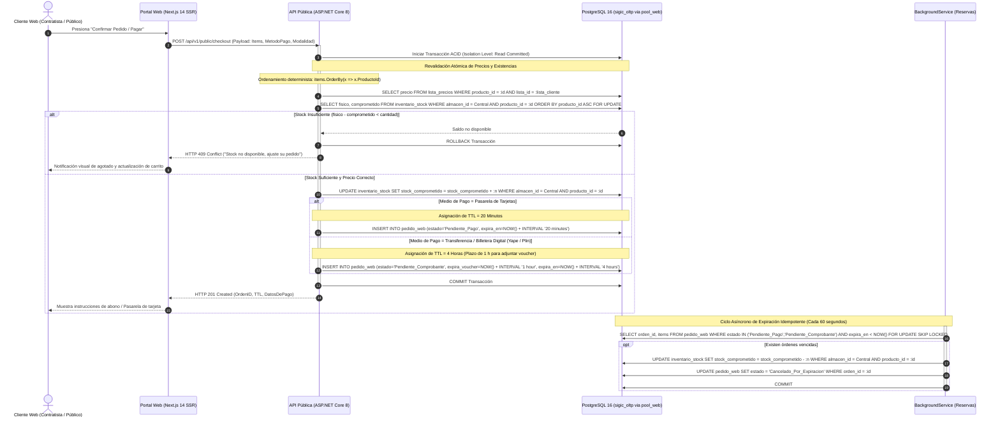

# Especificación Arquitectónica Inicial y Topología del Sistema (SIGIC Ferretería)

> **Documento:** `02-arquitectura-software/arquitectura-inicial.md`  
> **Versión de Especificación:** 2.2 (Oficial – SIGIC Ferretería)  
> **Disciplina:** Arquitectura de Software y Diseño de Infraestructura  
> **Modelado:** Clean Architecture, Diagramas C4 Conceptual / UML Sequence y Topología Física  
> **Evaluación Académica:** IS-488 Arquitectura de Software (UNSCH)

---

## 1. Visión General de la Arquitectura

La arquitectura de **SIGIC Ferretería v2.2** está concebida bajo el paradigma de **Clean Architecture** (Arquitectura Limpia) sobre un **Monolito Modular en ASP.NET Core 8 Web API**, con un desacoplamiento estricto entre el núcleo de dominio transaccional, los mecanismos de persistencia y las capas de presentación de los dos canales de captura comercial: el **Punto de Venta Mostrador (SPA React 18 en LAN)** y el **Portal Web E-commerce B2B/B2C (Next.js 14 SSR en Internet)**.

La plataforma garantiza de manera determinante:
1. **Rendimiento de Misión Crítica (AC01):** Tiempos de respuesta $P95 < 250\text{ ms}$ en la API transaccional Core, consultas de catálogo con Dapper sub-$15\text{ ms}$, y cobro en mostrador físico $P95 \le 1.0\text{ s}$ sin degradación por ráfagas web.
2. **Consistencia Transaccional ACID y Cero Sobreventas (AC02):** Toda mutación de existencias opera sobre PostgreSQL 16 con bloqueo pesimista a nivel de fila (`SELECT ... FOR UPDATE`) ordenado ascendentemente por ID (`ORDER BY producto_id ASC`) y la fórmula inviolable:
   $$\text{Stock Disponible} = \text{stock\_fisico} - \text{stock\_comprometido}$$
3. **Trazabilidad y No Repudio Inmutable (AC03):** Registro inmutable en `Audit_Log` de toda operación sensible mediante Transactional Outbox, y política de **Arqueo Ciego de Caja** con persistencia estrictamente *append-only* en `caja_arqueo`.
4. **Prioridad Absoluta al Mostrador Físico:** Segregación de conexiones en PgBouncer mediante dos pools aislados: `pool_pos` (50 conexiones dedicadas de alta prioridad) y `pool_web` (30 conexiones limitadas con backpressure).
5. **Aislamiento Operacional vs. Analítico:** Segregación física entre la base de datos operacional (`sigic_oltp`) y el Datamart en esquema estrella (`sigic_olap`).
6. **Almacenamiento Seguro Privado:** Storage privado para comprobantes bancarios (vouchers $\le 5\text{ MB}$) y comprobantes electrónicos XML/CDR de SUNAT, inaccesibles directamente desde la web pública.

---

## 2. Diagrama Conceptual de Arquitectura

El siguiente diagrama modela la interacción integral de los componentes del sistema, desde los actores hasta los servicios externos y la capa de almacenamiento:

---

## 3. Diagrama de Secuencia: Checkout Web y Revalidación Atómica

El flujo crítico de compra digital modela cómo el sistema resuelve la revalidación atómica de existencias y precios frente a una capa de lectura en caché, garantizando cero sobreventas y el manejo del tiempo de vida (*TTL*) de la reserva:

---

## 4. Especificación de Topología de Infraestructura

Para garantizar el aislamiento de recursos, la alta disponibilidad y la resiliencia operativa demandada por el comercio ferretero, se establece una **Topología en Estrella Segregada** compuesta por 5 servidores físicos / virtualizados y un volumen de almacenamiento privado:

| N.° | Servidor | Función y Rol en la Arquitectura | Sistema Operativo y Software Base | Especificación de Hardware Mínimo | Justificación Técnica de Dimensionamiento |
| :---: | :--- | :--- | :--- | :--- | :--- |
| **1** | **Servidor Web / API** | Nodo perimetral expuesto a Internet. Aloja el proxy inverso, el portal web Next.js 14 y la API ASP.NET Core 8 con sus superficies pública e interna. | Ubuntu Server 22.04 LTS; Nginx 1.24+ (TLS 1.3, Rate Limiting, Gzip); Node.js 20 LTS (Runtime Next.js 14); .NET 8 Runtime (Kestrel). | **8 vCPU** (2.5 GHz o superior), **16 GB RAM**, **200 GB SSD** (NVMe recomendado). | Absorbe hasta 200 sesiones web concurrentes, renderizado SSR móvil en Next.js y 20 terminales de mostrador en hora pico sin cuellos de botella ($P95 < 250\text{ ms}$). |
| **2** | **Servidor de Base de Datos** | Aloja el motor relacional OLTP (`sigic_oltp`) y el intermediario PgBouncer en volúmenes lógicos segregados. | Ubuntu Server 22.04 LTS; PostgreSQL 16; PgBouncer 1.22+ configurado en modo transacción con pools `pool_pos` y `pool_web`. | **12 núcleos** (3.0 GHz o superior), **48 GB RAM**, **Almacenamiento NVMe en RAID 1** para OLTP + WAL continuo. | Memoria dimensionada para retener el conjunto de trabajo de inventario en `shared_buffers` (~25 % de RAM) y absorber ráfagas de escritura y bloqueos pesimistas sin degradar el POS. |
| **3** | **Servidor de Reportes** | Generación intensiva por lotes de reportes transaccionales pesados, exportaciones a Excel y documentos PDF oficiales. | Ubuntu Server 22.04 LTS; .NET 8 Runtime; motor de renderizado y exportación de reportes (ClosedXML / QuestPDF). | **4 vCPU** (2.5 GHz), **8 GB RAM**, **100 GB SSD**. | El renderizado de documentos extensos y reportes tabulares es intensivo en memoria volátil y ciclos de cómputo; su aislamiento evita degradar el servidor de API. |
| **4** | **Servidor OLAP (Datamart)** | Ejecución de procesos ETL asíncronos programados (01:00 UTC-5), agregaciones históricas y explotación de tableros de BI. | Ubuntu Server 22.04 LTS; .NET 8 Runtime (Servicio ETL y Worker de BI); PostgreSQL 16 con vistas materializadas indexadas. | **4 vCPU** (2.5 GHz), **16 GB RAM**, **300 GB SSD**. | Las agregaciones analíticas sobre tablas de hechos con 24 meses de transacciones requieren memoria amplia para algoritmos de ordenamiento (*Hash Join* y *Sort*). |
| **5** | **Servidor de Directorio y Accesos** | Gestión centralizada de identidades en dos ámbitos (Colaboradores Internos con RBAC y Clientes Web Externos); derivación Argon2id y emisión de JWT RS256. | Ubuntu Server 22.04 LTS; ASP.NET Core 8 Identity / Custom Auth Server; librería criptográfica Argon2id. | **4 vCPU** (2.5 GHz), **8 GB RAM**, **80 GB SSD**. | Argon2id es computacionalmente intensivo por diseño para mitigar ataques de fuerza bruta; un servidor dedicado impide que ráfagas de login saturen la API de ventas. |
| **6** | **Storage Privado de Archivos** | Almacenamiento seguro no público de comprobantes de pago de clientes web ($\le 5\text{ MB}$) y comprobantes electrónicos XML/CDR de SUNAT. | Sistema de archivos cifrado local (LUKS / MinIO S3 privado) con cuotas por usuario y expiración automática. | **Volumen dedicado de 500 GB en RAID 1**. | Salvaguarda la privacidad tributaria y bancaria; ningún archivo es accesible por URL pública directa, requiriendo validación en API Core. |

---

## 5. Especificaciones de Terminales Cliente

Para garantizar el cumplimiento de los tiempos de respuesta definidos en los requerimientos funcionales y atributos de calidad (`AC01`, `RNF-USA-002`), se estandariza el equipamiento cliente en las sedes físicas:

### 5.1. Terminal de Mostrador (POS / Almacén / Despacho)
- **Sistema Operativo:** Windows 10/11 Pro (64 bits) o distribución Linux Desktop LTS.
- **Navegador Web:** Google Chrome, Microsoft Edge o Mozilla Firefox en versiones vigentes (cero instalación local de plugins).
- **Hardware Mínimo:** Procesador doble núcleo a 2.0 GHz, 4 GB de memoria RAM, monitor con resolución mínima nativa de $1024 \times 768$ píxeles sin desplazamiento horizontal (`RNF-USA-002`).
- **Periféricos de Mostrador:** Pistola lectora óptica de códigos de barras (1D/2D) con interfaz USB en modo emulación de teclado e impresora térmica de tickets de 80 mm (protocolo ESC/POS). Operación 100% por atajos de teclado (`F1`-`F12`).

### 5.2. Terminal de Cliente Externo (Portal Web)
- **Dispositivos Soportados:** Teléfonos inteligentes (iOS / Android) y computadoras personales / laptops.
- **Conectividad Mínima de Prueba:** Enlace móvil 4G comercial estándar en Huamanga, logrando renderizado interactivo completo de listados en menos de 1.5 segundos ($LCP \le 1.5\text{ s}$).
