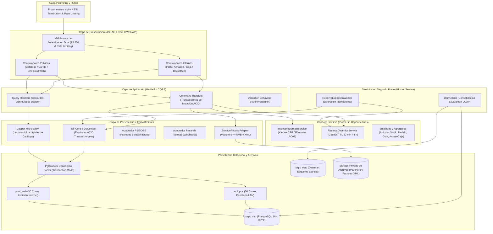
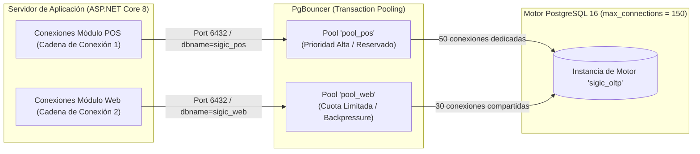

# Componentes Arquitectónicos del Sistema (SIGIC Ferretería)

> **Documento:** `02-arquitectura-software/componentes-arquitectonicos.md`  
> **Versión de Especificación:** 2.2 (Oficial – SIGIC Ferretería)  
> **Disciplina:** Arquitectura de Software y Descomposición Estructural  
> **Estándar:** Clean Architecture (Robert C. Martin) y Patrón Puertos y Adaptadores (Alistair Cockburn)  
> **Evaluación Académica:** IS-488 Arquitectura de Software (UNSCH)

---

## 1. Visión Estructural de Componentes

La arquitectura de **SIGIC Ferretería v2.2** se descompone en subsistemas desacoplados diseñados para resolver la concurrencia omnicanal entre el mostrador físico (POS) y el portal de compras web (E-commerce B2B/B2C). El sistema se ejecuta como un **Monolito Modular** en ASP.NET Core 8 Web API, respaldado por una infraestructura de persistencia de alto rendimiento en **PostgreSQL 16** con el intermediario de conexiones **PgBouncer**, un Datamart analítico segregado y un **Storage Privado de Archivos**.



---

## 2. Catálogo Detallado de Componentes Arquitectónicos

### 2.1. Middleware de Borde y Proxy Inverso (Nginx)
- **Función:** Actúa como escudo perimetral, terminador de TLS 1.3, despachador de contenido estático y balanceador local.
- **Responsabilidades:**
  - Terminación segura de conexiones HTTPS y redirección forzada de HTTP (`Port 80` $\rightarrow$ `Port 443`).
  - Filtrado y limitación de peticiones (*Rate Limiting*) en rutas públicas de login (`limit_req_zone` a 5 req/min por IP).
  - Caché perimetral de cabeceras HTTP de listados de catálogo (`Cache-Control: public, max-age=30, stale-while-revalidate=60`).
  - Enrutamiento inteligente: peticiones al portal web hacia Next.js 14 (`localhost:3000`) y peticiones con prefijo `/api/` hacia el runtime Kestrel de ASP.NET Core (`localhost:5000`).

---

### 2.2. Capa de Controladores y Superficie de Exposición de API
La capa de presentación en ASP.NET Core 8 Web API se divide en dos superficies lógicas estrictamente aisladas para evitar escalada de privilegios y contención de recursos:

#### A. Superficie REST Interna (`/api/v1/internal/*`)
- **Controladores:**
  - `VentasPOSController`: Gestión de transacciones de caja, búsqueda rápida de productos por escáner y cierre de cobro con pagos mixtos (`RF-POS-003`, `RF-POS-006`).
  - `InventarioInternoController`: Administración de almacenes, recepción de órdenes de compra y emisión/recepción de guías internas de traslado (`RF-INV-001` al `RF-INV-006`).
  - `DespachoMostradorController`: Pantalla ligera de retiro en tienda (`RF-POS-011`) para validar código de pedido y registrar entrega mediante DNI sin acceso a comprobantes ni vouchers.
  - `CajaTurnosController`: Apertura, declaración de arqueo ciego y conciliación de turnos (`RF-CAJ-001` al `RF-CAJ-003`).
  - `BackofficeTesoreriaController`: Consola desacoplada para validación y auditoría de comprobantes bancarios (Yape/Plin/Transferencias de hasta 5 MB) de pedidos web (`RF-WEB-003`).
- **Seguridad:** Requiere JWT con claim `Audience: SIGIC_InternalStaff` y roles RBAC específicos (`Cajero`, `Almacenero`, `Despachador`, `Administrador`).

#### B. Superficie REST Pública (`/api/v1/public/*`)
- **Controladores:**
  - `CatalogoPublicoController`: Listado jerárquico de materiales, navegación por categorías y consulta de fichas técnicas con precios diferenciados según cliente autenticado (`RF-WEB-001`). **Aplica filtro estricto:** si `disponible_en_web == false`, retorna `HTTP 404 Not Found`.
  - `CheckoutWebController`: Creación del pedido, bloqueo transaccional de stock en Almacén Central y revalidación atómica de precio y existencias (`RF-WEB-002`, `RF-WEB-005`).
  - `WebhooksPasarelaController`: Receptor de notificaciones asíncronas firmadas emitidas por la pasarela de pagos con tarjeta de crédito/débito.
  - `TrackingPedidosController`: Consulta en tiempo real del estado del pedido (`RF-WEB-004`).
- **Seguridad:** Abierto para consulta de catálogo; requiere JWT con claim `Audience: SIGIC_WebClient` para checkout y subida de comprobantes.

---

### 2.3. Capa de Aplicación (MediatR, CQRS y Casos de Uso)
Implementa el patrón **CQRS** (*Command Query Responsibility Segregation*) mediante la biblioteca MediatR:
- **Commands (Mutación Transaccional ACID):**
  - `RegistrarVentaPOSCommand`, `IniciarCheckoutWebCommand`, `ConfirmarPagoManualCommand`, `ExpirarReservaCommand`, `CrearGuiaTrasladoCommand`.
  - Cada comando se procesa a través de un pipeline behavior con validación declarativa mediante **FluentValidation** y apertura de transacción ACID con EF Core.
- **Queries (Lectura de Alto Rendimiento - AC01):**
  - `GetCatalogoFiltradoQuery`, `GetStockDisponibleArticuloQuery`, `GetReporteKardexQuery`, `GetVentaTurnoActualQuery`.
  - Las consultas eluden el seguimiento de entidades de EF Core (`AsNoTracking`) o utilizan Dapper directamente contra vistas indexadas ($< 15\text{ ms}$).

---

### 2.4. Capa de Dominio (Servicios de Dominio Puros)
Encapsula la lógica de negocio ferretero libre de dependencias a frameworks externos:
- **`InventarioDomainService`:**
  - Ejecuta la regla cardinal de disponibilidad de inventario (`AC02`):
    $$\text{Stock Disponible} = \text{stock\_fisico} - \text{stock\_comprometido}$$
  - Aplica la fórmula de valorización de existencias por **Costo Promedio Ponderado (CPP)** tras recepciones de mercadería:
    $$\text{CPP}_{\text{nuevo}} = \frac{(\text{Stock Actual} \times \text{CPP Actual}) + (\text{Cantidad Comprada} \times \text{Costo Unitario})}{ \text{Stock Actual} + \text{Cantidad Comprada} }$$
  - Gobierna el ordenamiento de bloqueos de fila (`ORDER BY producto_id ASC`) para eliminar bloqueos mutuos (*Deadlocks*).
- **`ReservaDinamicaService`:**
  - Determina y asigna la caducidad (TTL) de las reservas web según el medio de pago (`RF-WEB-002`):
    - **Pasarela de Tarjetas:** $TTL = 20\text{ minutos}$ exactos.
    - **Pagos Manuales (Yape/Plin/Transferencia):** $TTL_{\text{máximo}} = 240\text{ minutos}$ (4 horas), con ventana de carga de constancia de $60\text{ minutos}$ (1 hora).
  - Gestiona la transición a `Stock Comprometido` y la liberación atómica en caso de expiración o rechazo.

---

### 2.5. Componente de Persistencia Dual: EF Core 8 y Dapper
Para maximizar el rendimiento y preservar la integridad transaccional:
- **Entity Framework Core 8 (`SIGICDbContext`):**
  - Empleado exclusivamente para comandos de escritura, inserción y mutación de estado que requieren transacciones ACID estrictas.
  - Mapeo fluido mediante `EntityTypeConfiguration` respetando tipos primitivos de PostgreSQL (`numeric(12,2)`, `timestamptz`, `jsonb`, `uuid`).
  - Bloqueos pesimistas nativos mediante sentencias SQL parametrizadas dentro de la misma transacción de EF Core.
- **Dapper Micro-ORM:**
  - Empleado para la consulta masiva del catálogo e-commerce y generación de reportes analíticos.
  - Ejecuta consultas SQL crudas optimizadas con unión indexada (`JOIN`) hacia vistas desnormalizadas, retornando DTOs inmutables con latencias inferiores a $15\text{ ms}$ (`AC01`).

---

### 2.6. Storage Privado de Archivos
- **Responsabilidad:** Almacenamiento seguro no público de los comprobantes bancarios subidos por clientes web ($\le 5\text{ MB}$, formato JPG/PNG/PDF) y de los comprobantes electrónicos firmados (XML y constancias de recepción CDR del PSE/OSE SUNAT).
- **Aislamiento:** Los archivos no están alojados en carpetas públicas de Nginx ni servidos directamente por URLs web. Para visualizar un comprobante, la consola de Tesorería debe solicitar un token temporal de lectura a la API Core previa verificación RBAC.

---

### 2.7. Servicios en Segundo Plano (`BackgroundService` / `IHostedService`)
- **`ReservaExpirationWorker`:**
  - Tarea periódica programada que despierta cada 60 segundos.
  - Ejecuta una consulta atómica sobre la tabla `reserva_pedido`:
    ```sql
    SELECT id, pedido_id, producto_id, cantidad_reservada 
    FROM reserva_pedido 
    WHERE estado = 'Activa' AND fecha_expiracion <= NOW()
    FOR UPDATE SKIP LOCKED;
    ```
  - Libera el inventario decrementando `stock_comprometido` y cambia el estado del pedido a `Cancelado por Expiración` de manera estrictamente idempotente (`RNF-CON-004`).
- **`DailyEtlJob`:**
  - Proceso programado en segundo plano ejecutado fuera de horario comercial (01:00 UTC-5).
  - Extrae los hechos transaccionales de `sigic_oltp`, calcula agregados diarios y puebla las tablas de hechos (`Fact_Ventas`, `Fact_Kardex`) en el Datamart `sigic_olap`.

---

## 3. Infraestructura de Conexiones: PgBouncer y Segregación de Pools

Para cumplir con `AC01` y `AC02`, se interpone **PgBouncer** entre el backend y PostgreSQL 16 en modo de asignación por transacción (**Transaction Pooling**).



### Especificación de Parámetros en `pgbouncer.ini`:

| Parámetro de Configuración | Valor en `pool_pos` (Mostrador LAN) | Valor en `pool_web` (Portal E-commerce) | Justificación Técnica |
| :--- | :--- | :--- | :--- |
| **`pool_mode`** | `transaction` | `transaction` | Libera la conexión física al motor relacional en el instante en que finaliza la transacción actual. |
| **`default_pool_size`** | `50` | `30` | Asigna cuota garantizada al POS; el portal web no puede agotar las conexiones del mostrador físico. |
| **`reserve_pool_size`** | `10` | `5` | Conexiones de emergencia reservadas para picos inesperados. |
| **`max_client_conn`** | `200` | `500` | Admite múltiples clientes TCP concurrentes encolados en el pool web. |
| **`query_timeout`** | `10 s` | `5 s` | Consultas web lentas se abortan para evitar saturación del motor. |
| **`server_idle_timeout`** | `60 s` | `30 s` | Cierre ágil de conexiones ociosas para liberar memoria de base de datos. |
