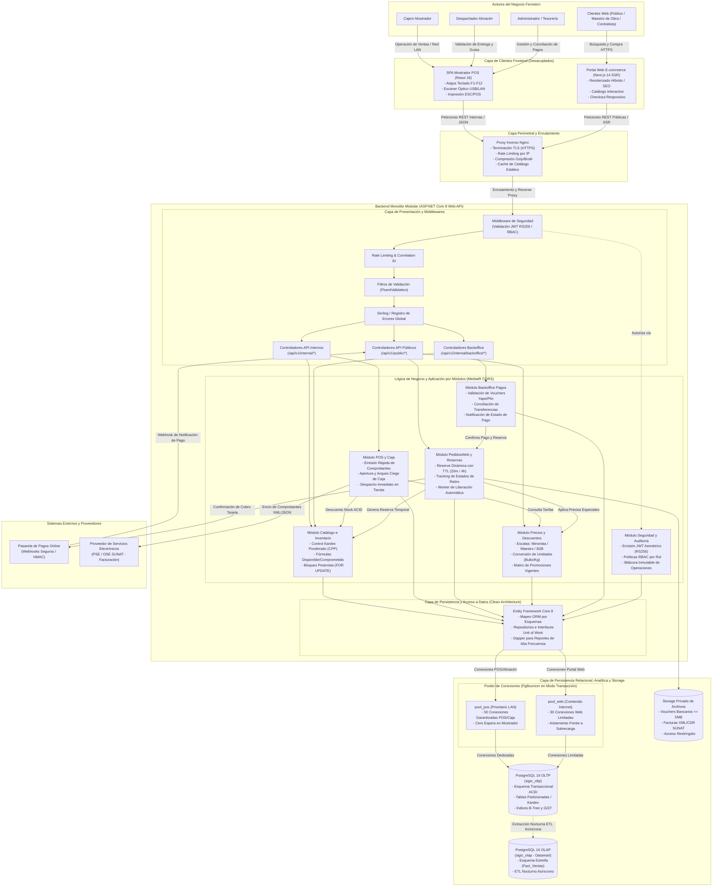

# Estilo Arquitectónico Global: Monolito Modular en Capas (Cliente-Servidor)

> **Documento:** `02-arquitectura-software/estilo-arquitectonico.md`  
> **Versión de Especificación:** 2.2 (Oficial – SIGIC Ferretería)  
> **Disciplina:** Arquitectura de Software y Diseño de Sistemas Distribuidos  
> **Metodología y Estándar:** Alineado a la Guía 03 (Estilo Arquitectónico, Justificación Técnica, Reglas Estructurales y Topología Mermaid)  
> **Evaluación Académica:** IS-488 Arquitectura de Software (UNSCH)

---

## 1. Justificación del Estilo Seleccionado

Para dar respuesta rigurosa a los desafíos de concurrencia omnicanal, consistencia de inventario y mantenibilidad en **SIGIC Ferretería v2.2**, se adopta formalmente el estilo arquitectónico de **Monolito Modular con Clean Architecture bajo el Paradigma Cliente-Servidor Desacoplado**.

### 1.1. Monolito Modular con Clean Architecture frente a Microservicios
Frente a una aproximación basada en microservicios independientes, la adopción del Monolito Modular resuelve de raíz las siguientes fricciones técnicas y operativas:

| Criterio de Decisión | Arquitectura de Microservicios | Monolito Modular en SIGIC v2.2 | Justificación Técnica de la Elección |
| :--- | :--- | :--- | :--- |
| **Consistencia Transaccional (AC02)** | Consistencia Eventual (*Eventual Consistency*) mediante patrones Saga o Two-Phase Commit (2PC). | **Transacciones ACID Inmediatas** sobre una única instancia relacional PostgreSQL 16. | En una ferretería de materiales pesados (cemento, fierro de construcción), la consistencia eventual genera ventanas críticas de sobreventa cuando un cliente web reserva y un cajero factura en ventanilla simultáneamente. |
| **Latencia Inter-Módulo (AC01)** | 20 a 50 ms por llamada de red (HTTP/gRPC) entre servicios distribuidos. | **$< 1\text{ ms}$** mediante llamadas tipadas directas en memoria del proceso Kestrel. | Garantiza tiempo de respuesta en mostrador físico $P95 \le 1.0\text{ s}$ y $P95 < 250\text{ ms}$ en la API Core sin degradación de red LAN. |
| **Sobrecarga Operacional (DevOps)** | Múltiples repositorios, clúster Kubernetes, service mesh, tracing distribuido y monitoreo fragmentado. | **Un solo pipeline CI/CD**, un solo artefacto ejecutable desplegado en systemd/Docker. | Se ajusta con precisión al tamaño del equipo de ingeniería y presupuesto de una mediana empresa comercial en Ayacucho. |
| **Integridad de Datos y Auditoría (AC03)** | Dificultad para coordinar bitácoras distribuidas entre múltiples bases de datos. | **Transactional Outbox y Bitácora Unificada** (`Audit_Log`, `caja_arqueo` *append-only*). | Cero desfase entre el registro contable y la mutación física de stock en la misma transacción relacional. |

---

### 1.2. Justificación Técnica de la Pila Tecnológica Seleccionada

#### A. ASP.NET Core 8 Web API (Backend Monolítico Modular)
- **Runtime Kestrel de Ultra-Alto Rendimiento:** Capaz de procesar miles de peticiones HTTP concurrentes con consumo mínimo de CPU y memoria, optimizado con C# 12 y recolección de basura (*Server GC*) para baja latencia.
- **Implementación Estricta de Clean Architecture:** Estructuración concéntrica (`Domain`, `Application`, `Infrastructure`, `Presentation`) con el patrón Mediador (**MediatR**) que orquesta comandos y consultas (CQRS), aplicando comportamientos de validación declarativa con **FluentValidation**.
- **Acceso a Datos Híbrido:** Combinación sinérgica de **Entity Framework Core 8** para transacciones de escritura complejas con seguimiento de entidades, y **Dapper Micro-ORM** para consultas de catálogo y reportes de lectura ultrarrápidos ($< 15\text{ ms}$).

#### B. PostgreSQL 16 con PgBouncer (Motor Transaccional y Pooler Segregado)
- **Aislamiento ACID Robusto:** Soporte nativo para bloqueos pesimistas a nivel de fila (`SELECT ... FOR UPDATE`) con cláusulas `SKIP LOCKED` y tipos de datos avanzados (`numeric(12,2)`, `jsonb`, `timestamptz`).
- **Segregación de Conexiones mediante PgBouncer:** Configurado en modo transacción (*Transaction Pooling*) con dos pools aislados:
  - `pool_pos`: 50 conexiones dedicadas de alta prioridad para mostrador físico y LAN.
  - `pool_web`: 30 conexiones limitadas para el tráfico e-commerce, aplicando control de contención (*backpressure*) para que ningún pico de tráfico web sature la base de datos de las tiendas.

#### C. Portal Web en Next.js 14 (App Router y React Server Components)
- **Renderizado del Lado del Servidor (SSR):** Optimización para motores de búsqueda (SEO) de materiales de construcción y tiempos de carga interactiva $LCP \le 1.5\text{ s}$ en redes móviles 4G.
- **Desacoplamiento Total:** El portal web actúa como un cliente HTTP/REST externo; no posee lógica de cálculo comercial ni acceso directo a la base de datos, consumiendo exclusivamente la superficie de API pública (`/api/v1/public/*`).

#### D. Terminal Mostrador POS en SPA React 18
- **Ergonomía de Misión Crítica:** Aplicación SPA servida en red LAN, diseñada para monitores de $1024 \times 768$ píxeles sin scroll horizontal (`RNF-USA-002`), operada al 100% mediante atajos de teclado (`F1`-`F12`) y escáner láser sin tocar el ratón (`RF-POS-003`).

---

## 2. Reglas Cardinales de la Arquitectura

Para salvaguardar la integridad del sistema, prevenir el acoplamiento caótico y garantizar la evolución a largo plazo, se establecen tres reglas de observancia obligatoria:

### Regla 1: Comunicación Estricta entre Capas e Inversión de Dependencias
- La solución backend se rige bajo los principios de **Clean Architecture**:
  $$\text{Presentation} \longrightarrow \text{Infrastructure} \longrightarrow \text{Application} \longrightarrow \text{Domain}$$
- Las dependencias de código fuente solo apuntan hacia adentro. La capa de **Dominio** constituye el núcleo puro y no posee referencias a frameworks, bibliotecas externas ni bases de datos.
- Todo acceso a infraestructura periférica (acceso a base de datos relacional, pasarela de pago web, servicios del Proveedor de Servicios Electrónicos SUNAT - PSE/OSE, storage privado) debe realizarse a través de interfaces y abstracciones (puertos) inyectadas mediante el contenedor de Inversión de Control de ASP.NET Core (`IServiceCollection`).

### Regla 2: Límites Lógicos Modulares Estrictos y Encapsulamiento de Datos
- Cada módulo funcional (`Inventario`, `VentasPOS`, `PedidosWeb`, `Precios`, `Caja`, `Seguridad`) posee un *Bounded Context* rigurosamente demarcado.
- **Prohibición de acceso cruzado directo a tablas:** Queda terminantemente prohibido que el código de un módulo (por ejemplo, `PedidosWeb`) ejecute consultas SQL directas o instancie entidades del `DbContext` pertenecientes a otro módulo (por ejemplo, `Caja` o `Kardex`).
- La interacción inter-módulo se efectúa exclusivamente mediante:
  1. **Servicios de Aplicación o Contratos de Interfaz Pública:** Métodos tipados expuestos intencionalmente por el módulo receptor (ej. `IInventarioReservaService`).
  2. **Eventos de Dominio en Memoria:** Notificaciones asíncronas dentro del mismo proceso (vía mediadores en memoria) para efectos colaterales (ej. `VentaPOSCompletadaEvent` que desencadena la salida del Kardex y la actualización del saldo de caja).

### Regla 3: Persistencia Transaccional Unificada con Pools Segregados en PgBouncer
- El almacenamiento transaccional central reside en una única instancia de **PostgreSQL 16** (`sigic_oltp`), complementada con un Datamart analítico segregado (`sigic_olap`) para reportería y balance mensual.
- Para evitar que los picos de tráfico de usuarios concurrentes navegando el portal e-commerce saturen las conexiones de la base de datos y bloqueen la facturación del mostrador físico, se interpone **PgBouncer** en modo de asignación por transacción (*Transaction Pooling*), gestionando dos pools estrictamente segregados:
  - **`pool_pos` (Prioritario / LAN):** Conexiones reservadas y garantizadas de alta prioridad para las cajas y almacén físico, con tiempo de espera de conexión prácticamente nulo.
  - **`pool_web` (Contenido / Internet):** Pool con cuota estricta de conexiones concurrentes para las solicitudes públicas del portal e-commerce, protegiendo al núcleo del sistema de cualquier ataque de denegación de servicio o degradación por sobretráfico web.

---

## 3. Diagrama de Arquitectura Global

El siguiente diagrama modela la arquitectura integral de **SIGIC Ferretería v2.2**, reflejando la interacción completa entre actores, frontends segregados, proxy perimetral, la estructura modular en capas del backend ASP.NET Core 8, la capa de persistencia administrada con PgBouncer, el storage privado y las integraciones con sistemas externos:

---

## 4. Trazabilidad con Decisiones de Arquitectura y Atributos de Calidad

| Elemento Estructural | Justificación Técnica en SIGIC Ferretería v2.2 | Decisión / Requisito Asociado | Atributo de Calidad |
| :--- | :--- | :--- | :--- |
| **Monolito Modular ASP.NET Core 8** | Evita latencias inter-nodo y garantiza transacciones ACID unificadas sobre el inventario compartido. | `ADR-001`, `ADR-002`, `DA-01`, `DA-06` | **AC01**, **AC02** |
| **Doble Frontend (React 18 / Next.js 14)** | Interfaz ultrarrápida para escáner/teclado en LAN mostrador versus catálogo SEO con SSR en Web. | `ADR-007`, `DA-02`, `DA-05` | **AC01** |
| **Segregación PgBouncer (`pool_pos` / `pool_web`)** | Protege el mostrador físico frente a picos de tráfico en línea, blindando la disponibilidad transaccional. | `ADR-004`, `DA-02`, `DA-05` | **AC01**, **AC02** |
| **Reserva con TTL Dinámico** | Bloqueo temporal para evitar sobreventa en materiales pesados (cemento, fierro) sin congelar stock permanentemente. | `ADR-003`, `DA-01`, `DA-04` | **AC02** |
| **Dualidad de Identidad y JWT RS256** | Firma asimétrica con claims segregados que impide escalada de privilegios de usuarios web a funciones internas. | `ADR-005`, `DA-03` | **AC03** |
| **Aislamiento OLTP / OLAP** | El cálculo analítico pesado de Kardex valorizado no compite por recursos de CPU/RAM con las ventas en curso. | `ADR-008`, `DA-07` | **AC01** |
| **Arqueo Ciego de Caja Append-Only** | Prevención de fraude e inmutabilidad estricta sin exposición de saldos teóricos al cajero. | `ADR-002`, `DA-03`, `RF-CAJ-002` | **AC03** |
| **Storage Privado de Vouchers y XML** | Custodia cifrada de constancias bancarias ($\le 5\text{ MB}$) y documentos fiscales sin exposición pública directa. | `ADR-002`, `RF-WEB-003`, `RNF-SEG-004` | **AC03** |
