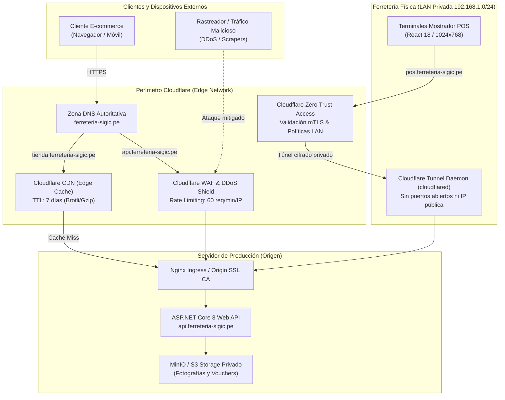

# Topología Perimetral, DNS Segregado y Red de Distribución de Contenido (CDN)

> **Documento:** `02-arquitectura-software/infraestructura-red-dns-cdn.md`  
> **Sistema:** SIGIC Ferretería v2.2  
> **Asignatura:** IS-488 Arquitectura de Software (UNSCH)  
> **Criterio Oficial de Evaluación:** **Criterio 10 — Configuración de Dominio, Subdominios DNS y CDN**  
> **Proveedor Perimetral:** Cloudflare Enterprise / Zero Trust  
> **Dominio Corporativo:** `ferreteria-sigic.pe`

---

## 1. Topología de Red Perimetral y Modelo Edge

La arquitectura de red de **SIGIC Ferretería v2.2** implementa un modelo de seguridad perimetral basado en **Cloudflare Edge**, desacoplando los accesos públicos de los canales internos mediante túneles seguros privados (**Cloudflare Tunnel / Zero Trust**):



---

## 2. Zona DNS y Segregación Estricta de Subdominios

Para evitar fugas de información, proteger los terminales de caja y blindar las APIs de negocio, el dominio `ferreteria-sigic.pe` se estructura en tres subdominios especializados con políticas de enrutamiento disímiles:

| Subdominio FQDN | Destino y Tipo de Enrutamiento | Exposición a Internet | Políticas de Seguridad y Red |
| :--- | :--- | :---: | :--- |
| **`pos.ferreteria-sigic.pe`** | Terminales POS mostrador en tienda física | **NO EXPUESTO**<br>(IP Oculta) | Enrutado exclusivamente a través de **Cloudflare Tunnel (`cloudflared`)** hacia la LAN privada (`192.168.1.0/24`). No posee registro DNS público tipo A; acceso restringido mediante políticas de Cloudflare Zero Trust y certificado cliente. |
| **`tienda.ferreteria-sigic.pe`** | Portal público E-commerce B2B/B2C (Next.js 14) | **PÚBLICO** | Registro DNS proxyficado (*Orange Cloud*). Tráfico inspeccionado por CDN Edge Cache y protección automática contra ataques de denegación de servicio (DDoS capa 3, 4 y 7). |
| **`api.ferreteria-sigic.pe`** | Backend Monolítico ASP.NET Core 8 Web API | **CONTROLADO** | Proxyficado con inspección profunda en **Cloudflare WAF**. Aplica *Rate Limiting* (60 peticiones/minuto por IP pública), bloqueo geográfico (restringido a Perú/región) y escaneo de firmas OWASP Top 10. |

---

## 3. Políticas de CDN y Edge Caching para Activos Estáticos

Para maximizar el rendimiento del portal web y cumplir con el tiempo de carga $\le 1.5\text{ s}$ en conexiones móviles (AC01), la CDN de Cloudflare almacena en caché perimetral los siguientes activos:

### 3.1. Matriz de Reglas de Edge Cache (Cloudflare Cache Rules)

| Patrón de Ruta URL | Tipo de Contenido | Origen de Datos | TTL de Edge Cache | Política Cache-Control HTTP |
| :--- | :--- | :--- | :---: | :--- |
| `/_next/static/*` | Bundles JavaScript, CSS y Webpack | Next.js Build Output | **7 días** (604,800 s) | `public, max-age=604800, immutable` |
| `/assets/fonts/*` | Tipografías WOFF2 e íconos vectoriales | Storage Local Nginx | **30 días** (2,592,000 s) | `public, max-age=2592000, immutable` |
| `/productos/imagenes/*` | Catálogo fotográfico (cemento, fierro, PVC) | Storage MinIO/S3 Privado | **7 días** (604,800 s) | `public, max-age=604800, stale-while-revalidate=86400` |
| `/api/v1/public/catalogo` | Listado desnormalizado de productos web | API Core (Dapper) | **5 minutos** (300 s) | `public, max-age=300, stale-while-revalidate=60` |
| `/api/v1/checkout/*` | Transacciones de compra y reservas | PostgreSQL 16 (Dapper) | **0 s (NO CACHE)** | `no-store, no-cache, must-revalidate, max-age=0` |

### 3.2. Optimización de Carga y Compresión
- **Compresión Automática:** La CDN aplica **Brotli (br)** con nivel de compresión 11 para texto, HTML, CSS y JSON, reduciendo el peso de transferencia en un 20% adicional frente a Gzip tradicional.
- **Formato de Imagen de Próxima Generación:** Conversión dinámica en Edge a formato **WebP / AVIF**, reduciendo el peso de las fotos de artículos ferreteros en más del 65%.
- **Invalidación Reactiva de Caché:** Disparada automáticamente vía API de Cloudflare (`POST /zones/:zone_id/purge_cache`) cuando el Superadmin publica una actualización masiva de precios o imágenes en `RF-INV-008`.

---

## 4. Configuración Criptográfica SSL/TLS y HSTS

La integridad y confidencialidad del tráfico omnicanal se garantiza mediante un esquema de cifrado de extremo a extremo:

1. **Modo SSL/TLS: Full (Strict):**
   - La conexión entre el navegador del cliente y Cloudflare Edge opera bajo **TLS 1.3**.
   - La conexión entre Cloudflare Edge y el servidor de origen (Nginx) está autenticada mediante un certificado emitido por **Cloudflare Origin CA** con clave RSA de 2048 bits y vigencia de 15 años. El servidor rechaza cualquier conexión que no provenga de los rangos IP oficiales de Cloudflare.
2. **HTTP Strict Transport Security (HSTS):**
   - Cabecera obligatoria inyectada por el servidor y respaldada por Cloudflare:
     ```http
     Strict-Transport-Security: max-age=31536000; includeSubDomains; preload
     ```
   - Forzado de HTTPS automático: Cualquier intento de conexión por HTTP puerto 80 es redirigido permanentemente (`HTTP 301`) hacia el puerto seguro 443.
3. **Restricción de Protocolos Legados:** Desactivación explícita de TLS 1.0 y TLS 1.1, mitigando vulnerabilidades criptográficas obsoletas (POODLE, BEAST).
