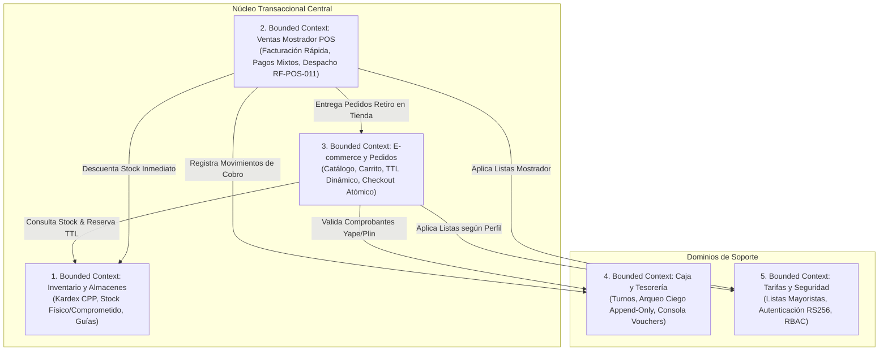
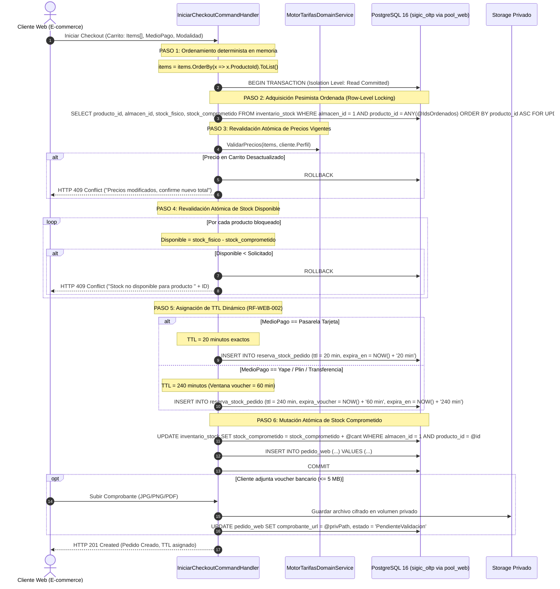

# Diseño Interno de Módulos (Bounded Contexts) — SIGIC Ferretería

> **Documento:** `03-diseno-de-software/diseno-interno-modulos/diseno-interno-de-modulos.md`  
> **Versión de Especificación:** 2.2 (Oficial – SIGIC Ferretería)  
> **Disciplina:** Diseño Detallado de Software y Domain-Driven Design (DDD)  
> **Patrón Arquitectónico:** Monolito Modular con Bounded Contexts Cohesivos  
> **Evaluación Académica:** IS-488 Arquitectura de Software (UNSCH)

---

## 1. Mapa de Contextos Delimitados (Context Map)

El sistema **SIGIC Ferretería v2.2** se estructura internamente en cinco **Contextos Delimitados (Bounded Contexts)** independientes, desplegados dentro del mismo proceso en ASP.NET Core 8 Web API pero con encapsulamiento estricto de modelo de dominio y esquemas de persistencia:



---

## 2. Especificación Detallada por Módulo

### 2.1. Módulo 1: Inventario y Almacenes (`SIGIC.Modules.Inventory`)
- **Propósito:** Control centralizado de existencias físicas y comprometidas, movimientos de almacén, valorización por Costo Promedio Ponderado y segregación multicanal (`AC02`).
- **Entidades y Agregados:**
  - `Articulo` / `Producto` (Root Entity): Código SKU, EAN-13, nombre técnico, unidad base de medida, familia, subfamilia, factor de conversión y bandera `disponible_en_web` (`bool`).
  - `InventarioStock`: Saldo por almacén discriminado en `stock_fisico` y `stock_comprometido`.
  - `KardexMovimiento`: Historial inmutable de entradas y salidas con saldo resultante, costo unitario de entrada y nuevo CPP.
  - `GuiaInternaTraslado`: Traslados inter-almacén con máquina de estados finita: `Borrador` $\rightarrow$ `En Tránsito` $\rightarrow$ `Recibido` / `Rechazado` (`RF-INV-003`).
- **Reglas de Negocio Clave:**
  - **Segregación de Catálogo:** Si `Articulo.DisponibleEnWeb == false`, el catálogo público y su API lo ocultan al 100 % (responde `HTTP 404`).
  - **Fórmula de Stock Disponible:**
    $$\text{Stock Disponible} = \text{stock\_fisico} - \text{stock\_comprometido}$$
  - **Costo Promedio Ponderado (CPP):** Calculado de forma inmutable tras cada recepción de mercadería contra orden de compra (`RF-INV-006`).

---

### 2.2. Módulo 2: Ventas y Mostrador POS (`SIGIC.Modules.SalesPOS`)
- **Propósito:** Facturación de alta velocidad en mostrador presencial, orientada a constructores y maestros de obra con operación exclusiva por teclado y escáner láser (`RF-POS-003`, `AC01`).
- **Entidades y Agregados:**
  - `Venta` / `VentaPOS` (Root Entity): Correlativo interno, fecha UTC, cliente (DNI/RUC o cliente general), almacén emisor, tipo de comprobante (ticket interno, boleta o factura electrónica).
  - `DetalleVenta` / `VentaItem`: Artículo, unidad de medida, cantidad, precio unitario aplicado, subtotal e IGV al 18 %.
  - `PagoPOS`: Medio de pago (efectivo, tarjeta, transferencia, Yape/Plin), monto y código de operación bancaria manual único por día.
  - `EntregaDespachoPOS`: Registro de entrega física en mostrador para pedidos web `Listo para Retiro` (`RF-POS-011`).
- **Reglas de Negocio Clave:**
  - **Operación sin Ratón:** Foco en grilla, navegación con flechas y teclas rápidas fijas (`F2` Búsqueda, `F4` Cantidad, `F8` Cliente, `F9` Pago, `F12` Confirmar).
  - **Frontera de Despacho Web (`RF-POS-011`):** La pantalla de entrega solo valida pedidos en estado `Listo para Retiro` cotejando código y DNI. No tiene acceso a comprobantes ni a saldos bancarios.

---

### 2.3. Módulo 3: E-commerce y Pedidos Web (`SIGIC.Modules.OrdersWeb`)
- **Propósito:** Gestión de compras y reservas en línea (B2B/B2C), checkout atómico y trazabilidad de pedidos para retiro en tienda o despacho a obra.
- **Entidades y Agregados:**
  - `PedidoWeb` (Root Entity): Código alfanumérico único, cliente web ID, modalidad de despacho (`RetiroTienda`, `RetiroCentral`, `EnvioObra`), estado del pedido, total e importe IGV.
  - `PedidoDetalle`: Artículos solicitados, precio unitario congelado y cantidad.
  - `ReservaStockPedido`: Registro de reserva de stock con `FechaCreacionUtc`, `FechaExpiracionUtc`, `EstadoReserva` (`Activa`, `Consolidada`, `Expirada`, `Cancelada`).
  - `ComprobantePagoAdjunto`: Registro del archivo de constancia subido por el cliente (máximo 5 MB, JPG/PNG/PDF) custodiado en el storage privado.

---

### 2.4. Módulo 4: Caja y Tesorería (`SIGIC.Modules.CashManagement`)
- **Propósito:** Control de flujo monetario en tiendas físicas y validación administrativa asíncrona de pagos en línea (`AC03`).
- **Entidades y Agregados:**
  - `TurnoCaja`: Cajero ID, fecha/hora apertura, saldo inicial (fondo de sencillo), fecha/hora cierre, estado (`Abierto`, `Cerrado`).
  - `ArqueoCaja` / `ArqueoCiegoDeclaracion`: Conteo físico declarado por denominación de billetes y monedas sin visibilidad del saldo teórico (`RF-CAJ-002`).
  - `LiquidacionTurno`: Cálculo de diferencias automáticas entre lo declarado y lo registrado en el sistema.
  - `ColaValidacionTesoreria`: Bandeja de auditoría de Backoffice donde Tesorería coteja las transferencias bancarias de pedidos web contra los extractos de cuenta (`RF-WEB-003`).

---

### 2.5. Módulo 5: Tarifas y Seguridad (`SIGIC.Modules.PricingSecurity`)
- **Propósito:** Administración de listas de precios mayoristas, autenticación criptográfica y control de acceso basado en roles (RBAC).
- **Entidades y Agregados:**
  - `ListaPrecio`: Definición de listas (1: Público General, 2: Maestro de Obra, 3: Contratista/Mayorista).
  - `PrecioArticulo`: Precio fijado por artículo, lista y unidad de medida, con vigencia temporal.
  - `UsuarioColaborador`: Credenciales internas en Argon2id, asignación de roles RBAC (`Cajero`, `Almacenero`, `Despachador`, `Administrador`).
  - `ClienteWeb`: Identidad de clientes externos, perfil de compras y consentimiento de datos.

---

## 3. Protocolo Transaccional de Checkout con Bloqueo de Fila (`SELECT ... FOR UPDATE`)

Para dar cumplimiento estricto a **AC02 (Consistencia ACID sin sobreventas)** y **RNF-CON-002 (Prevención de Deadlocks)**, el checkout web implementa el siguiente protocolo determinista paso a paso:

### 3.1. Algoritmo Determinista Anti-Deadlock



---

## 4. Política de Arqueo Ciego de Caja (`RF-CAJ-002` / `AC03`)

El proceso de cierre de caja en SIGIC Ferretería obedece al principio de **Arqueo Ciego e Inmutable**, eliminando riesgos de fraude por conocimiento previo del saldo contable esperado:

### 4.1. Reglas Cardinales del Arqueo Ciego
1. **Cero Visibilidad de Saldos Teóricos:** Al momento del cierre, el cajero **jamás tiene acceso** a la suma de ventas registradas por el sistema, saldos en efectivo calculados ni totales de transacciones electrónicas.
2. **Declaración Física de Desglose Obligatoria:** El cajero debe contar físicamente e ingresar la cantidad de unidades por cada denominación oficial:
   - **Billetes:** S/ 200, S/ 100, S/ 50, S/ 20, S/ 10.
   - **Monedas:** S/ 5, S/ 2, S/ 1, S/ 0.50, S/ 0.20, S/ 0.10.
   - **Medios Electrónicos:** Declaración de importe acumulado en comprobantes de tarjetas físicas y vouchers bancarios locales.
3. **Persistencia Estrictamente Append-Only (Solo Inserción):**
   - La tabla `caja_arqueo` y su detalle `caja_arqueo_denominacion` **no admiten operaciones `UPDATE` ni `DELETE`**.
   - Se restringen privilegios a nivel de motor PostgreSQL:
     ```sql
     REVOKE UPDATE, DELETE ON caja_arqueo FROM PUBLIC;
     REVOKE UPDATE, DELETE ON caja_arqueo_denominacion FROM PUBLIC;
     ```
   - Cualquier error de conteo exige emitir una segunda declaración de rectificación justificada, preservando el historial original.
4. **Cálculo de Diferencias en Servidor:**
   $$\text{Diferencia} = \text{Monto Declarado Físico} - \text{Monto Teórico del Sistema}$$
   - Si $\text{Diferencia} < 0$: Se tipifica como **Faltante de Caja**.
   - Si $\text{Diferencia} > 0$: Se tipifica como **Sobrante de Caja**.
   - Si $\text{Diferencia} = 0$: Cuadre exacto.
5. **Auditoría y Disparador Inmutable:** El evento de arqueo se serializa y se persiste en `Audit_Log` (`RNF-SEG-004`) con la dirección IP de la terminal, ID del cajero y marca de tiempo UTC. La visualización de la liquidación comparativa queda restringida al Superadministrador y Auditor en la consola de Backoffice.
