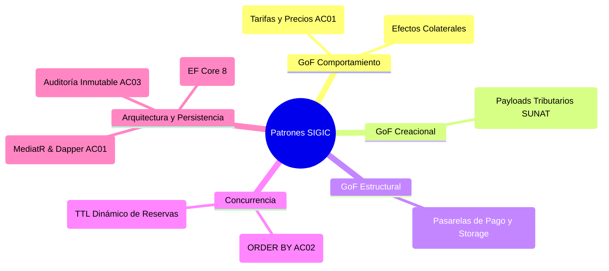
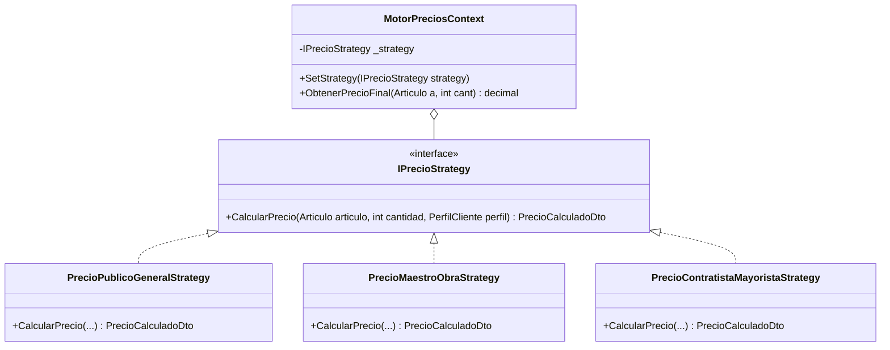
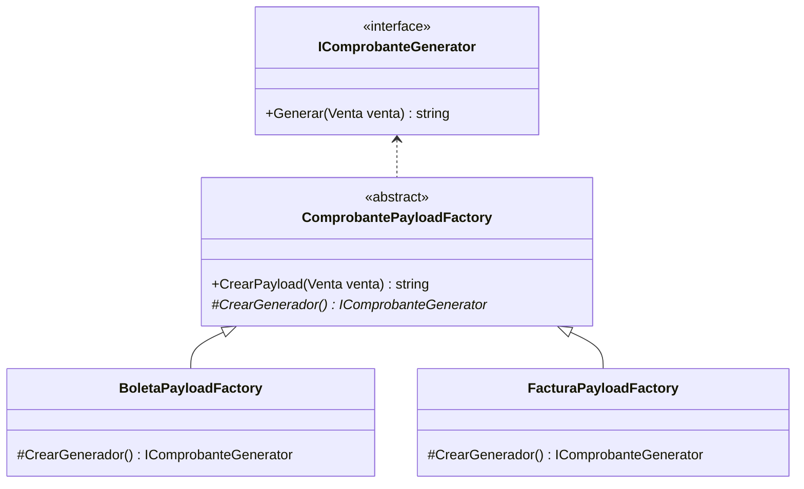
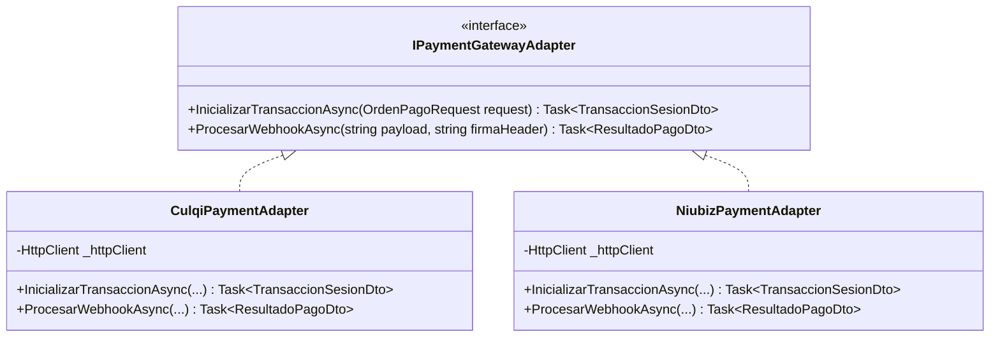
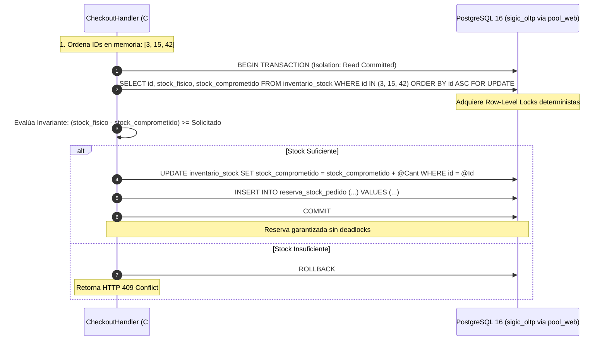

# Catálogo de Patrones de Diseño — SIGIC Ferretería

> **Documento:** `03-diseno-de-software/diseno-interno-modulos/patrones-de-diseno.md`  
> **Versión de Especificación:** 2.2 (Oficial – SIGIC Ferretería)  
> **Disciplina:** Patrones de Diseño de Software (GoF & Patrones de Arquitectura Empresarial)  
> **Sistema:** SIGIC Ferretería (Monolito Modular ASP.NET Core 8 Web API)  
> **Evaluación Académica:** IS-488 Arquitectura de Software (UNSCH)

---

## 1. Visión General de Patrones Aplicados

El diseño técnico de **SIGIC Ferretería v2.2** aplica un conjunto disciplinado de patrones de diseño orientados a objetos (GoF), patrones de concurrencia relacional y patrones de arquitectura empresarial para desacoplar responsabilidades, garantizar integridad ACID y permitir la evolución del dominio:



---

## 2. Patrones GoF de Comportamiento

### 2.1. Patrón Strategy: Cálculo Dinámico de Precios por Perfil de Cliente
- **Problema de Negocio:** La ferretería maneja múltiples perfiles de clientes (Público General, Maestro de Obra y Contratista B2B). Las reglas de descuento y asignación de tarifa varían según el volumen, la unidad de medida (bolsa vs. millar) y el canal de venta (`RF-PRE-001`, `RF-PRE-002`, `RF-WEB-001`).
- **Solución:** Se define una interfaz `IPrecioStrategy` que encapsula el algoritmo de obtención y descuento, desacoplando el checkout de la lógica de tarifas.



#### Implementación en C#:
```csharp
public interface IPrecioStrategy
{
    PrecioCalculadoDto CalcularPrecio(Articulo articulo, decimal cantidad, PerfilCliente perfil);
}

public class PrecioContratistaMayoristaStrategy : IPrecioStrategy
{
    public PrecioCalculadoDto CalcularPrecio(Articulo articulo, decimal cantidad, PerfilCliente perfil)
    {
        // Aplica Lista 3 (Mayorista) verificando margen mínimo de seguridad sobre el CPP (AC02)
        decimal precioBase = articulo.ObtenerPrecioLista3();
        if (precioBase < articulo.CostoPromedioPonderado * 1.05m)
            throw new MargenInvalidoException("El precio mayorista no puede perforar el costo ponderado.");
            
        return new PrecioCalculadoDto(precioBase, TipoTarifa.ContratistaB2B);
    }
}
```

---

## 3. Patrones GoF Creacionales

### 3.1. Patrón Factory Method: Generador de Payloads Tributarios (PSE/OSE)
- **Problema de Negocio:** SIGIC emite Notas de Venta internas (sin efecto fiscal) y Comprobantes Electrónicos Oficiales (Boleta y Factura). La construcción del payload estandarizado (JSON o XML para el PSE/OSE SUNAT) varía según el tipo de comprobante, cálculo de IGV (18 %) y validación de RUC con módulo 11 (`RF-POS-007`, `RF-POS-008`).
- **Solución:** Se implementa un Factory Method que crea el generador correspondiente, encapsulando las diferencias de estructura impositiva.



---

## 4. Patrones GoF Estructurales

### 4.1. Patrón Adapter: Integración de Pasarelas de Pago Web (`IPaymentGatewayAdapter`)
- **Problema de Negocio:** El portal web requiere procesar tarjetas de crédito/débito a través de proveedores certificados (Niubiz, Culqi). Para no atar el módulo de pedidos a la API propietaria de un proveedor específico (`RF-WEB-003`), se requiere un adaptador que normalice las solicitudes y los webhooks entrantes.
- **Solución:** Se introduce la interfaz `IPaymentGatewayAdapter` que convierte la semántica del dominio en las llamadas de red del proveedor seleccionado.



---

## 5. Patrones de Persistencia y Concurrencia

### 5.1. Bloqueo Pesimista Ordenado Anti-Deadlock (`SELECT ... FOR UPDATE` - AC02)
- **Problema de Negocio:** En concurrencia extrema (cajeros cobrando y clientes en checkout compitiendo por bolsas de cemento o varillas de fierro), si dos transacciones adquieren bloqueos en orden inverso, ocurre un *deadlock* en PostgreSQL 16 (`RNF-CON-002`).
- **Solución:** Se obliga a ordenar los identificadores de productos ascendentemente (`ORDER BY producto_id ASC`) en memoria antes de emitir el bloqueo pesimista en la base de datos.



### 5.2. Patrón Repository & Unit of Work (EF Core 8)
- Centraliza la persistencia transaccional ACID dentro de un límite de transacción unificado. El `IUnitOfWork` garantiza que todas las mutaciones sobre el inventario, los asientos de venta y las reservas se confirmen atómicamente (`CommitAsync()`) o se reviertan en su totalidad ante cualquier fallo.

### 5.3. Patrón Transactional Outbox para Auditoría Inmutable (AC03)
- Todas las operaciones sensibles (`RNF-SEG-004`) y las mutaciones de arqueo ciego se insertan en la tabla `Audit_Log` dentro de la **misma transacción relacional** que muta el estado de negocio. Esto elimina de raíz la posibilidad de discrepancias entre los datos operacionales y la bitácora de auditoría.
