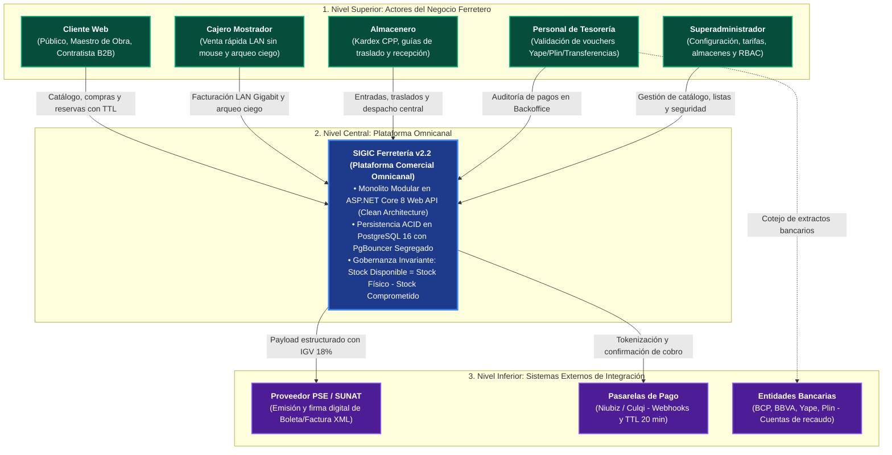

# Modelo C4 — Nivel 1: Diagrama de Contexto del Sistema

> **Documento:** `04-modelo-c4/Nivel1-DiagramadeContexto.md`  
> **Versión de Especificación:** 2.2 (Oficial – SIGIC Ferretería)  
> **Estándar:** Modelo C4 para Visualización de Arquitectura de Software (Simon Brown) – Nivel 1 (Contexto de Sistema)  
> **Sistema:** SIGIC Ferretería (Sistema Integrado de Gestión de Inventario y Comercialización)  
> **Evaluación Académica:** IS-488 Arquitectura de Software (UNSCH)

---

## 1. Propósito del Nivel 1 (System Context)

El **Diagrama de Contexto de Sistema (Nivel 1)** establece la vista panorámica de más alto nivel de la arquitectura de software. Su objetivo primordial es delimitar formalmente la frontera (*boundary*) del software **SIGIC Ferretería**, identificando de manera inequívoca:
1. Los **Actores Humanos** que interactúan con la plataforma: Superadministrador, Cajero Mostrador, Almacenero, Cliente Web, Despachador y Tesorería.
2. Los **Sistemas Externos** de frontera: Proveedor PSE/OSE SUNAT, Pasarela de Pagos con Tarjeta y Entidades Bancarias / Billeteras Locales.
3. La garantía de los atributos de calidad rectores: Rendimiento $P95 < 250\text{ ms}$ (**AC01**), Consistencia ACID sin sobreventas (**AC02**) y Trazabilidad inmutable (**AC03**).

---

## 2. Diagrama de Contexto del Sistema (Flujo Jerárquico de 3 Niveles)

---

## 3. Catálogo de Actores y Sistemas de Frontera

### 3.1. Actores Humanos del Sistema

| Actor | Categoría | Interacción Principal con SIGIC | Frontera y Restricciones |
| :--- | :--- | :--- | :--- |
| **Superadministrador** | Interno | Gestión de seguridad (RBAC), catálogo global, almacenes, listas de precios mayoristas y auditoría general. | Acceso irrestricto a los paneles gerenciales y reportería sobre el Datamart analítico (`AC03`). |
| **Cajero Mostrador** | Interno | Venta presencial rápida por escáner/teclado (`RF-POS-003`), cobro mixto y cierre ciego de caja (`RF-CAJ-002`). | Operación en LAN de mostrador; no valida vouchers bancarios ni tiene acceso a la tesorería de pedidos web (`AC01`). |
| **Almacenero** | Interno | Recepción de mercadería contra orden de compra (`RF-INV-006`), despacho y recepción de guías internas (`RF-INV-003`). | Opera sobre el Almacén Central y depósitos; no puede alterar listas de precios ni cobrar ventas (`AC02`). |
| **Cliente Web** | Externo | Compra digital, consulta de precios por perfil (General, Maestro de Obra, Contratista) y seguimiento de órdenes. | Sujeto a rate-limiting; solo ve artículos con `disponible_en_web = true` (`RF-INV-001`). No accede a endpoints internos. |
| **Despachador** | Interno | Entrega ágil en mostrador de pedidos web (`RF-POS-011`) y marcación de despachos a obra. | **Frontera estricta:** Solo valida pedidos en estado `Listo para Retiro` cotejando DNI; no manipula comprobantes ni vouchers. |
| **Personal de Tesorería** | Interno | Auditoría de comprobantes bancarios (Yape/Plin/Transferencias de hasta 5 MB) en Backoffice (`RF-WEB-003`). | Desacoplado del mostrador para evitar cuellos de botella en la atención presencial (`AC01`). |

---

### 3.2. Sistemas Externos de Frontera

| Sistema Externo | Tipo de Integración | Responsabilidad Interna de SIGIC | Responsabilidad del Sistema Externo (Out-of-Scope) |
| :--- | :--- | :--- | :--- |
| **Proveedor PSE / OSE (Tributario SUNAT)** | API REST / JSON | Captura datos fiscales (RUC/DNI), calcula el IGV al 18 % y genera el payload normalizado (`RF-POS-008`). | Firma digital con certificado `.pfx`, envío de XML a SUNAT y recepción de Constancias de Recepción (CDR). |
| **Pasarela de Pagos (Tarjetas)** | SDK / Webhook HTTPS | Inicializa la transacción con TTL de 20 minutos (`RF-WEB-002`) y procesa el webhook firmado de confirmación. | Captura de datos sensibles de tarjetas (cumplimiento PCI-DSS), procesamiento bancario y tokenización. |
| **Entidades Bancarias Locales** | Conciliación Asíncrona | Captura manual obligatoria del Código de Operación bancaria y archivo de voucher ($\le 5\text{ MB}$) (`RF-POS-006`, `RF-WEB-003`). | No existen webhooks ni APIs bancarias directas para microempresas ferreteras; la acreditación es auditada por Tesorería. |
