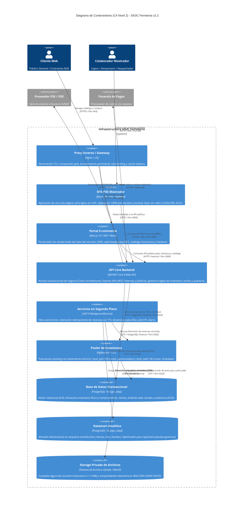

# Modelo C4 — Nivel 2: Diagrama de Contenedores

> **Documento:** `04-modelo-c4/Nivel2-DiagramadeContenedores.md`  
> **Versión de Especificación:** 2.2 (Oficial – SIGIC Ferretería)  
> **Estándar:** Modelo C4 para Visualización de Arquitectura de Software (Simon Brown) – Nivel 2 (Contenedores)  
> **Sistema:** SIGIC Ferretería (Monolito Modular con Frontends Desacoplados y Pools Segregados)  
> **Evaluación Académica:** IS-488 Arquitectura de Software (UNSCH)

---

## 1. Propósito del Nivel 2 (Containers)

El **Diagrama de Contenedores (Nivel 2)** descompone el sistema **SIGIC Ferretería v2.2** en sus unidades de software y almacenamiento ejecutables de manera autónoma (*contenedores* o procesos de despliegue):
1. **Frontends Desacoplados:** SPA Mostrador en React 18 (red LAN, atajos de teclado sin mouse) y Portal E-commerce en Next.js 14 SSR (Internet, SEO y catálogo interactivo).
2. **Backend API Core en .NET 8:** Núcleo transaccional monolítico modular estructurado bajo Clean Architecture.
3. **Servicios en Segundo Plano:** Background Workers para liberación idempotente de reservas con TTL y consolidación ETL nocturna.
4. **Intermediación y Persistencia Relacional:** PgBouncer con pools segregados (`pool_pos` y `pool_web`) sobre PostgreSQL 16 (`sigic_oltp`) y Datamart analítico (`sigic_olap`).
5. **Storage Privado de Archivos:** Almacén seguro para comprobantes de pago ($\le 5\text{ MB}$) y documentos XML/CDR tributarios sin exposición web directa.

---

## 2. Diagrama de Contenedores en Mermaid C4

---

## 3. Matriz Tecnológica y Protocolos de Comunicación

| Contenedor | Tecnología Principal | Propósito y Responsabilidad | Protocolo / Puerto | Mecanismo de Seguridad | Atributo de Calidad |
| :--- | :--- | :--- | :--- | :--- | :--- |
| **Proxy Inverso / Gateway** | Nginx 1.25 en Alpine Linux | Escudo perimetral, terminador TLS 1.3, rate-limiting y caché de catálogo. | HTTPS (443), HTTP (80) | Certificados TLS ECDSA, Nginx `limit_req_zone`. | **AC01** |
| **SPA POS Mostrador** | React 18, Vite, Tailwind CSS | Terminal de caja física en red LAN, optimizada para escáner óptico y atajos `F1`–`F12`. | HTTP / HTTPS (LAN) | JWT RS256 (`Audience: SIGIC_InternalStaff`). | **AC01** |
| **Portal E-commerce** | Next.js 14, Node.js runtime | Catálogo web B2B/B2C, renderizado SSR interactivo y carrito digital. | HTTP (3000 local) | JWT RS256 (`Audience: SIGIC_WebClient`), HttpOnly Cookies. | **AC01** |
| **API Core Backend** | ASP.NET Core 8 Web API (Kestrel) | Núcleo transaccional de Clean Architecture, validación de reglas e inventario. | HTTP (5000 local) | Middleware de autorización RBAC en servidor. | **AC01**, **AC02** |
| **Servicios de Fondo** | .NET 8 `IHostedService` | Worker de expiración de reservas dinámicas (cada 60 s) y consolidación ETL nocturna. | En memoria del proceso | Ejecución asíncrona interna e idempotente. | **AC02** |
| **Pooler de Conexiones** | PgBouncer 1.21 | Asignación transaccional (*Transaction Pooling*) con dos pools segregados (`pool_pos` y `pool_web`). | TCP (6432) | Autenticación SCRAM-SHA-256 local. | **AC01**, **AC02** |
| **Base de Datos OLTP** | PostgreSQL 16 Relacional | Almacén operacional ACID con bloqueos de fila deterministas (`SELECT ... FOR UPDATE`). | TCP (5432) | Tráfico aislado en red privada; backups WAL continuos. | **AC02** |
| **Datamart OLAP** | PostgreSQL 16 Dimensional | Almacén analítico en esquema estrella para reportería pesada y kardex mensual valorizado. | TCP (5433) | Aislamiento físico de CPU y memoria frente al motor OLTP. | **AC01** |
| **Storage Privado** | Sistema de Archivos Local / MinIO | Almacén no indexable de comprobantes de pago ($\le 5\text{ MB}$) y constancias tributarias XML/CDR. | I/O Cifrado Interno | Acceso mediado exclusivamente por API Core con autorización RBAC. | **AC03** |
