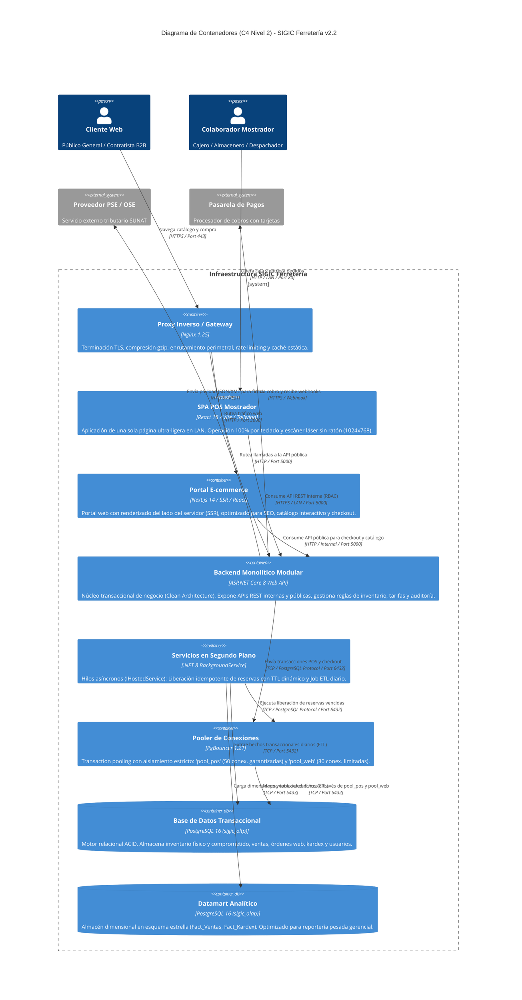

# Modelo C4 — Nivel 2: Diagrama de Contenedores

> **Documento:** `04-modelo-c4/Nivel2-DiagramadeContenedores.md`  
> **Versión de Especificación:** 2.2 (Oficial – SIGIC Ferretería)  
> **Estándar:** Modelo C4 para Visualización de Arquitectura de Software (Simon Brown) – Nivel 2 (Contenedores)  
> **Sistema:** SIGIC Ferretería (Monolito Modular con Frontends Desacoplados y Pools Segregados)

---

## 1. Propósito del Nivel 2 (Containers)

El **Diagrama de Contenedores (Nivel 2)** descompone el sistema **SIGIC Ferretería** en sus unidades de software y almacenamiento ejecutables de manera autónoma (*contenedores* o procesos de despliegue). Muestra:
1. La segregación de clientes frontends especializados (SPA Mostrador en React 18 vs. Portal E-commerce en Next.js 14).
2. El contenedor backend monolítico modular en ASP.NET Core 8 Web API con sus procesos asíncronos en segundo plano (*Background Workers*).
3. La topología de base de datos relacional y el subsistema de intermediación de conexiones **PgBouncer**, garantizando el aislamiento de recursos entre las transacciones de mostrador y la carga web.
4. El desacoplamiento entre el almacenamiento transaccional (OLTP) y el almacenamiento analítico (OLAP).

---

## 2. Diagrama de Contenedores en Mermaid C4

---

## 3. Matriz Tecnológica y Protocolos de Comunicación

| Contenedor | Tecnología Principal | Propósito y Responsabilidad | Protocolo / Puerto | Mecanismo de Seguridad |
| :--- | :--- | :--- | :--- | :--- |
| **Proxy Inverso / Gateway** | Nginx 1.25 en Alpine Linux | Escudo perimetral, terminador TLS 1.3, rate-limiting y caché de catálogo. | HTTPS (443), HTTP (80) | Certificados TLS ECDSA, Nginx `limit_req_zone`. |
| **SPA POS Mostrador** | React 18, Vite, Tailwind CSS | Terminal de caja física en red LAN, optimizada para escáner óptico y atajos `F1`–`F12`. | HTTP / HTTPS (LAN) | JWT RS256 (`Audience: SIGIC_InternalStaff`). |
| **Portal E-commerce** | Next.js 14, Node.js runtime | Catálogo web B2B/B2C, renderizado SSR interactivo y carrito digital. | HTTP (3000 local) | JWT RS256 (`Audience: SIGIC_WebClient`), HttpOnly Cookies. |
| **Backend Web API** | ASP.NET Core 8 Web API (Kestrel) | Núcleo transaccional de Clean Architecture, validación de reglas e inventario. | HTTP (5000 local) | Middleware de autorización RBAC en servidor. |
| **Servicios de Fondo** | .NET 8 `IHostedService` | Worker de expiración de reservas dinámicas (cada 60 s) y consolidación ETL nocturna. | En memoria del proceso | Ejecución asíncrona interna e idempotente. |
| **Pooler de Conexiones** | PgBouncer 1.21 | Asignación transaccional (*Transaction Pooling*) con dos pools segregados (`pool_pos` y `pool_web`). | TCP (6432) | Autenticación SCRAM-SHA-256 local. |
| **Base de Datos OLTP** | PostgreSQL 16 Relacional | Almacén operacional ACID con bloqueos de fila deterministas (`SELECT ... FOR UPDATE`). | TCP (5432) | Tráfico aislado en red privada; backups WAL continuos. |
| **Datamart OLAP** | PostgreSQL 16 Dimensional | Almacén analítico en esquema estrella para reportería pesada y kardex mensual valorizado. | TCP (5433) | Aislamiento físico de CPU y memoria frente al motor OLTP. |
