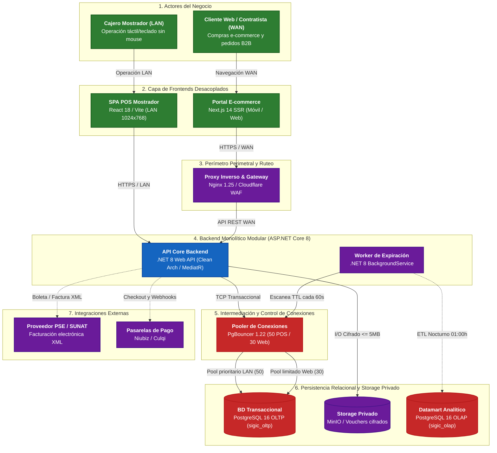

# Modelo C4 — Nivel 2: Diagrama de Contenedores

> **Documento:** `04-modelo-c4/Nivel2-DiagramadeContenedores.md`  
> **Versión de Especificación:** 2.2 (Oficial – SIGIC Ferretería)  
> **Estándar:** Modelo C4 para Visualización de Arquitectura de Software (Simon Brown) – Nivel 2 (Contenedores)  
> **Sistema:** SIGIC Ferretería (Monolito Modular con Frontends Desacoplados y Pools Segregados)  
> **Evaluación Académica:** IS-488 Arquitectura de Software (UNSCH)

---

## 1. Propósito del Nivel 2 (Containers)

El **Diagrama de Contenedores (Nivel 2)** descompone el sistema **SIGIC Ferretería v2.2** en sus unidades de software y almacenamiento ejecutables de manera autónoma (*contenedores* o procesos de despliegue):
1. **Frontends Desacoplados:** SPA Mostrador en React 18 (red LAN, atajos de teclado sin mouse) y Portal E-commerce en Next.js 14 SSR (Internet, SEO y catálogo interactivo).
2. **Perímetro de Seguridad:** Proxy inverso Nginx con terminación SSL/TLS y Rate Limiting perimetral.
3. **Backend API Core en .NET 8:** Núcleo transaccional monolítico modular estructurado bajo Clean Architecture.
4. **Servicios en Segundo Plano:** Background Workers para liberación idempotente de reservas con TTL y consolidación ETL nocturna.
5. **Intermediación y Persistencia Relacional:** PgBouncer con pools segregados (`pool_pos` y `pool_web`) sobre PostgreSQL 16 (`sigic_oltp`) y Datamart analítico (`sigic_olap`).
6. **Storage Privado de Archivos:** Almacén seguro para comprobantes de pago ($\le 5\text{ MB}$) y documentos XML/CDR tributarios sin exposición web directa.

---

## 2. Diagrama de Contenedores (Estructura Jerárquica Descendente)

---

## 3. Tabla Técnica de Soporte de Contenedores (C4 Nivel 2)

La siguiente tabla técnica desglosa la responsabilidad de negocio, contratos de interfaz y persistencia/concurrencia de cada contenedor para la evaluación formal de **IS-488 UNSCH**:

| Contenedor | Responsabilidad en la Ferretería | Tecnología / Interfaz de Entrada | Persistencia y Regla de Concurrencia |
| :--- | :--- | :--- | :--- |
| **`SPA POS Mostrador`** | Facturación presencial de alta velocidad sin ratón para cajeros de tienda física. Cobro mixto y entrega ligera en mostrador de compras online (`RF-POS-003`, `RF-POS-011`). | React 18, Vite, Tailwind CSS. Atajos de función `F1` a `F12` y lector de código de barras láser EAN-13. Conexión sobre LAN privada (`192.168.1.0/24`). | Peticiones síncronas HTTP/REST a `/api/v1/pos/*` ruteadas al pool prioritario `sigic_pos_pool`. Descuento directo de stock físico con latencia sub-segundo ($P95 < 250\text{ ms}$). |
| **`Portal E-commerce`** | Catálogo digital de materiales de construcción con fichas técnicas para contratistas y público general. Carrito de compras y checkout web (`RF-WEB-001`, `RF-WEB-002`). | Next.js 14 (App Router con Server Components SSR), Node.js runtime. HTTP/HTTPS WAN puertos 3000 / 443. | Consume la API pública (`/api/v1/public/*`). Filtro estricto `disponible_en_web = true` (HTTP 404 para exclusivos de mostrador). Asigna reservas de inventario con TTL dinámico. |
| **`Proxy Inverso & Gateway`** | Escudo de seguridad perimetral, terminación SSL/TLS, compresión Brotli y protección contra ataques DoS para salvaguardar la facturación de tienda (`RNF-SEG-001`). | Nginx 1.25 en Alpine Linux / Cloudflare WAF. Puertos HTTPS (443) y HTTP (80). | Rate limiting perimetral (60 req/min/IP). No accede a bases de datos; aísla el tráfico público de internet respecto a la red LAN de las cajas físicas. |
| **`API Core Backend`** | Núcleo transaccional que gobierna las reglas comerciales ferreteras: fórmula de stock disponible, listas de tarifas (Público, Maestro de Obra, Contratista B2B), arqueo ciego y facturación SUNAT. | ASP.NET Core 8 Web API (Clean Architecture, MediatR, CQRS). Endpoints `/api/v1/pos/*` (internos LAN) y `/api/v1/public/*` (públicos WAN). | Acceso dual híbrido (EF Core 8 para transacciones pesimistas `SELECT ... FOR UPDATE` ordenadas por ID y Dapper para lecturas de catálogo sub-15 ms). Gobierna la invariante: $\text{Stock Disponible} = \text{Stock Físico} - \text{Stock Comprometido}$. |
| **`Worker de Expiración`** | Auditoría en segundo plano que libera de forma automática las existencias retenidas de pedidos web abandonados o pagos manuales sin voucher (`RF-WEB-002`). | .NET 8 `BackgroundService` (`IHostedService`). Bucle asíncrono autónomo ejecutado cada 60 segundos. | Transacciones SQL idempotentes sobre tabla `reserva_stock_pedido` con `FOR UPDATE SKIP LOCKED`. Decrementa `stock_comprometido` y devuelve el saldo al disponible de tienda. |
| **`Pooler de Conexiones (PgBouncer)`** | Gestión y aislamiento de conexiones hacia PostgreSQL para impedir que picos de tráfico en la web saturen las cajas de cobro físico (`RNF-CON-001`). | PgBouncer 1.22 en modo transacción (*Transaction Pooling*). Puerto TCP 6432. | Segregación física en dos pools aislados: `pool_pos` (50 conexiones garantizadas para mostrador LAN, cero espera) y `pool_web` (30 conexiones compartidas con queue timeout de 3 s y backpressure). |
| **`BD Transaccional (PostgreSQL OLTP)`** | Persistencia central ACID de inventario físico y comprometido, ventas, órdenes web, correlativos tributarios y kardex CPP. | PostgreSQL 16 Relacional (`sigic_oltp`). Protocolo PostgreSQL TCP 5432. | Nivel de aislamiento `Read Committed` con bloqueos pesimistas de fila deterministas (`ORDER BY producto_id ASC` + `FOR UPDATE`). Tabla `caja_arqueo` estrictamente *Append-Only* (`REVOKE UPDATE, DELETE`). |
| **`Datamart Analítico (PostgreSQL OLAP)`** | Consolidación histórica de ventas, mermas y kardex mensual valorizado para tableros gerenciales de BI, sin ralentizar las cajas en tienda. | PostgreSQL 16 Dimensional (`sigic_olap`). Esquema estrella (*Star Schema* con `Fact_Ventas` y `Fact_Kardex`). Puerto TCP 5433. | Alimentado asíncronamente vía proceso ETL nocturno (01:00 UTC-5). Consultas analíticas de solo lectura que operan sin consumir recursos de CPU/RAM de la base transaccional. |
| **`Storage Privado de Archivos`** | Custodia aislada y segura de constancias de transferencia bancaria / vouchers Yape/Plin ($\le 5\text{ MB}$) y comprobantes electrónicos XML/CDR de SUNAT (`RF-WEB-003`, `AC03`). | Sistema de archivos cifrado local (LUKS / MinIO S3 API). Acceso mediado exclusivamente por adaptador C# `StoragePrivadoAdapter`. | Almacenamiento desacoplado sin URL pública directa. Validación criptográfica de hash SHA-256 y cuotas estrictas de archivo para prevenir saturación de disco. |
