# Modelo C4 — Nivel 3: Diagrama de Componentes

> **Documento:** `04-modelo-c4/Nivel3-Diagrama-de-Componentes.md`  
> **Versión de Especificación:** 2.2 (Oficial – SIGIC Ferretería)  
> **Estándar:** Modelo C4 para Visualización de Arquitectura de Software (Simon Brown) – Nivel 3 (Componentes)  
> **Contenedor Analizado:** Backend Monolítico Modular (ASP.NET Core 8 Web API)  
> **Estilo Arquitectónico:** Clean Architecture (Arquitectura Limpia con Puertos y Adaptadores)  
> **Evaluación Académica:** IS-488 Arquitectura de Software (UNSCH)

---

## 1. Propósito del Nivel 3 (Components)

El **Diagrama de Componentes (Nivel 3)** realiza un acercamiento (*zoom-in*) al interior del contenedor principal de cómputo: el **Backend Monolítico Modular en ASP.NET Core 8 Web API**. Detalla cómo se descompone internamente el código fuente respetando las cuatro capas concéntricas de **Clean Architecture**:
1. **Controlador Venta (`VentasPOSController`):** Puerta de entrada para las ventas en mostrador físico (`RF-POS-003`).
2. **Orquestador Checkout (`IniciarCheckoutCommandHandler`):** Orquestador de aplicación que gobierna la revalidación atómica y prevención de bloqueos mutuos (`RF-WEB-002`, `RF-WEB-005`).
3. **Servicio de Reserva de Stock (`ReservaStockService`):** Lógica pura de dominio para el cálculo del TTL dinámico y retención temporal de existencias.
4. **Repositorio de Inventario (`InventarioRepository` / `SIGICDbContext`):** Adaptador de persistencia con bloqueo pesimista a nivel de fila (`SELECT ... FOR UPDATE`).
5. **Storage Privado Adapter (`StoragePrivadoAdapter`):** Adaptador de infraestructura para custodia de comprobantes y archivos XML SUNAT.

---

## 2. Diagrama de Componentes en Mermaid C4

```mermaid
C4Component
    title Diagrama de Componentes (C4 Nivel 3) - Backend ASP.NET Core 8 Web API

    Container_Boundary(bWebApi, "Contenedor: ASP.NET Core 8 Web API") {
        
        Component(authMiddleware, "Middleware de Autenticación y RBAC", "ASP.NET Core Middleware", "Valida JWT RS256, distingue audiencias (SIGIC_InternalStaff vs SIGIC_WebClient) y aplica rate-limiting.")

        Boundary(cPresentation, "1. Capa de Presentación (Controllers)") {
            Component(ctrlPos, "Controlador Venta (VentasPOSController)", "API Controller Interno", "Recibe comandos de facturación rápida, atajos de teclado y cobros mixtos (RF-POS-003, RF-POS-006, AC01).")
            Component(ctrlDespacho, "DespachoMostradorController", "API Controller Interno", "Pantalla ligera de entrega en mostrador (RF-POS-011) cotejando código y DNI.")
            Component(ctrlCatalogo, "CatalogoPublicoController", "API Controller Público", "Consultas de productos con filtro estricto: disponible_en_web = true (RF-INV-001, RF-WEB-001).")
            Component(ctrlCheckout, "CheckoutWebController", "API Controller Público", "Recepción de órdenes de compra con revalidación atómica (RF-WEB-002, RF-WEB-005).")
        }

        Boundary(cApplication, "2. Capa de Aplicación (CQRS / MediatR)") {
            Component(cmdCrearVenta, "CrearVentaPOSCommandHandler", "MediatR Command Handler", "Orquesta la transacción de venta física, cálculo de IGV y rebaja directa del stock de tienda.")
            Component(cmdCheckout, "Orquestador Checkout (IniciarCheckoutCommandHandler)", "MediatR Command Handler", "Orquesta la revalidación atómica de precio y adquisición pesimista de stock en Almacén Central (AC02).")
            Component(qryCatalogo, "GetCatalogoQueryHandler", "MediatR Query Handler", "Resuelve la consulta de catálogo leyendo vistas optimizadas mediante Dapper (AC01).")
            Component(cmdLiberarReserva, "LiberarReservaVencidaCommandHandler", "MediatR Command Handler", "Procesa la expiración de pedidos y decrementa stock comprometido de forma idempotente.")
        }

        Boundary(cDomain, "3. Capa de Dominio (Pure Business Logic)") {
            Component(srvInventario, "InventarioDomainService", "Domain Service", "Aplica fórmula: Disponible = Físico - Comprometido. Ordena IDs deterministamente para evitar deadlocks (AC02).")
            Component(srvReserva, "Servicio Reserva Stock (ReservaStockService)", "Domain Service", "Calcula TTL de reserva según medio de pago (20 min pasarela / 4 h manual con 1 h comprobante).")
            Component(srvTarifas, "MotorTarifasDomainService", "Domain Service", "Calcula precios según lista asignada al cliente (Público, Maestro de Obra, Contratista).")
        }

        Boundary(cInfrastructure, "4. Capa de Infraestructura (Adapters & Persistence)") {
            Component(efDbContext, "Repositorio Inventario (SIGICDbContext / InventarioRepository)", "Data Access / Unit of Work", "Gestiona la transacción ACID sobre PostgreSQL con mapeo fluido y bloques SELECT ... FOR UPDATE (AC02).")
            Component(dapperRepo, "CatalogoDapperRepository", "Micro-ORM Query Repository", "Ejecuta sentencias SQL crudas indexadas con baja latencia para el catálogo web (< 15 ms, AC01).")
            Component(adapterPse, "PseFacturacionAdapter", "Tributary Adapter", "Construye el payload JSON/XML estructurado de boletas/facturas electrónicas.")
            Component(adapterPasarela, "CulqiNiubizPaymentAdapter", "Payment Gateway Adapter", "Gestiona tokens de cobro y valida firmas criptográficas de webhooks de pasarela.")
            Component(adapterStorage, "StoragePrivadoAdapter", "Private Storage Adapter", "Gestiona almacenamiento cifrado de comprobantes de pago (<= 5 MB) y XMLs (AC03).")
        }

        Component(workerReserva, "ReservaExpirationWorker", "IHostedService Background Worker", "Monitorea cada 60 s reservas caducadas y despacha LiberarReservaVencidaCommand.")
    }

    Container(spaPos, "SPA POS Mostrador", "React 18")
    Container(portalWeb, "Portal E-commerce", "Next.js 14")
    ContainerDb(pgBouncer, "PgBouncer Pooler", "Transaction Pooling")
    ContainerDb(storagePriv, "Storage Privado de Archivos", "Vouchers & Facturas XML")

    Rel(spaPos, authMiddleware, "Peticiones POS / Despacho", "HTTPS")
    Rel(portalWeb, authMiddleware, "Peticiones Catálogo / Checkout", "HTTPS")

    Rel(authMiddleware, ctrlPos, "Rutea petición autorizada", "En memoria")
    Rel(authMiddleware, ctrlDespacho, "Rutea petición autorizada", "En memoria")
    Rel(authMiddleware, ctrlCatalogo, "Rutea petición pública", "En memoria")
    Rel(authMiddleware, ctrlCheckout, "Rutea petición pública", "En memoria")

    Rel(ctrlPos, cmdCrearVenta, "Despacha comando", "MediatR")
    Rel(ctrlDespacho, cmdCrearVenta, "Despacha confirmación de entrega", "MediatR")
    Rel(ctrlCheckout, cmdCheckout, "Despacha comando", "MediatR")
    Rel(ctrlCatalogo, qryCatalogo, "Despacha consulta", "MediatR")
    Rel(workerReserva, cmdLiberarReserva, "Invoca comando periódicamente", "MediatR")

    Rel(cmdCrearVenta, srvInventario, "Valida y descuenta inventario", "Llamada tipada C#")
    Rel(cmdCheckout, srvInventario, "Verifica stock disponible con bloqueo", "Llamada tipada C#")
    Rel(cmdCheckout, srvReserva, "Asigna TTL dinámico", "Llamada tipada C#")
    Rel(cmdCheckout, srvTarifas, "Revalida precio vigente", "Llamada tipada C#")

    Rel(cmdCrearVenta, efDbContext, "Persiste venta y descuenta stock físico", "EF Core / Unit of Work")
    Rel(cmdCheckout, efDbContext, "Persiste orden e incrementa stock comprometido", "EF Core / Unit of Work")
    Rel(cmdCheckout, adapterStorage, "Custodia archivo de voucher adjunto", "Llamada tipada C#")
    Rel(cmdLiberarReserva, efDbContext, "Libera stock comprometido", "EF Core / Unit of Work")
    Rel(qryCatalogo, dapperRepo, "Consulta catálogo en caché/vista", "Dapper")

    Rel(cmdCrearVenta, adapterPse, "Solicita generación de payload tributario", "Interfaz C#")
    Rel(cmdCheckout, adapterPasarela, "Inicializa cobro en pasarela", "Interfaz C#")

    Rel(efDbContext, pgBouncer, "Ejecuta transacciones ACID (pool_pos / pool_web)", "TCP 6432")
    Rel(dapperRepo, pgBouncer, "Ejecuta lecturas sin bloqueo", "TCP 6432")
    Rel(adapterStorage, storagePriv, "Escribe archivos en volumen privado", "I/O File System")
```

---

## 3. Matriz de Responsabilidades de Componentes Internos

| Componente | Capa de Clean Architecture | Responsabilidad Primaria | Invariantes de Negocio Gobernados |
| :--- | :--- | :--- | :--- |
| **Controlador Venta (`VentasPOSController`)** | Presentación | Punto de entrada para terminales físicas de mostrador. | Operación 100% por teclado, validación de pagos mixtos (`RF-POS-003`, `RF-POS-006`, `AC01`). |
| **Orquestador Checkout (`IniciarCheckoutCommandHandler`)** | Aplicación | Orquestación transaccional del carrito de compras en línea. | Bloqueo pesimista ordenado (`ORDER BY producto_id ASC`) y revalidación atómica (`RF-WEB-002`, `RF-WEB-005`, `AC02`). |
| **Servicio Reserva Stock (`ReservaStockService`)** | Dominio | Gobernanza de tiempos de expiración y compromisos de stock. | TTL 20 min (tarjetas), TTL 4 h con 1 h comprobante (manuales) (`RF-WEB-002`, `AC02`). |
| **Repositorio Inventario (`InventarioRepository` / `SIGICDbContext`)** | Infraestructura | Persistencia transaccional ACID en PostgreSQL 16 con bloqueo de fila. | Transacciones atómicas, aislamiento `Read Committed` y `SELECT ... FOR UPDATE` (`AC02`). |
| **`InventarioDomainService`** | Dominio | Cálculos puros de Kardex CPP y disponibilidad de existencias. | $\text{Disponible} = \text{Físico} - \text{Comprometido}$ (`RNF-CON-003`), orden determinista anti-deadlock (`RNF-CON-002`). |
| **`CatalogoDapperRepository`** | Infraestructura | Consultas de lectura desnormalizadas de catálogo. | Filtrado estricto `disponible_en_web = true` y tiempo de respuesta $\le 400\text{ ms}$ (`RNF-PERF-004`, `AC01`). |
| **`StoragePrivadoAdapter`** | Infraestructura | Custodia aislada de archivos de voucher y comprobantes XML. | Protección de documentos financieros y tributarios sin URL pública (`RF-WEB-003`, `AC03`). |
| **`ReservaExpirationWorker`** | Infraestructura | Servicio en segundo plano para revocación de reservas vencidas. | Liberación idempotente de existencias comprometidas (`RNF-CON-004`). |
