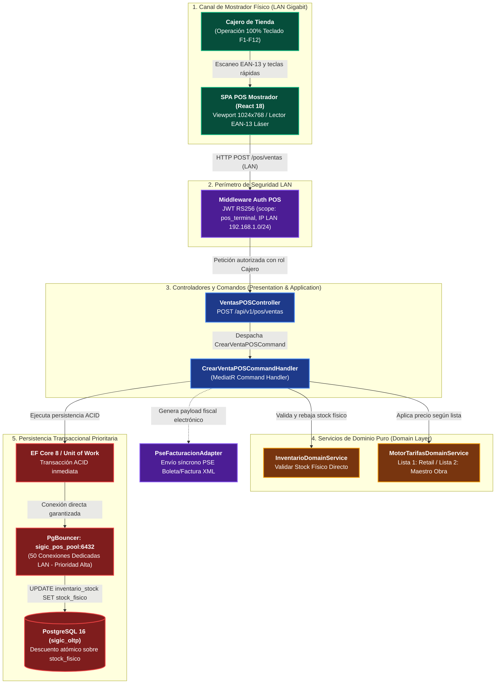
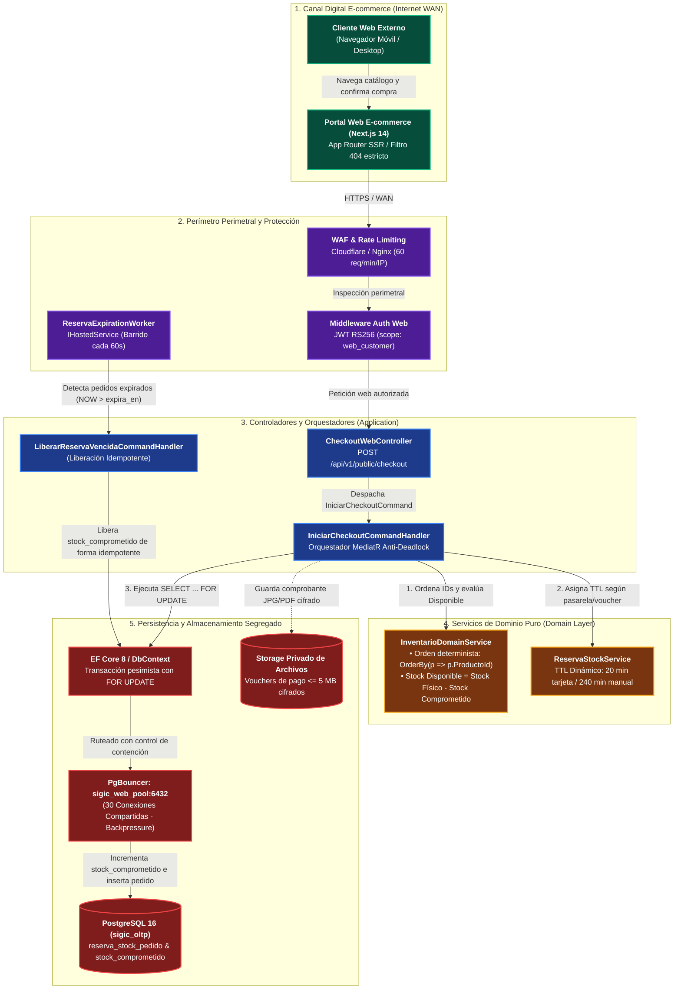

# Modelo C4 — Nivel 3: Diagrama de Componentes

> **Documento:** `04-modelo-c4/Nivel3-Diagrama-de-Componentes.md`  
> **Versión de Especificación:** 2.2 (Oficial – SIGIC Ferretería)  
> **Estándar:** Modelo C4 para Visualización de Arquitectura de Software (Simon Brown) – Nivel 3 (Componentes)  
> **Contenedor Analizado:** Backend Monolítico Modular (ASP.NET Core 8 Web API)  
> **Estilo Arquitectónico:** Clean Architecture (Arquitectura Limpia con Puertos y Adaptadores)  
> **Evaluación Académica:** IS-488 Arquitectura de Software (UNSCH)

---

## 1. Propósito del Nivel 3 (Components)

El **Diagrama de Componentes (Nivel 3)** realiza un acercamiento (*zoom-in*) al interior del contenedor principal de cómputo: el **Backend Monolítico Modular en ASP.NET Core 8 Web API**. Detalla cómo se descompone internamente el código fuente respetando las cuatro capas concéntricas de **Clean Architecture**:
1. **Controlador Venta (`VentasPOSController`):** Puerta de entrada para las ventas en mostrador físico (`RF-POS-003`).
2. **Orquestador Checkout (`IniciarCheckoutCommandHandler`):** Orquestador de aplicación que gobierna la revalidación atómica y prevención de bloqueos mutuos (`RF-WEB-002`, `RF-WEB-005`).
3. **Servicio de Reserva de Stock (`ReservaStockService`):** Lógica pura de dominio para el cálculo del TTL dinámico y retención temporal de existencias.
4. **Repositorio de Inventario (`InventarioRepository` / `SIGICDbContext`):** Adaptador de persistencia con bloqueo pesimista a nivel de fila (`SELECT ... FOR UPDATE`).
5. **Storage Privado Adapter (`StoragePrivadoAdapter`):** Adaptador de infraestructura para custodia de comprobantes y archivos XML SUNAT.

---

## 2. Diagramas de Componentes en 2 Vistas Especializadas (C4 Nivel 3)

Para erradicar la sobrecarga visual y garantizar la máxima legibilidad técnica evaluada en **IS-488 UNSCH**, la descomposición interna del backend en ASP.NET Core 8 Web API se estructura en **dos vistas arquitectónicas segregadas**:

### 2.1. Vista 3.1: Flujo Crítico Mostrador POS (LAN Gigabit)
Modela la ruta de ejecución prioritaria de facturación rápida presencial sin ratón, con asignación de conexiones de alta prioridad en PgBouncer y tiempo de respuesta sub-segundo ($P95 < 250\text{ ms}$):

---

### 2.2. Vista 3.2: Flujo E-commerce y Pedidos Web (WAN)
Modela el flujo de compras digitales, orquestación del checkout determinista anti-deadlock, retención temporal de existencias con TTL dinámico y liberación asíncrona mediante worker en segundo plano:

---

## 3. Tabla Resumen de Componentes del Backend Monolítico (C4 Nivel 3)

La siguiente tabla sintetiza la descomposición técnica del contenedor backend en ASP.NET Core 8 Web API, mapeando cada componente con su responsabilidad en la ferretería, contratos de entrada y reglas de concurrencia:

| Nombre del Componente / Clase | Responsabilidad en el Negocio de la Ferretería | Interfaz de Entrada / Métodos Clave | Persistencia / Regla de Concurrencia Asociada |
| :--- | :--- | :--- | :--- |
| **`VentasPOSController`** | Entrada REST para terminales de mostrador en tienda física. Procesa facturación de cemento, fierro y herramientas con teclado y escáner láser (`RF-POS-003`). | `POST /api/v1/pos/ventas` `POST /api/v1/pos/cajas/arqueo` `GET /api/v1/pos/productos/buscar` | Ruteado prioritario a `sigic_pos_pool`. Ejecución síncrona de baja latencia ($P95 < 250\text{ ms}$). |
| **`DespachoMostradorController`** | Pantalla ligera de entrega para retiro en tienda física de compras originadas en el portal web (`RF-POS-011`). | `POST /api/v1/pos/despacho/{codigo}/entregar` `GET /api/v1/pos/despacho/buscar` | Valida código de retiro y DNI receptor. Actualiza estado del pedido y rebaja física desde Almacén de Despacho. |
| **`CatalogoPublicoController`** | API pública de consulta de catálogo para clientes web. Protege el stock interno de la ferretería (`RF-INV-001`, `RF-WEB-001`). | `GET /api/v1/public/catalogo` `GET /api/v1/public/productos/{id}` | Ruteado a `sigic_web_pool`. Filtro estricto `disponible_en_web = true` (retorna HTTP 404 estricto si es exclusivo de mostrador). |
| **`CheckoutWebController`** | Recepción de órdenes de compra del portal web con revalidación atómica (`RF-WEB-002`, `RF-WEB-005`). | `POST /api/v1/public/checkout` `POST /api/v1/public/pedidos/{id}/comprobante` | Invoca orquestador transaccional en `sigic_web_pool` con TTL dinámico y control de cuota. |
| **`IniciarCheckoutCommandHandler`** | Orquestador MediatR de checkout transaccional. Elimina condiciones de carrera entre la web y mostrador (`AC02`). | `Handle(IniciarCheckoutCommand, CancellationToken)` | Transacción ACID corta: ordena IDs en memoria (`OrderBy(p => p.ProductoId)`), ejecuta `SELECT ... FOR UPDATE` y actualiza `stock_comprometido`. |
| **`CrearVentaPOSCommandHandler`** | Orquestador MediatR de facturación presencial inmediata. Descuenta inventario físico y dispara comprobante electrónico. | `Handle(CrearVentaPOSCommand, CancellationToken)` | Transacción inmediata: rebaja directa sobre `stock_fisico`, emisión síncrona a PSE SUNAT y registro en turno de caja. |
| **`InventarioDomainService`** | Servicio de dominio puro. Gobierna la regla cardinal de disponibilidad y el algoritmo anti-deadlock. | `ValidarDisponible(stockFisico, stockComp, cant)` `OrdenarParaBloqueo(items)` `CalcularCostoPonderado(exist, ent)` | Invariante 1 (`RNF-CON-003`): $\text{Stock Disponible} = \text{Stock Físico} - \text{Stock Comprometido}$. Cero acceso a I/O de base de datos. |
| **`ReservaStockService`** | Gobernanza de tiempos de caducidad (TTL) de reservas de inventario web según modalidad de pago. | `CalcularTtl(MedioPago)` `AsignarVentanaComprobante()` | Tarjeta/Pasarela: TTL 20 min exacto. Pagos manuales (Yape/Plin/Transferencia): TTL 4 h con ventana de 60 min para comprobante. |
| **`InventarioRepository` / `SIGICDbContext`** | Adaptador de persistencia relacional sobre PostgreSQL 16 con aislamiento `Read Committed`. | `ObtenerParaBloqueoAsync(ids, almacenId)` `ActualizarComprometidoAsync(reserva)` | Bloqueo pesimista de fila (`FOR UPDATE`). Conectado mediante PgBouncer segregado (`sigic_pos_pool` / `sigic_web_pool`). |
| **`CatalogoDapperRepository`** | Micro-ORM de alta velocidad para lecturas de catálogo sin bloqueo ni overhead de tracking (`AC01`). | `GetCatalogoPaginadoAsync(filtros)` `GetProductoPublicoPorIdAsync(id)` | Consultas SQL indexadas sobre vistas materializadas con latencia de ejecución sub-15ms. |
| **`StoragePrivadoAdapter`** | Custodia aislada de archivos de voucher de pago y archivos XML tributarios SUNAT (`AC03`). | `GuardarComprobanteAsync(stream, ext)` `ObtenerVoucherProtegidoAsync(id)` | Almacenamiento local en volumen cifrado `/var/sigic/storage/` sin acceso web directo. Tamaño máx 5MB, SHA-256. |
| **`ReservaExpirationWorker`** | Background Worker (`IHostedService`) que se ejecuta cada 60 segundos para sanear reservas abandonadas. | `ExecuteAsync(CancellationToken)` | Identifica reservas con `FechaExpiracionUtc < Now` y ejecuta comando de liberación idempotente de `stock_comprometido`. |
