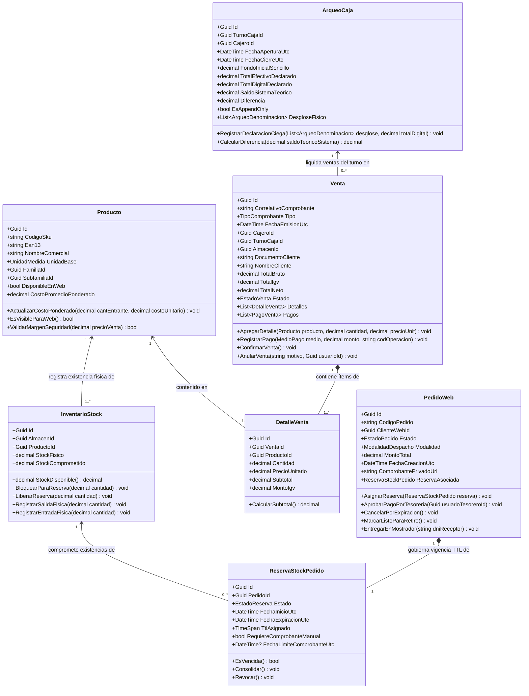
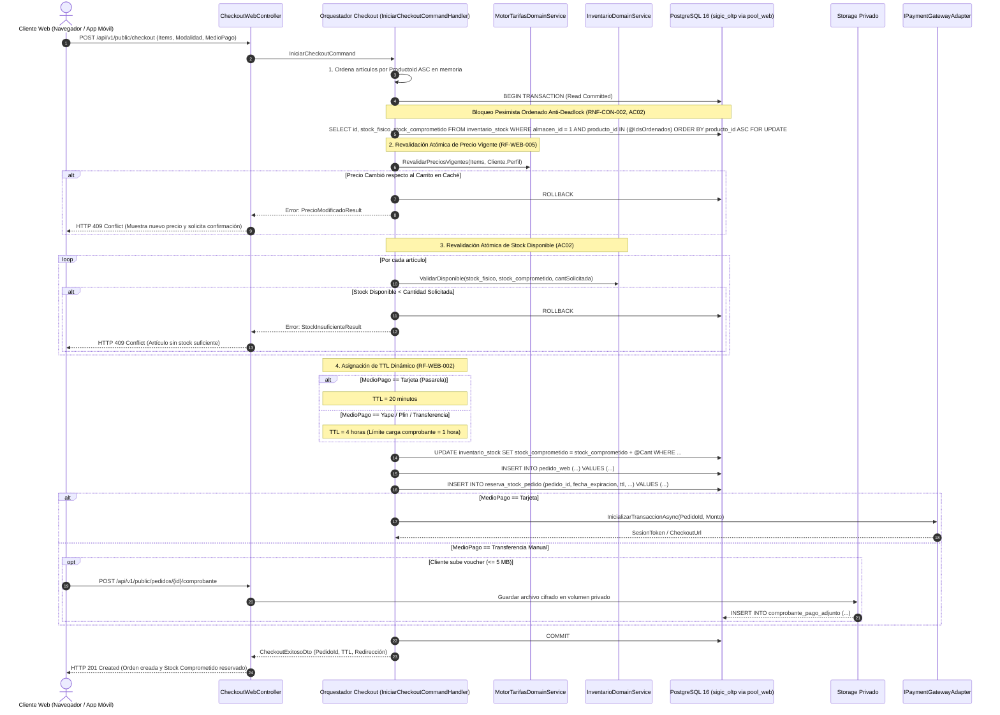
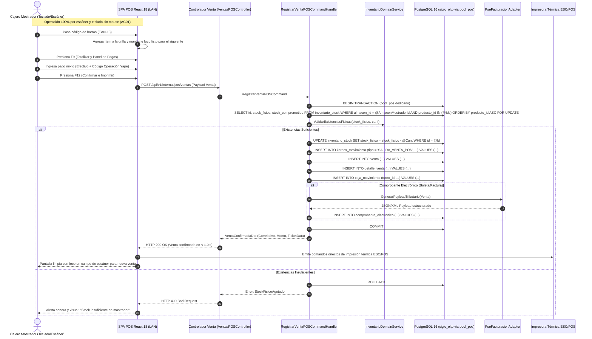

# Modelo C4 — Nivel 4: Diagrama de Código (Clases y Secuencias Críticas)

> **Documento:** `04-modelo-c4/Nivel4-DiagramadeCodigo.md`  
> **Versión de Especificación:** 2.2 (Oficial – SIGIC Ferretería)  
> **Estándar:** Modelo C4 para Visualización de Arquitectura de Software (Simon Brown) – Nivel 4 (Código e Implementación)  
> **Sistema:** SIGIC Ferretería (Monolito Modular ASP.NET Core 8 Web API)  
> **Evaluación Académica:** IS-488 Arquitectura de Software (UNSCH)

---

## 1. Propósito del Nivel 4 (Code)

El **Diagrama de Código (Nivel 4)** desciende al detalle más granular de la arquitectura de software. Formaliza la implementación exacta en el núcleo de dominio:
1. **Diagrama de Clases Estructural:** Modela las entidades de dominio centrales requeridas por la especificación: **`Producto`**, **`Venta`**, **`DetalleVenta`** y **`ArqueoCaja`**, junto con su interacción con `InventarioStock`, `PedidoWeb` y `ReservaStockPedido`.
2. **Diagrama de Secuencia 1 (Checkout Web Atómico):** Modela la resolución de `RF-WEB-002`, `RF-WEB-005` y `AC02` ante la concurrencia con el mostrador físico mediante bloqueo pesimista ordenado (`ORDER BY producto_id ASC`) y TTL dinámico.
3. **Diagrama de Secuencia 2 (Venta Rápida en Mostrador POS sin Mouse):** Modela la interacción de alta velocidad para el cajero descrita en `RF-POS-003`, `RF-POS-004` y `AC01`.

---

## 2. Diagrama de Clases de Dominio Central: `Producto`, `Venta`, `DetalleVenta` y `ArqueoCaja`

El siguiente diagrama modela la estructura de clases de la Capa de Dominio encargada de salvaguardar las reglas cardinales de consistencia ACID, venta en mostrador y cierre inmutable de caja:

### 2.1. Tabla Resumen de Clases de Dominio Centrales (C4 Nivel 4)

La siguiente tabla sintetiza las clases de dominio modeladas en el diagrama superior, formalizando sus responsabilidades operativas en la ferretería, métodos de negocio y garantías de concurrencia/persistencia:

| Nombre del Componente / Clase | Responsabilidad en el Negocio de la Ferretería | Interfaz de Entrada / Métodos Clave | Persistencia / Regla de Concurrencia Asociada |
| :--- | :--- | :--- | :--- |
| **`Producto`** | Entidad de catálogo y precios. Custodia la ficha técnica (cemento, fierros, herramientas), margen comercial y costo promedio ponderado (CPP) tras recepción de mercadería (`RF-INV-001`). | `ActualizarCostoPonderado(cant, costo)` `EsVisibleParaWeb()` `ValidarMargenSeguridad(precioVenta)` | Tabla `producto`. Invariante 2: si `DisponibleEnWeb == false`, no se expone a la web (retorna HTTP 404 estricto ante cualquier consulta o intento de compra). |
| **`InventarioStock`** | Agregado de existencias físicas y comprometidas segregadas por almacén (Almacén Central vs Mostrador Tienda). | `StockDisponible()` `BloquearParaReserva(cantidad)` `LiberarReserva(cantidad)` `RegistrarSalidaFisica(cantidad)` | Tabla `inventario_stock`. Invariante 1 (`RNF-CON-003`): $\text{Stock Disponible} = \text{StockFisico} - \text{StockComprometido}$. Invariante 3: Bloqueo pesimista ordenado (`ORDER BY producto_id ASC`) y `SELECT ... FOR UPDATE`. |
| **`Venta`** | Agregado transaccional de facturación presencial en mostrador. Asocia los ítems vendidos, medios de pago (efectivo, Yape/Plin) y emite comprobantes electrónicos SUNAT (`RF-POS-003`). | `AgregarDetalle(producto, cant, precio)` `RegistrarPago(medio, monto, op)` `ConfirmarVenta()` `AnularVenta(motivo, usuarioId)` | Transacción ACID en `sigic_pos_pool`. Bloqueo pesimista de fila en serie de comprobantes para evitar saltos o duplicados correlativos tributarios. |
| **`DetalleVenta`** | Entidad granular que representa cada renglón de la transacción física (ej. 40 bolsas de Cemento Portland, 10 varillas de Fierro 1/2"). | `CalcularSubtotal()` `AsignarPrecioUnitario(precio)` | Tabla `detalle_venta`. Utiliza precisión decimal exacta (4 decimales para cálculo de base imponible e IGV, 2 decimales en importe final). |
| **`ArqueoCaja`** | Entidad inmutable de auditoría para el Arqueo Ciego de turno (`RF-CAJ-002`, `AC03`, `RNF-SEG-004`). Registra el recuento de efectivo sin revelar el saldo teórico del sistema. | `RegistrarDeclaracionCiega(desglose, digital)` `CalcularDiferencia(saldoTeorico)` | Tabla `caja_arqueo`. Estructura estrictamente **Append-Only**: la base de datos revoca permisos `UPDATE` y `DELETE` (`REVOKE UPDATE, DELETE ON caja_arqueo FROM sigic_app_user`), emitiendo error PostgreSQL `42501` si se vulnera. |
| **`PedidoWeb`** | Agregado de pedidos digitales originados en el e-commerce. Soporta entrega a domicilio o retiro en mostrador (`RF-WEB-002`, `RF-POS-011`). | `AsignarReserva(reserva)` `AprobarPagoPorTesoreria(tesoreroId)` `EntregarEnMostrador(dniReceptor)` | Tabla `pedido_web`. Para modalidad 'Retiro en Tienda', dispara la creación automática de una Guía Interna de Traslado desde Almacén Central hacia mostrador (`RF-INV-003`). |
| **`ReservaStockPedido`** | Entidad temporal que gobierna el stock comprometido mientras se procesa o audita el pago del cliente. | `EsVencida()` `Consolidar()` `Revocar()` | Tabla `reserva_stock_pedido`. Invariante 4: TTL dinámico estricto de 20 min (pasarela) o hasta 4 h para pagos manuales (con límite improrrogable de 1 h para subir comprobante/voucher). |

---

## 3. Diagrama de Secuencia 1: Checkout Web con Revalidación Atómica y TTL Dinámico

Este flujo modela la resolución de `RF-WEB-002`, `RF-WEB-005` y **AC02** ante la concurrencia con el mostrador físico:

### 3.1. Tabla Resumen de Participantes del Flujo de Checkout Web (C4 Nivel 4)

La siguiente tabla resume el rol técnico, los contratos de interacción y las garantías de concurrencia de cada participante en la secuencia de Checkout Web:

| Componente / Agregado / Clase | Responsabilidad en la Ferretería | Interfaz de Entrada / Métodos Clave | Persistencia y Regla de Concurrencia |
| :--- | :--- | :--- | :--- |
| **`CheckoutWebController`** | Punto de entrada HTTP público para clientes e-commerce (contratistas y público general). | `POST /api/v1/public/checkout` `POST /api/v1/public/pedidos/{id}/comprobante` | Ruteado a `sigic_web_pool:6432` (pool limitado a 30 conexiones con backpressure). Rate limiting estricto (máx 60 req/min por IP pública). |
| **`IniciarCheckoutCommandHandler`** | Orquestador transaccional MediatR. Coordina el orden anti-deadlock, validación de tarifas y reserva temporal. | `Handle(IniciarCheckoutCommand, CancellationToken)` | Transacción ACID corta en `sigic_web_pool`. Ordena artículos en memoria por `producto_id ASC` antes de solicitar bloqueos en base de datos. |
| **`MotorTarifasDomainService`** | Revalida que los precios del carrito coincidan con la tarifa oficial vigente (Público, Maestro o Contratista B2B). | `RevalidarPreciosVigentes(items, perfil)` | Consulta optimizada en memoria/Dapper. Si el precio cambió en el servidor, ejecuta `ROLLBACK` y emite `HTTP 409 Conflict`. |
| **`InventarioDomainService`** | Aplica la fórmula cardinal de inventario para impedir sobreventas contra el mostrador físico. | `ValidarDisponible(stockFisico, stockComp, cant)` | Regla matemática pura: $\text{Stock Disponible} = \text{Stock Físico} - \text{Stock Comprometido}$. Si $\text{Disponible} < \text{Solicitado}$, aborta con `HTTP 409 Conflict`. |
| **`ReservaStockPedido`** | Entidad de retención temporal de existencias en el Almacén Central según la modalidad de pago. | `AsignarTtl(MedioPago)` `EsVencida()` | Mutación atómica en `reserva_stock_pedido` e incremento de `stock_comprometido`. Asigna TTL dinámico: 20 min (tarjeta) o 240 min (manual, con 60 min para voucher). |
| **`StoragePrivadoAdapter`** | Custodia segura y cifrada de las constancias de transferencia bancaria y capturas de Yape/Plin. | `GuardarComprobanteAsync(stream, ext)` | Almacenamiento en volumen privado `/var/sigic/storage/` sin acceso web directo. Tamaño máx 5MB, verificación MIME y hash SHA-256. |

---

## 4. Diagrama de Secuencia 2: Venta Rápida en Mostrador POS sin Mouse

Este flujo modela la interacción de alta velocidad para el cajero descrita en `RF-POS-003`, `RF-POS-004` y **AC01**:

### 4.1. Tabla Resumen de Participantes del Flujo de Venta Rápida POS (C4 Nivel 4)

La siguiente tabla resume el rol técnico, los contratos de interacción y las garantías de concurrencia de cada participante en la secuencia de facturación rápida en mostrador:

| Componente / Agregado / Clase | Responsabilidad en la Ferretería | Interfaz de Entrada / Métodos Clave | Persistencia y Regla de Concurrencia |
| :--- | :--- | :--- | :--- |
| **`SPA POS Mostrador (React 18)`** | Terminal de venta de alta velocidad optimizada para monitores 1024x768. Operación 100% por teclado y escáner láser sin mouse. | Mapeo de teclas de función (`F1` a `F12`), lectura de eventos de pistola óptica (EAN-13/SKU). | Ejecución local en navegador sobre red LAN privada. Mantiene estado en memoria; tiempo de adición de ítem $\le 1.0\text{ s}$. |
| **`VentasPOSController`** | Controlador interno en ASP.NET Core 8 Web API para recepción de transacciones de caja física. | `POST /api/v1/internal/pos/ventas` | Exclusivo para LAN (valida JWT con claim `scope: pos_terminal`, `caja_id: N` y segmento IP `192.168.1.0/24`). Conectado a `sigic_pos_pool:6432`. |
| **`RegistrarVentaPOSCommandHandler`** | Orquestador MediatR de la transacción de cobro presencial y liquidación de inventario en mostrador. | `Handle(RegistrarVentaPOSCommand, CancellationToken)` | Transacción ACID en `sigic_pos_pool`. Bloqueo pesimista de fila (`SELECT ... FOR UPDATE`), descuento directo de `stock_fisico` e inserción en kardex. |
| **`InventarioDomainService`** | Verificación inmediata de existencias físicas disponibles en el almacén de mostrador asignado al punto de venta. | `ValidarExistenciasFisicas(stockFisico, cant)` | Valida que $\text{Stock Físico} \ge \text{cantidad}$. Si no alcanza, aborta con `HTTP 400 Bad Request` y alerta sonora inmediata en la terminal. |
| **`PseFacturacionAdapter`** | Construcción del payload estructurado JSON/XML para emisión de comprobantes electrónicos SUNAT (boletas/facturas). | `GenerarPayloadTributario(Venta)` | Transmisión síncrona o encolada hacia el Proveedor de Servicios Electrónicos (PSE/OSE). Persiste correlativo en `comprobante_electronico`. |
| **`Impresora Térmica ESC/POS`** | Impresión física instantánea del ticket de venta o boleta electrónica en la gaveta del cajero. | Comandos raw ESC/POS vía socket TCP/USB LAN | Emisión inmediata del ticket físico en $< 1.0\text{ s}$ tras el commit en base de datos. Permite dejar el cursor listo para la siguiente venta. |

