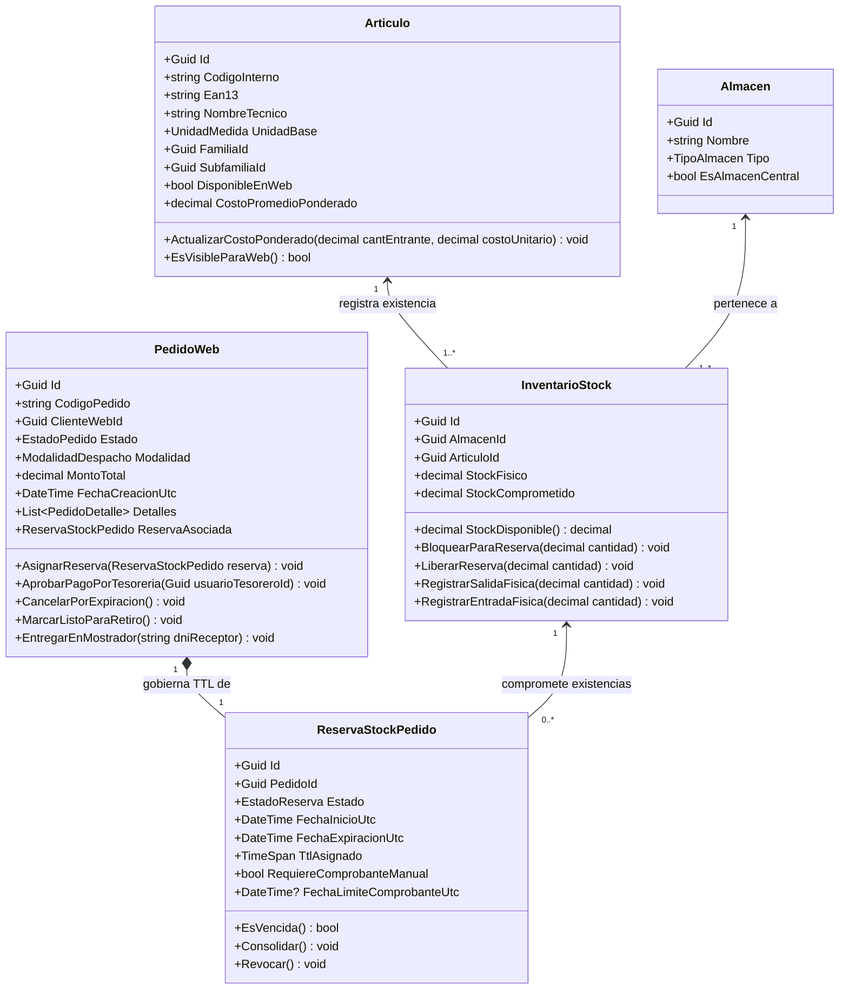
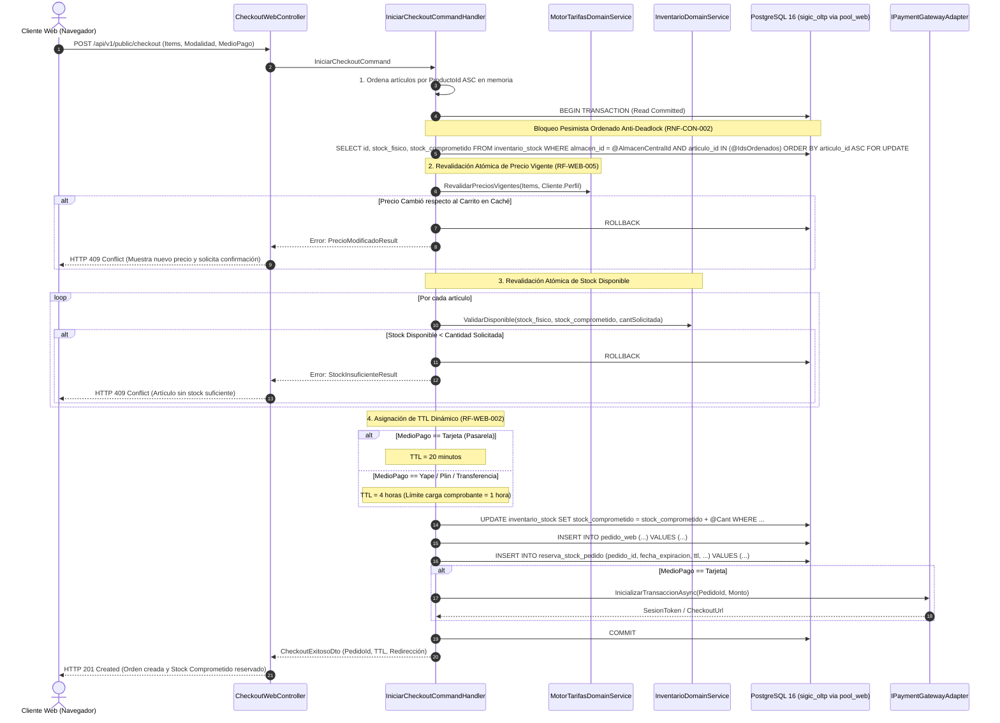
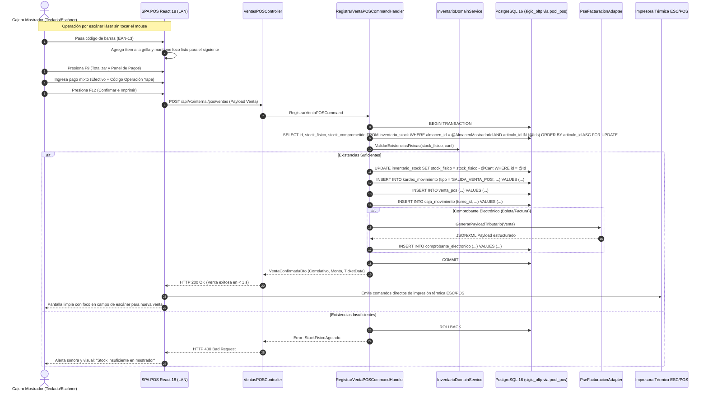

# Modelo C4 — Nivel 4: Diagrama de Código (Clases y Secuencias Críticas)

> **Documento:** `04-modelo-c4/Nivel4-DiagramadeCodigo.md`  
> **Versión de Especificación:** 2.2 (Oficial – SIGIC Ferretería)  
> **Estándar:** Modelo C4 para Visualización de Arquitectura de Software (Simon Brown) – Nivel 4 (Código e Implementación)  
> **Sistema:** SIGIC Ferretería (Monolito Modular ASP.NET Core 8 Web API)

---

## 1. Propósito del Nivel 4 (Code)

El **Diagrama de Código (Nivel 4)** desciende al detalle más granular de la arquitectura de software. En sistemas donde los componentes generales ocultan patrones de diseño complejos o condiciones de carrera de misión crítica, el Nivel 4 formaliza:
1. El **Diagrama de Clases Estructural** de los Agregados de Dominio más significativos (`Articulo`, `InventarioStock`, `PedidoWeb`, `ReservaStockPedido`).
2. El **Diagrama de Secuencia 1:** Flujo de Checkout Web con revalidación atómica de precio y existencias, bloqueo pesimista ordenado (`ORDER BY producto_id ASC`) y asignación de TTL dinámico (`RF-WEB-002`, `RF-WEB-005`, `RNF-CON-003`).
3. **El Diagrama de Secuencia 2:** Flujo de Venta Rápida en Mostrador POS mediante escáner óptico y atajos de teclado sin mouse (`RF-POS-003`, `RF-POS-004`).

---

## 2. Diagrama de Clases del Agregado de Inventario y Reservas

El siguiente diagrama modela la estructura de clases de la Capa de Dominio encargada de salvaguardar la regla cardinal: $\text{Stock Disponible} = \text{Stock Físico} - \text{Stock Comprometido}$.

---

## 3. Diagrama de Secuencia 1: Checkout Web con Revalidación Atómica y TTL Dinámico

Este flujo modela la resolución de `RF-WEB-002`, `RF-WEB-005` y `RNF-CON-003` ante la concurrencia con el mostrador físico:

---

## 4. Diagrama de Secuencia 2: Venta Rápida en Mostrador POS sin Mouse

Este flujo modela la interacción de alta velocidad para el cajero descrita en `RF-POS-003`, `RF-POS-004` y `RNF-PERF-001`:

