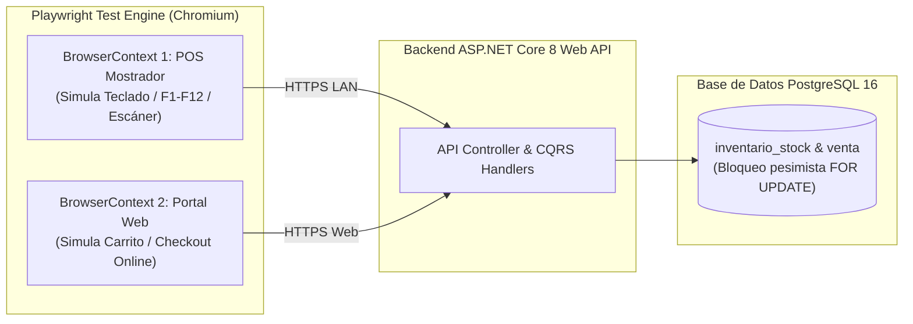

# Especificación y Arquitectura de Pruebas End-to-End (E2E) — SIGIC Ferretería v2.2

> **Documento:** `05-pruebas-y-calidad/02-pruebas-e2e.md`  
> **Sistema:** SIGIC Ferretería v2.2  
> **Asignatura:** IS-488 Arquitectura de Software (UNSCH)  
> **Criterio Oficial de Evaluación:** **Criterio 6 — Pruebas End-to-End (E2E)**  
> **Herramienta Automatizada:** Playwright (Microsoft) sobre Chromium Headless  
> **Suite de Prueba:** [`tests/e2e/checkout-omnicanal.spec.ts`](file:///home/crhistian/Projects/SIGIC-arquitSoft-proyecto-final/tests/e2e/checkout-omnicanal.spec.ts)

---

## 1. Propósito y Alcance de las Pruebas E2E

Las **Pruebas End-to-End (E2E)** en SIGIC Ferretería v2.2 tienen como objetivo certificar el comportamiento holístico del sistema simulando la interacción humana real sobre los dos canales comerciales principales:
1. **Canal Mostrador POS (LAN):** Interfaz SPA React 18 operada exclusivamente por teclado (`F1` a `F12`) y lector de código de barras sin mouse.
2. **Canal Portal Web (Internet):** Portal e-commerce Next.js 14 que compite de forma asíncrona por el mismo inventario central.



---

## 2. Herramientas Tecnológicas y Entorno de Ejecución

| Componente | Tecnología Seleccionada | Justificación Técnica de Arquitectura |
| :--- | :--- | :--- |
| **Framework E2E** | **Playwright Test (TypeScript)** | Soporte nativo para múltiples contextos aislados de navegador en paralelo (`browser.newContext()`), permitiendo simular colisiones multicanal (POS vs Web) en una sola corrida. |
| **Motor de Renderizado** | **Chromium Headless** | Emulación idéntica del motor Blink presente en las terminales de caja física de la tienda ferretera. |
| **Selectores Robustos** | `data-testid` normalizados | Desacopla las pruebas de los estilos CSS y clases dinámicas de Tailwind/CSS Modules (`data-testid="input-scanner-sku"`). |
| **Integración CI/CD** | GitHub Actions Workflow | Ejecución desatendida en contenedores Ubuntu con generación de reportes HTML y captura de video/trazas ante fallas. |

---

## 3. Matriz de Escenarios de Prueba Automatizados

La suite implementada en [`tests/e2e/checkout-omnicanal.spec.ts`](file:///home/crhistian/Projects/SIGIC-arquitSoft-proyecto-final/tests/e2e/checkout-omnicanal.spec.ts) cubre los dos flujos operativos críticos del negocio:

| ID Escenario | Canal Principal | Objetivo de Verificación | Comportamiento Esperado | Criterio de Éxito |
| :---: | :--- | :--- | :--- | :--- |
| **E2E-01** | Mostrador POS (LAN) | **Flujo Feliz de Venta Rápida sin Ratón:**<br>1. Login cajero con PIN.<br>2. Escaneo SKU Fierro 1/2".<br>3. Cálculo automático IGV 18%.<br>4. Cobro en efectivo con F9.<br>5. Emisión de boleta electrónica con F10. | Venta completada en $< 2.0\text{ s}$, cursor listo en input de escáner para nueva venta, persistencia atómica en base de datos. | Toast de éxito visible con correlativo `B001-XXXX`, cálculo de vuelto exacto (`S/ 8.00`) y foco activo retenido. |
| **E2E-02** | Omnicanal (POS + Web) | **Colisión Concurrente y Rechazo Amigable:**<br>1. Cliente web prepara carrito con últimas 5 varillas.<br>2. Cajero POS vende físicamente las 5 varillas.<br>3. Cliente web confirma pedido simultáneo. | El backend rechaza la transacción web por violación de la invariante `RNF-CON-003` ($\text{Disponible} < \text{Solicitado}$). La UI web muestra alerta amigable de stock agotado. | Alerta visual clara `HTTP 409 Conflict` en pantalla web; **0% errores internos 500** y sin páginas en blanco. |

---

## 4. Comandos de Ejecución y Automatización en CI/CD

### 4.1. Ejecución Local (Terminal Linux / Fish)

```bash
# Instalación de dependencias y navegadores Playwright
pnpm install
npx playwright install --with-deps chromium

# Ejecución de la suite E2E en modo headless
npx playwright test tests/e2e/checkout-omnicanal.spec.ts

# Ejecución en modo interactivo con UI para depuración visual
npx playwright test --ui
```

### 4.2. Integración en el Pipeline de GitHub Actions

```yaml
- name: Run Playwright E2E Tests
  run: |
    npx playwright test
  env:
    SIGIC_POS_URL: "http://localhost:3000"
    SIGIC_WEB_URL: "http://localhost:3001"
    SIGIC_API_URL: "http://localhost:5000"

- name: Upload Playwright Artifacts on Failure
  if: failure()
  uses: actions/upload-artifact@v4
  with:
    name: playwright-report
    path: playwright-report/
    retention-days: 7
```
