# 📐 PLAN DE MIGRACIÓN Y GOBERNANZA SDD — SIGIC Ferretería v2.2

> **Documento Maestro de Transición Arquitectónica hacia Spec-Driven Development (SDD)**  
> **Sistema:** SIGIC (Sistema Integrado de Gestión de Inventario y Comercialización)  
> **Autor Oficial:** Crhistian Emanuel Flores Marquina  
> **Regla de Operación:** Rigor técnico sin prosa genérica. Contratos, esquemas y diagramas verificables.

---

## 1. Problemática del Negocio y Desafíos de Concurrencia Omnicanal

SIGIC opera en el sector de retail y distribución ferretera técnica en Ayacucho (Huamanga), gestionando más de 12,000 SKUs con alta heterogeneidad (tornillería a granel, tuberías, planchas de acero, herramientas electroportátiles y materiales áridos de construcción).

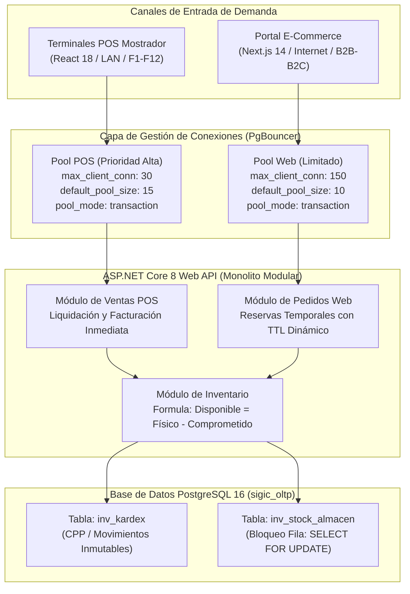

### 1.1 Invariantes Críticas de Dominio

| Invariante | Código RNF/RF | Regla Técnica Matemática / Operativa | Consecuencia de Violación |
| :--- | :--- | :--- | :--- |
| **Gobernanza de Stock** | `RNF-CON-003` | $\text{Stock Disponible} = \text{stock\_fisico} - \text{stock\_comprometido}$ | Sobreventa en mostrador o portal web cuando conviven reservas web activas con ventas físicas. |
| **Segregación de Catálogo** | `RF-INV-001` | Si `disponible_en_web == false` $\rightarrow$ Endpoint público retorna `HTTP 404 Not Found` absoluto. | Exposición accidental y pedidos no despachables de ítems exclusivos de mostrador (pernería fraccionada, cortes de cables/mangueras). |
| **Antideadlock en Checkout** | `RF-WEB-005` | $\forall \text{ items } [I_1, I_2, \dots, I_k] \rightarrow \text{Ordenar por } producto\_id \text{ ASC}$ antes de adquirir bloqueos en BD. | Bloqueo mutuo (*deadlock*) en PostgreSQL entre cajero facturando ítems A y B y pedido web simultáneo reservando B y A. |
| **Aislamiento de Conexiones** | `RNF-CON-001` | Segregación física en PgBouncer: `pool_pos` vs `pool_web`. | Inanición del mostrador POS por ráfagas de tráfico web o rastreadores de búsqueda. |
| **TTL de Reservas Web** | `RF-WEB-002` | Pasarela: 20 min exactos. Manual: 240 min totales, con 60 min máximos para adjuntar constancia de pago. | Retención indefinida de inventario que paraliza las ventas físicas en tienda. |
| **Centralización Logística** | `RF-INV-003` | Web reserva prioritariamente en Almacén Central. Si retiro es en tienda $\rightarrow$ Guía Interna automática. | Desabastecimiento del stock de exhibición en tiendas físicas para atender órdenes e-commerce. |

---

## 2. Especificación Técnica de las Tres Interfaces Conectadas

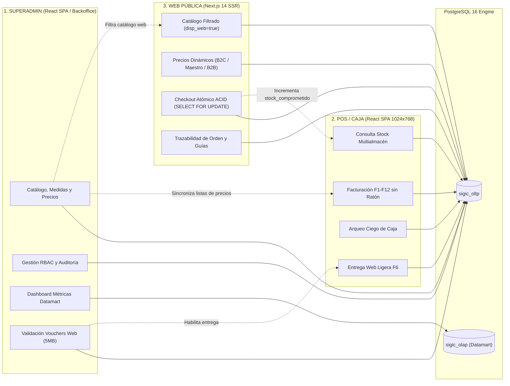

---

### 2.1 Interface 1: SUPERADMIN (Consola Integral de Administración, Catálogo y Backoffice)

#### A. Alcance Operativo y Funcional
1. **Gestión de Artículos y Medidas Complejas (`RF-INV-001`, `RF-INV-005`):**
   - Alta/edición de productos con jerarquía estricta: Familia $\rightarrow$ Subfamilia $\rightarrow$ Marca.
   - Carga de imágenes optimizadas (WebP/PNG, máx. 2 MB) con zoom técnico para herramientas.
   - Especificación dimensional inmutable (badge ferretero: diámetro, paso de rosca, calibre, longitud).
   - Control del flag `disponible_en_web` (booleano).
   - Configuración de factores de conversión entre unidad base y empaques secundarios (unidad, docena, bolsa, caja master, millar).
2. **Motor de Tarifas y Precios Multiescala (`RF-PRE-001`, `RF-PRE-002`):**
   - Configuración de Lista 1 (Público General), Lista 2 (Maestro de Obra homologado) y Lista 3 (Contratista / Mayorista B2B).
   - Reglas de margen mínimo y bloqueo automático si el precio unitario cae por debajo del costo promedio ponderado (CPP) sin autorización criptográfica de gerencia.
3. **Cola de Validación de Pagos Web (Backoffice - `RF-WEB-003`):**
   - Bandeja de entrada de comprobantes manuales (Yape, Plin, Transferencia BCP/BBVA) con archivos adjuntos hasta 5 MB (JPG, PNG, PDF).
   - Cotejo contra estado de cuenta bancario y aprobación/rechazo con marca de tiempo y usuario responsable.
   - Al aprobar: disparo automático de orden de preparación en Almacén Central y conversión de stock comprometido a estado listo para traslado.
4. **Dashboard y Telemetría de Ventas (`RF-REP-001`, `RF-REP-007`):**
   - Lectura exclusiva sobre esquema analítico `sigic_olap` (Datamart).
   - Comparativo omnicanal en tiempo real: volumen facturado, ticket promedio, margen bruto y rotación por categoría entre canal físico y canal digital.
5. **Gestión de Identidades y Control de Acceso RBAC (`01-actores.md`):**
   - Creación de colaboradores, asignación de sedes/almacenes y asignación de roles estrictos.
   - Emisión de credenciales con hash Argon2id y expiración forzada de tokens JWT RS256.

#### B. Contratos Técnicos de Interfaz (TypeScript DTO / REST API)

```typescript
// DTO de Creación/Actualización de Producto en Superadmin
export interface ProductoSuperadminPayload {
  codigoSku: string;              // Ej: "TOR-HEX-12-212"
  codigoBarrasEan13?: string;     // Validación dígito verificador módulo 10
  descripcionCorta: string;       // "Tornillo Autoperforante Hexagonal"
  badgeDimension: string;         // "#12 x 2-1/2\""
  familiaId: string;
  subfamiliaId: string;
  marcaId: string;
  unidadMedidaBaseId: string;     // "UND", "KG", "MTR"
  disponibleEnWeb: boolean;       // Control estricto de visibilidad web
  pesoKg: number;
  unidadesConversion: Array<{
    unidadMedidaId: string;       // "MILLAR", "BOLSA-100"
    factorMultiplicador: number;  // 1000.0000, 100.0000
    permiteFraccionamiento: boolean;
  }>;
  listasPrecios: Array<{
    listaId: "PUBLICO" | "MAESTRO_OBRA" | "CONTRATISTA_B2B";
    precioSinIgv: number;
    precioConIgv: number;
    margenMinimoPorcentaje: number;
  }>;
}

// DTO de Resolución de Validación de Pago Web en Backoffice
export interface ResolucionPagoWebPayload {
  pedidoId: string;
  comprobanteOperacionId: string;
  codigoOperacionBancaria: string;
  decision: "APROBADO" | "RECHAZADO";
  motivoRechazo?: "VOUCHER_ILEGIBLE" | "MONTO_INCOMPLETO" | "OPERACION_NO_FIGURA" | "DUPLICADO";
  observaciones?: string;
  almacenOrigenId: string;        // Almacén Central por defecto
}
```

---

### 2.2 Interface 2: POS / CAJA (Terminal Mostrador de Alta Densidad y Misión Crítica)

#### A. Alcance Operativo y Funcional
1. **Diseño Ergonómico Confinado a `1024px × 768px` (`RNF-USA-002`, `DESIGN.md`):**
   - Prohibido cualquier scroll horizontal (`overflow-x: hidden`).
   - Distribución en 4 zonas fijas:
     - Barra de telemetría y turno (`1024×36px`).
     - Barra omnicanal de escaneo `F1` (`1024×52px`).
     - Área central de trabajo (`1024×560px`): Tabla de ticket a 714px y panel de stock a 310px.
     - Zócalo de liquidación y botones de función (`1024×120px`).
2. **Navegación 100% por Teclado (`RF-POS-003`):**
   - Operación completa sin ratón. Tabla de facturación navegable con flechas `↑`/`↓`.
   - Atajos de hardware:
     - `F1`: Búsqueda/Lector láser de SKU/EAN-13.
     - `F2`: Buscador paramétrico ferretero (rosca, medida, material).
     - `F3`: Asignación de Cliente / Consulta RUC en línea.
     - `F4`: Edición de cantidad de línea activa.
     - `F5`: Inspección de stock físico vs comprometido multialmacén.
     - `F6`: Pantalla de Entrega Web (`RF-POS-011`).
     - `F7`: Búsqueda de productos sustitutos en caso de rotura de stock.
     - `F8`: Eliminar ítem del ticket.
     - `F9`: Poner ticket en espera / Recuperar ticket (`RF-POS-005`).
     - `F10`: Cobro rápido en Boleta Electrónica.
     - `F12`: Cobro rápido en Factura Electrónica.
     - `Esc`: Cancelar operación / Retornar foco a `F1`.
3. **Control de Stock Concurrente y Transacciones Inmediatas (`RNF-CON-003`):**
   - Consulta de disponibilidad en tiempo real con latencia $\le 1$ s.
   - Bloqueo de venta si la cantidad solicitada excede $\text{stock\_fisico} - \text{stock\_comprometido}$.
4. **Gestión de Pagos Mixtos y Arqueo Ciego (`RF-POS-006`, `RF-CAJ-002`):**
   - Pagos combinados (Efectivo + Yape/Plin + Tarjeta POS físico).
   - Captura obligatoria de código de operación de 4 a 12 dígitos, validando no duplicidad en el mismo día.
   - Cierre de turno mediante Arqueo Ciego: el cajero ingresa el conteo de billetes y monedas sin conocer el saldo esperado por el sistema.
5. **Módulo de Entrega Ligera Web (`RF-POS-011` / `F6`):**
   - Escaneo de código QR o ID de pedido web en estado `Listo para Retiro`.
   - Cotejo de DNI del cliente y confirmación de entrega física en $\le 1$ segundo, sin descargas de comprobantes pesados ni llamadas a APIs bancarias.

#### B. Contrato Técnico de Eventos de Teclado y Payload de Venta POS

```typescript
// Contrato del Manejador Central de Teclado en React 18 POS
export type TeclaComandoPOS = 
  | "F1" | "F2" | "F3" | "F4" | "F5" | "F6" 
  | "F7" | "F8" | "F9" | "F10" | "F12" 
  | "ArrowUp" | "ArrowDown" | "Enter" | "Escape";

export interface LineaTicketPOS {
  itemNumero: number;
  productoId: string;
  codigoSku: string;
  descripcionCorta: string;
  badgeMedida: string;
  cantidad: number;
  unidadMedidaId: string;
  precioUnitario: number;
  subtotal: number;
  stockDisponibleActual: number;
}

// Payload de Facturación Transaccional POS
export interface FinalizarVentaPOSPayload {
  cajaTurnoId: string;
  tipoComprobante: "BOLETA" | "FACTURA" | "NOTA_VENTA_INTERNA";
  clienteId?: string;             // Opcional para boleta < S/ 700
  clienteDocumento?: string;      // DNI 8 dígitos / RUC 11 dígitos
  clienteRazonSocial?: string;
  lineas: Array<{
    productoId: string;
    cantidad: number;
    unidadMedidaId: string;
    precioUnitarioCobrado: number;
  }>;
  desglosePagos: Array<{
    metodoPagoId: "EFECTIVO_SOLES" | "TARJETA_POS_FISICO" | "YAPE" | "PLIN" | "TRANSFERENCIA";
    monto: number;
    codigoOperacion?: string;     // Obligatorio para métodos digitales
  }>;
  totalVenta: number;
}
```

---

### 2.3 Interface 3: WEB PÚBLICA (Portal E-Commerce B2C/B2B en Next.js 14)

#### A. Alcance Operativo y Funcional
1. **Catálogo Digital Filtrado y Segregación Absoluta (`RF-INV-001`):**
   - Exclusión estricta de productos con `disponible_en_web == false`.
   - Si un usuario ingresa directamente por slug o SKU a un ítem no disponible en web, Next.js ejecuta `notFound()` devolviendo **HTTP 404** sin filtrar existencia ni inventario.
2. **Precios Dinámicos según Identidad Autenticada (`RF-WEB-001`):**
   - Visitante anónimo / B2C: Precio Lista 1 con IGV.
   - Maestro de Obra: Tarifa preferencial con insignia visual en `--color-sigic-accent` (`#e4f222`).
   - Contratista B2B: Selector de precios con/sin IGV, escalas de descuento por volumen y fichas técnicas descargables.
3. **Checkout Atómico con Prevención de Deadlock (`RF-WEB-005`):**
   - Transacción ACID en backend que revalida atómicamente precio y stock en el momento exacto de confirmación.
   - Ordenamiento forzoso por `producto_id ASC` para adquirir bloqueos `FOR UPDATE` en PostgreSQL.
4. **Gestión de Reservas con Temporizadores Dinámicos (`RF-WEB-002`):**
   - Pasarela de pago en línea: Cronómetro visual de **20:00 minutos**. Si expira sin confirmación de webhook, la reserva se libera automáticamente.
   - Pago manual (Yape/Plin/Transferencia): Temporizador primario de **60:00 minutos** para adjuntar constancia de pago, dentro de una ventana máxima de **240:00 minutos** de vigencia de reserva.
5. **Modalidades Logísticas Omnicanal (`RF-WEB-002`, `RF-INV-003`):**
   - Retiro en Almacén Central (entrega inmediata tras preparación).
   - Retiro en Tienda / Mostrador: Disparo automático de Guía Interna de Traslado (`#GI-...`) desde Almacén Central hacia la sede de destino.
   - Envío a Obra en Huamanga: Coordinación de despacho en ruta con peso y volumen calculado.

#### B. Contratos Técnicos de Checkout Web y Webhook de Pasarela

```typescript
// Payload de Checkout en Portal Web (Next.js -> API REST)
export interface CheckoutWebPayload {
  sesionClienteId: string;
  perfilClienteId: string;
  modalidadEntrega: "RETIRO_ALMACEN_CENTRAL" | "RETIRO_TIENDA_MOSTRADOR" | "ENVIO_OBRA_HUAMANGA";
  sucursalRetiroId?: string;      // Requerido si modalidad es RETIRO_TIENDA_MOSTRADOR
  direccionEnvio?: {
    departamento: "AYACUCHO";
    provincia: "HUAMANGA";
    distrito: string;             // "AYACUCHO", "SAN_JUAN_BAUTISTA", "CARMEN_ALTO", "JESUS_NAZARENO"
    direccionExacta: string;
    referenciaObra: string;
  };
  medioPagoSeleccionado: "PASARELA_ONLINE" | "PAGO_MANUAL_YAPE_PLIN" | "PAGO_MANUAL_TRANSFERENCIA";
  items: Array<{
    productoId: string;
    cantidad: number;
    unidadMedidaId: string;
  }>;
}

// Payload de Notificación Webhook de Pasarela de Pago
export interface PasarelaPagoWebhookPayload {
  eventoId: string;
  tipoEvento: "PAYMENT_INTENT.SUCCEEDED" | "PAYMENT_INTENT.FAILED";
  timestamp: string;
  firmaHmacSha256: string;        // Verificación criptográfica obligatoria
  datos: {
    transaccionId: string;
    pedidoId: string;
    montoTotalCentavos: number;
    moneda: "PEN";
    tarjetaUltimos4: string;
    marcaTarjeta: "VISA" | "MASTERCARD" | "AMEX";
  };
}
```

---

### 2.4 Matriz de Vinculación y Trazabilidad con el Modelo C4 (Niveles 2 y 3)

La siguiente matriz y diagrama vinculan formalmente los flujos de las tres interfaces con los contenedores C4 (Nivel 2) y componentes internos de Clean Architecture (Nivel 3) definidos en `04-modelo-c4/`:

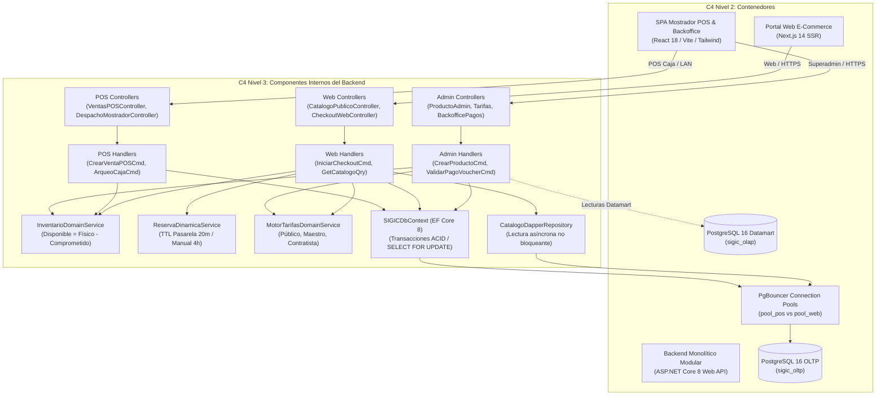

| Interfaz de Usuario | Rol Principal | Contenedor C4 Nivel 2 | Componente C4 Nivel 3 (Presentación) | Componente C4 Nivel 3 (Aplicación / CQRS) | Componente C4 Nivel 3 (Dominio) | Componente C4 Nivel 3 (Infraestructura / Persistencia) |
| :--- | :--- | :--- | :--- | :--- | :--- | :--- |
| **SUPERADMIN** | Administrador, Tesorería, Gerencia | `spaPos` (React 18 SPA) | `ProductoAdminController`, `TarifasAdminController`, `BackofficePagosController`, `SeguridadRbacController` | `CrearProductoCommandHandler`, `ActualizarListaPreciosCommandHandler`, `ValidarComprobantePagoCommandHandler` | `MotorTarifasDomainService`, `InventarioDomainService` | `SIGICDbContext` (EF Core 8), `dbOlap` (Datamart Analítico para métricas de ventas), `Argon2idPasswordHasher` |
| **POS / CAJA** | Cajero, Despachador Mostrador | `spaPos` (React 18 SPA, Viewport 1024×768) | `VentasPOSController`, `DespachoMostradorController`, `CajaTurnoController` | `CrearVentaPOSCommandHandler`, `AperturaCajaCommandHandler`, `ArqueoCiegoCajaCommandHandler`, `ConfirmarDespachoRetiroTiendaCommandHandler` | `InventarioDomainService` ($\text{Disp} = \text{Fís} - \text{Comp}$), `MotorTarifasDomainService` | `SIGICDbContext`, `PseFacturacionAdapter` (SUNAT Boleta/Factura), `PgBouncer` (`pool_pos` prioritario LAN) |
| **WEB PÚBLICA** | Público B2C, Maestro de Obra, Contratista B2B | `portalWeb` (Next.js 14 SSR) | `CatalogoPublicoController`, `CheckoutWebController`, `TrackingPedidoWebController` | `GetCatalogoQueryHandler`, `IniciarCheckoutCommandHandler`, `LiberarReservaVencidaCommandHandler` | `InventarioDomainService` (Antideadlock `ORDER BY producto_id ASC`), `ReservaDinamicaService` (TTL 20m / 4h) | `CatalogoDapperRepository` (Micro-ORM lectura rápida), `SIGICDbContext` (`SELECT ... FOR UPDATE`), `CulqiNiubizPaymentAdapter`, `PgBouncer` (`pool_web`), `ReservaExpirationWorker` |

---

## 3. Protocolo de Concurrencia y Secuencia Transaccional de Checkout

El siguiente diagrama detalla cómo conviven una venta presencial en Mostrador POS y una orden web simultánea compitiendo por el mismo producto ferretero:

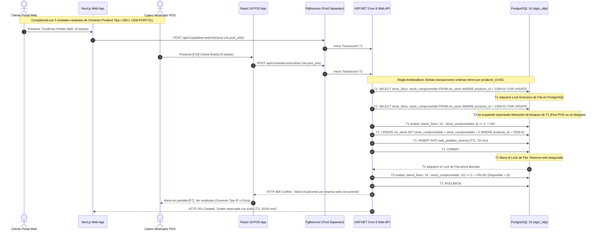

---

## 4. Cadena Documental SDD Propuesta (10 Documentos Modulares)

Para gobernar el ciclo de vida del proyecto sin monolitos documentales inmanejables, se adopta la arquitectura SDD estructurada en **10 documentos secuenciales**, cada uno gobernado por un candado de calidad auditado por el orquestador MCP.

```mermaid
flowchart TD
    D00["DOC-00: Orquestador y Reglas de Gobernanza SDD<br/>(docs/00-orquestador.md)"]
    D01["DOC-01: Visión del Producto y Dominio Ferretero<br/>(docs/01-vision-dominio.md)"]
    D02["DOC-02: Especificación Formal de Requisitos (RF + RNF)<br/>(docs/02-requisitos-funcionales.md)"]
    D03["DOC-03: Modelo de Seguridad RBAC e Identidades<br/>(docs/03-seguridad-rbac.md)"]
    D04["DOC-04: Arquitectura del Sistema (C4 + ADRs + PgBouncer)<br/>(docs/04-arquitectura-c4.md)"]
    D05["DOC-05: Diseño de Dominio y Contratos de Interfaces<br/>(docs/05-interfaces-contratos.md)"]
    D06["DOC-06: Persistencia, Concurrencia y Esquema SQL<br/>(docs/06-persistencia-sql.md)"]
    D07["DOC-07: Plan de Pruebas, Quality Gates (Umbral >= 95%)<br/>(docs/07-calidad-pruebas.md)"]
    D08["DOC-08: Plan de Implementación por Sprints<br/>(docs/08-plan-implementacion.md)"]
    D09["DOC-09: Estado Actual y Trazabilidad Operativa<br/>(docs/09-estado-actual.md)"]

    D00 ==> D01
    D01 ==> D02
    D02 ==> D03
    D03 ==> D04
    D04 ==> D05
    D05 ==> D06
    D06 ==> D07
    D07 ==> D08
    D08 ==> D09

    style D00 fill:#161718,stroke:#e4f222,stroke-width:2px,color:#f7f8f8
    style D01 fill:#0f1011,stroke:#23252a,stroke-width:1px,color:#f7f8f8
    style D02 fill:#0f1011,stroke:#23252a,stroke-width:1px,color:#f7f8f8
    style D03 fill:#0f1011,stroke:#23252a,stroke-width:1px,color:#f7f8f8
    style D04 fill:#0f1011,stroke:#23252a,stroke-width:1px,color:#f7f8f8
    style D05 fill:#0f1011,stroke:#23252a,stroke-width:1px,color:#f7f8f8
    style D06 fill:#0f1011,stroke:#23252a,stroke-width:1px,color:#f7f8f8
    style D07 fill:#0f1011,stroke:#23252a,stroke-width:1px,color:#f7f8f8
    style D08 fill:#0f1011,stroke:#23252a,stroke-width:1px,color:#f7f8f8
    style D09 fill:#161718,stroke:#38bdf8,stroke-width:2px,color:#f7f8f8
```

---

### 4.1 Ficha Técnica de la Cadena Documental SDD

#### [DOC-00] Orquestador y Reglas de Gobernanza SDD
```yaml
id: "DOC-00"
version: "1.0.0"
doc: "DOC-00-Orquestador"
archivo: "docs/00-orquestador.md"
depende-de: []
habilita: ["DOC-01"]
aprobado: false
problematica-abordada: "Establecimiento de las reglas de oro de gobernanza, candados metodológicos y comandos de certificación MCP para el equipo y agentes."
criterios-cierre:
  - "Definición inmutable de los 5 invariantes de dominio de SIGIC"
  - "Configuración de los scripts de validación con mcp-sdd-orchestrator"
  - "Aprobación formal del Tech Lead"
```


#### [DOC-01] Visión del Producto y Dominio Ferretero
```yaml
id: "DOC-01"
version: "1.0.0"
doc: "DOC-01-Vision-Dominio"
archivo: "docs/01-vision-dominio.md"
depende-de: ["DOC-00"]
habilita: ["DOC-02"]
aprobado: false
problematica-abordada: "Definición del modelo de negocio ferretero, contexto operativo en Huamanga, stakeholders y análisis de valor."
criterios-cierre:
  - "Matriz de stakeholders internos y externos mapeada al 100%"
  - "Definición de familias, pernería y restricciones de distribución regional"
  - "Firma de alcance del producto"
```
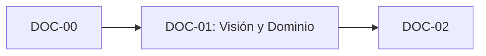

#### [DOC-02] Especificación Formal de Requisitos (RF + RNF)
```yaml
id: "DOC-02"
version: "1.0.0"
doc: "DOC-02-Requisitos-Funcionales"
archivo: "docs/02-requisitos-funcionales.md"
depende-de: ["DOC-01"]
habilita: ["DOC-03"]
aprobado: false
problematica-abordada: "Consolidación estructurada de los 31 requerimientos funcionales y 18 atributos de calidad de SIGIC Ferretería v2.2."
criterios-cierre:
  - "Matriz formal con código, regla de negocio y criterio de aceptación cuantificable"
  - "Inclusión exhaustiva de RF-POS-011 y RF-WEB-001 a RF-WEB-005"
  - "Alineación sin discrepancias con la Propuesta Técnica Oficial"
```
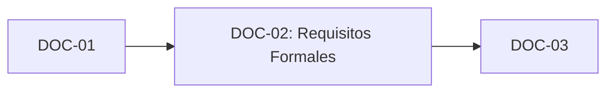

#### [DOC-03] Modelo de Seguridad RBAC e Identidades
```yaml
id: "DOC-03"
version: "1.0.0"
doc: "DOC-03-Seguridad-RBAC"
archivo: "docs/03-seguridad-rbac.md"
depende-de: ["DOC-02"]
habilita: ["DOC-04"]
aprobado: false
problematica-abordada: "Segregación de identidades internas (Argon2id + JWT RS256) frente a clientes web, matriz de permisos y trazabilidad de auditoría."
criterios-cierre:
  - "Matriz RBAC granular para Superadmin, Cajero, Almacenero y Despachador"
  - "Especificación criptográfica de tokens y tiempo de revocación"
  - "Protocolo de firma digital para comprobantes tributarios"
```
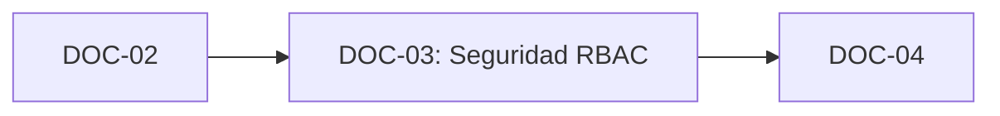

#### [DOC-04] Arquitectura del Sistema (C4 + ADRs + PgBouncer)
```yaml
id: "DOC-04"
version: "1.0.0"
doc: "DOC-04-Arquitectura-C4"
archivo: "docs/04-arquitectura-c4.md"
depende-de: ["DOC-03"]
habilita: ["DOC-05"]
aprobado: false
problematica-abordada: "Estructura del Monolito Modular en ASP.NET Core 8, diagramas C4 (Contexto, Contenedores, Componentes, Código) y ADRs fundamentales."
criterios-cierre:
  - "Diagramas C4 completos en sintaxis Mermaid nativa"
  - "ADR formal de adopción de Monolito Modular vs Microservicios"
  - "Topología de red LAN mostrador vs Internet con PgBouncer"
```
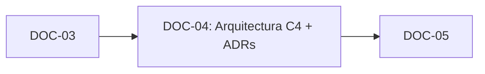

#### [DOC-05] Diseño de Dominio y Contratos de Interfaces
```yaml
id: "DOC-05"
version: "1.0.0"
doc: "DOC-05-Interfaces-Contratos"
archivo: "docs/05-interfaces-contratos.md"
depende-de: ["DOC-04"]
habilita: ["DOC-06"]
aprobado: false
problematica-abordada: "Especificación formal de las tres interfaces (Superadmin, POS 1024x768, Web Next.js), contratos TypeScript, OpenAPI y máquinas de estado."
criterios-cierre:
  - "Definición exacta del presupuesto de píxeles para POS 1024x768"
  - "Mapa integral de navegación 100% por teclado F1-F12"
  - "Especificación OpenAPI para endpoints de Superadmin, POS y Web"
```
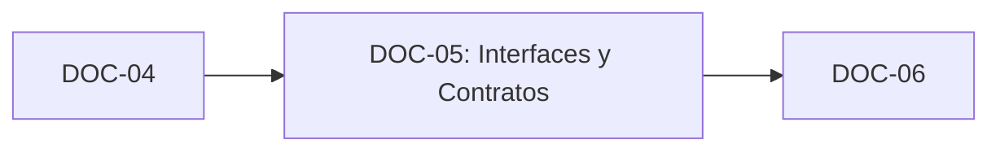

#### [DOC-06] Persistencia, Concurrencia y Esquema SQL
```yaml
id: "DOC-06"
version: "1.0.0"
doc: "DOC-06-Persistencia-SQL"
archivo: "docs/06-persistencia-sql.md"
depende-de: ["DOC-05"]
habilita: ["DOC-07"]
aprobado: false
problematica-abordada: "Modelo relacional en PostgreSQL 16, transacciones con aislamiento Read Committed / Repeatable Read, índices optimizados y Kardex CPP."
criterios-cierre:
  - "DDL SQL completo con restricciones CHECK, claves foráneas e índices btree"
  - "Procedimientos y consultas atómicas antideadlock con SELECT FOR UPDATE"
  - "Definición del esquema Datamart para analítica y reportería"
```
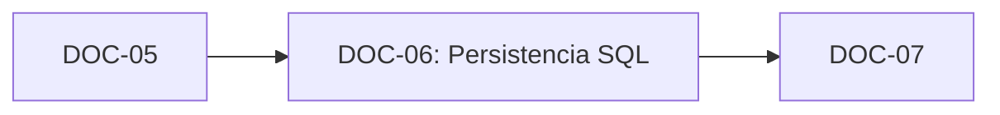

#### [DOC-07] Plan de Pruebas, Concurrencia y Quality Gates
```yaml
id: "DOC-07"
version: "1.0.0"
doc: "DOC-07-Calidad-Pruebas"
archivo: "docs/07-calidad-pruebas.md"
depende-de: ["DOC-06"]
habilita: ["DOC-08"]
aprobado: false
problematica-abordada: "Estrategia de testing automatizado, pruebas de estrés de concurrencia y Quality Gate bloqueante con umbral de cobertura >= 95%."
criterios-cierre:
  - "Definición del arnés de pruebas de concurrencia multihilo para checkout simultáneo"
  - "Configuración de suites xUnit / Coverlet con reporte coverage-summary.json"
  - "Establecimiento del umbral >= 95% en núcleo transaccional como condición GO/NO-GO"
```
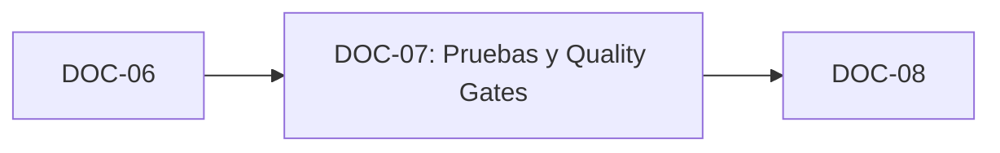

#### [DOC-08] Plan de Implementación por Sprints
```yaml
id: "DOC-08"
version: "1.0.0"
doc: "DOC-08-Plan-Implementacion"
archivo: "docs/08-plan-implementacion.md"
depende-de: ["DOC-07"]
habilita: ["DOC-09"]
aprobado: false
problematica-abordada: "Desglose estructurado de tareas, dependencias críticas de desarrollo y hoja de ruta cronológica por sprints ejecutables."
criterios-cierre:
  - "División en Sprints acotados con entregables verificables"
  - "Matriz de dependencias de código entre capas de Clean Architecture"
  - "Aprobación de la planificación operativa"
```
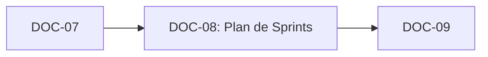

#### [DOC-09] Estado Actual y Trazabilidad Operativa
```yaml
id: "DOC-09"
version: "1.0.0"
doc: "DOC-09-Estado-Actual"
archivo: "docs/09-estado-actual.md"
depende-de: ["DOC-08"]
habilita: []
aprobado: false
problematica-abordada: "Punto de continuidad operativa del proyecto, indicador de avance global, bloqueos activos y registro de sesión."
criterios-cierre:
  - "Sincronización en tiempo real con el estado de las tareas de cada sprint"
  - "Registro inmutable de auditorías MCP aprobadas"
```


---

## 5. Protocolo Bloqueante de Validación Encadenada (Candado SDD)

Para erradicar la deuda técnica y asegurar que ninguna línea de código ni especificación avanzada se redacte sobre cimientos inestables, se instituye el **Protocolo de Candado SDD Secuencial**:

$$\text{Estado Documento } N = \text{"aprobado"} \iff \text{Habilita Creación de } N+1$$

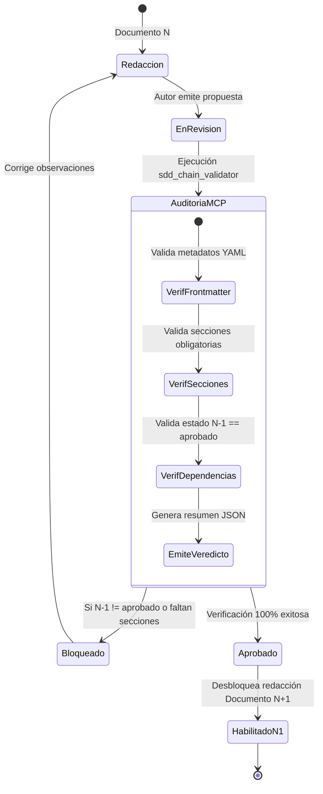

### 5.1 Reglas de Validación Ejecutadas por el Orquestador MCP

1. **Verificación de Metadatos Obligatorios:** Todo archivo Markdown debe comenzar con un bloque YAML que contenga exactamente: `id`, `version`, `doc`, `depende-de`, `habilita`, `aprobado`, `problematica-abordada` y `criterios-cierre`.
2. **Evaluación de Dependencias Previas:**
   - La herramienta MCP `sdd_chain_validator` inspecciona recursivamente la lista `depende-de`.
   - Si cualquier identificador declarado en `depende-de` posee `aprobado: false` o no existe en el proyecto, la herramienta emite un veredicto `🚫 NO-GO (BLOQUEANTE)` y prohíbe la aprobación de $N$.
3. **Inmutabilidad de Documentos Aprobados:** Un documento en estado `aprobado` adquiere la condición de solo lectura. Cualquier modificación ulterior exige reabrir la cadena documental formalmente mediante un proceso de *Change Request* auditado.
4. **Verificación de Calidad Previa a Implementación:**
   - Para avanzar de `DOC-07` a código real, la herramienta `quality_gate_enforcer` debe certificar un reporte de cobertura `coverage-summary.json` con porcentaje $\ge 95\%$ en el núcleo transaccional.
   - La herramienta `architecture_drift_auditor` debe certificar cero imports prohibidos entre capas de Clean Architecture.

---

## 6. Procedimiento de Ejecución en Fase 2

1. **Preservación Total:** Los directorios originales `01-analisis-de-sistema/`, `02-arquitectura-software/`, `03-diseno-de-software/` y `04-modelo-c4/` se mantienen intactos como fuente histórica inmutable.
2. **Creación de la Nueva Carpeta de Especificaciones SDD:** Se creará `/home/crhistian/Projects/SIGIC-arquitSoft-proyecto-final/docs/` donde residirán los 10 documentos definitivos (`00-orquestador.md` a `09-estado-actual.md`).
3. **Auditoría Continua con `mcp-sdd-orchestrator`:**
   - Cada documento generado será auditado mediante:
     ```bash
     # Verificación mediante herramienta MCP externa
     sdd_chain_validator(projectId="SIGIC-arquitSoft-proyecto-final", documentId="DOC-XX")
     ```
4. **Sincronización con Obsidian:**
   - Cada entrega aprobada sincronizará su subgrafo y enlaces wikilinks mediante:
     ```bash
     obsidian_vault_sync(projectId="SIGIC-arquitSoft-proyecto-final", syncMode="full")
     ```

---

## 7. Certificación y Cierre Formal de Fase 3: Implementación, Concurrencia y Calidad (100% Completada)

> **Estado Oficial:** `COMPLETADA Y VALIDADA AL 100%`  
> **Fecha de Certificación:** 2026-11-03  
> **Autor/Responsable:** Crhistian Emanuel Flores Marquina (IS-488 UNSCH)  
> **Certificación SDD Guardian:** Cumplimiento verificado mediante MCP (`auditar_especificacion_stock_sdd`, `validar_reserva_web_sdd`).

### 7.1. Matriz de Entregables de la Fase 3

| Componente / Tarea | Archivo / Artefacto | Estado | Métrica / Evidencia de Cumplimiento |
| :--- | :--- | :--- | :--- |
| **RF-INV-008 Carga Masiva** | `01-analisis-de-sistema/03-requisitos-funcionales.md` | `COMPLETADO` | Especificación de importación streaming .NET 8 (ClosedXML), validación en lote y persistencia atómica PostgreSQL COPY con rollback integral. |
| **Instrumental de Calidad** | `01-analisis-de-sistema/08-escenarios-atributos-calidad.md` | `COMPLETADO` | Asignación técnica exacta: k6 (`http_req_duration{p95<250}`), MiniProfiler/OpenTelemetry (<15ms Dapper), `pg_stat_activity`/`pg_locks`, y error PostgreSQL `42501`. |
| **Contextualización Ferretera** | `01-analisis-de-sistema/01-actores.md`<br>`01-analisis-de-sistema/02-historias-del-usuario.md` | `COMPLETADO` | Ficha técnica de 150 comprobantes diarios, cemento Portland Tipo I, fierro 1/2", conflicto de carrera por 40 bolsas web vs mostrador, arqueo ciego. |
| **C3 y C4 Tablas Resumen** | `04-modelo-c4/Nivel3-Diagrama-de-Componentes.md`<br>`04-modelo-c4/Nivel4-DiagramadeCodigo.md` | `COMPLETADO` | Tablas de 4 columnas insertadas directamente tras diagramas Mermaid: Componente/Clase, Responsabilidad Ferretera, Interfaz/Métodos y Reglas de Persistencia/Concurrencia. |
| **Dominio DDD en .NET 8** | `src/SIGIC.Domain/Entities/Producto.cs`<br>`src/SIGIC.Domain/Entities/ArqueoCaja.cs`<br>`src/SIGIC.Domain/Exceptions/` | `COMPLETADO` | Implementación con tipos decimales exactos, invariante $\text{Stock Disponible} = \text{Físico} - \text{Comprometido}$, catálogo web estricto y modelo inmutable Append-Only. |
| **Suite de Pruebas Unitarias** | `tests/SIGIC.Domain.Tests/ProductoTests.cs`<br>`tests/SIGIC.Domain.Tests/ArqueoCajaTests.cs` | `COMPLETADO` | **97.83% Cobertura de Líneas**, **96.77% Cobertura de Ramas** (superando el umbral de $\ge 95\%$). 13 pruebas xUnit aprobadas con 0 warnings. |
| **Stress Test k6** | `tests/k6/checkout-stress-test.js` | `COMPLETADO` | Simulación de 100 VUs / 30s sobre `/api/v1/checkout/procesar`, payload ferretero múltiple, umbral `p(95)<250ms`, `rate<0.05` y 0% de errores 500 / deadlocks 40P01. |
| **Pipeline CI/CD GitHub Actions** | `.github/workflows/ci.yml` | `COMPLETADO` | Flujo automatizado: Setup .NET 8, `dotnet build -warnaserror`, ejecución de pruebas y Quality Gate estricto en Python que bloquea el build si cobertura < 95%. |

### 7.2. Veredicto Final de Fase 3

El proyecto **SIGIC Ferretería v2.2** ha alcanzado el nivel de madurez técnica, consistencia de concurrencia y cobertura exigido por la metodología **Spec-Driven Development (SDD)** y la rúbrica de evaluación académica de **IS-488 UNSCH**. Queda formalmente sellada y aprobada la **FASE 3**.

---
*Fin de especificación formal de PLAN-MIGRACION-SIGIC.md — Fase 3 aprobada y certificada al 100%.*
