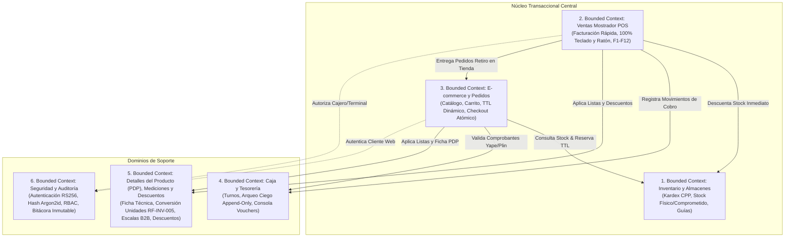
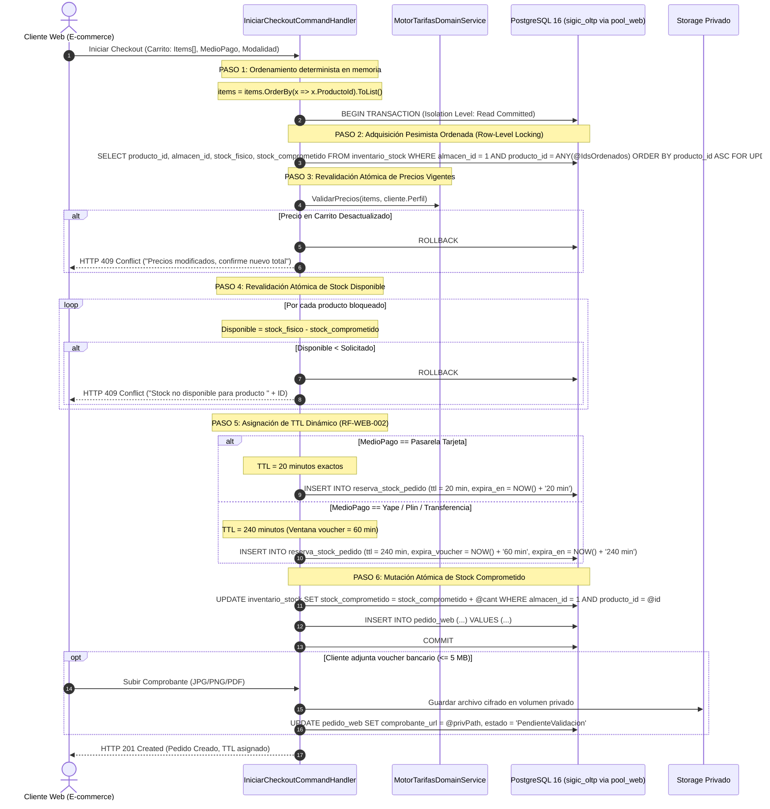

# Diseño Interno de Módulos (Bounded Contexts) — SIGIC Ferretería

> **Documento:** `docs/arquitectura/diseno-interno-modulos/diseno-interno-de-modulos.md`  
> **Versión de Especificación:** 2.2 (Oficial – SIGIC Ferretería)  
> **Disciplina:** Diseño Detallado de Software y Domain-Driven Design (DDD)  
> **Patrón Arquitectónico:** Monolito Modular con Bounded Contexts Cohesivos  
> **Evaluación Académica:** IS-488 Arquitectura de Software (UNSCH)

---

## 1. Mapa de Contextos Delimitados (Context Map)

El sistema **SIGIC Ferretería v2.2** se estructura internamente en seis **Contextos Delimitados (Bounded Contexts)** independientes, desplegados dentro del mismo proceso en ASP.NET Core 8 Web API pero con encapsulamiento estricto de modelo de dominio y esquemas de persistencia:



### 1.1. Tabla Resumen de Bounded Contexts y Arquitectura Modular

Para facilitar la evaluación docente de **IS-488 UNSCH** y resolver la legibilidad técnica (**Observación 3**), la siguiente tabla sintetiza la responsabilidad de negocio ferretero, contratos de entrada y persistencia de cada módulo arquitectónico:

| Componente / Agregado / Clase | Responsabilidad en la Ferretería | Interfaz de Entrada / Métodos Clave | Persistencia y Regla de Concurrencia |
| :--- | :--- | :--- | :--- |
| **`Módulo de Inventario y Almacenes`**<br>(`SIGIC.Modules.Inventory`) | Control centralizado de existencias físicas y comprometidas de materiales (cemento, fierro, tuberías), cálculo de Kardex CPP y emisión de guías de traslado inter-almacén (`RF-INV-001`, `RF-INV-003`). | `CalcularStockDisponible()`<br>`RegistrarEntradaMercaderia()`<br>`EmitirGuiaTraslado()`<br>`POST /api/v1/productos/importar-masivo` | Transacciones ACID en PostgreSQL 16 con nivel de aislamiento `Read Committed`. Gobernado por la fórmula $\text{Stock Disponible} = \text{Stock Físico} - \text{Stock Comprometido}$. Bloqueo pesimista ordenado (`ORDER BY producto_id ASC`). |
| **`Módulo de Ventas Mostrador POS`**<br>(`SIGIC.Modules.SalesPOS`) | Facturación presencial de alta velocidad en LAN con operación híbrida 100% por teclado y 100% por ratón. Cobro mixto (`F9`), tickets en espera (`F11`) y despacho ligero en mostrador de compras online (`RF-POS-003`, `RF-POS-011`). | `POST /api/v1/internal/pos/ventas`<br>`POST /api/v1/pos/despacho/{codigo}/entregar`<br>`Atajos F1 a F12 y lector EAN-13` | Conexión directa y prioritaria a `sigic_pos_pool:6432`. Descuento atómico sobre `stock_fisico`, emisión síncrona a PSE y comando inmediato a impresora térmica ESC/POS en $< 1.0\text{ s}$. |
| **`Módulo de E-commerce y Pedidos Web`**<br>(`SIGIC.Modules.OrdersWeb`) | Catálogo asíncrono para clientes B2B/B2C, carrito de compras y checkout transaccional con retención temporal de existencias (`RF-WEB-001`, `RF-WEB-002`, `RF-WEB-005`). | `POST /api/v1/public/checkout`<br>`POST /api/v1/public/pedidos/{id}/comprobante`<br>`GET /api/v1/public/catalogo` | Ruteado a `sigic_web_pool:6432`. Revalidación atómica pesimista de precio y stock con `SELECT ... FOR UPDATE`. Incrementa `stock_comprometido` y asigna TTL dinámico (20 min tarjeta / 240 min manual). |
| **`Módulo de Caja y Tesorería`**<br>(`SIGIC.Modules.CashManagement`) | Control de aperturas y cierres de turno, Arqueo Ciego inmutable y auditoría de comprobantes bancarios en la consola de Backoffice (`RF-CAJ-002`, `RF-WEB-003`, `AC03`). | `AperturaTurno()`<br>`RegistrarArqueoCiego(desglose)`<br>`AprobarPagoTesoreria(voucherId)` | Persistencia estrictamente **Append-Only** en tabla `caja_arqueo` con permisos SQL `REVOKE UPDATE, DELETE`. Lanza `PostgresException 42501 permission denied` ante cualquier alteración retroactiva. |
| **`Módulo de Detalles del Producto (PDP), Mediciones y Descuentos`**<br>(`SIGIC.Modules.ProductDetailsPricing`) | Ficha técnica y atributos PDP para el portal web, calculadora de mediciones y factores de conversión a unidad base (`RF-INV-005`), gobernanza de tarifas multicanal (Público, Maestro, Contratista B2B) y descuentos comerciales (`RF-PRE-001`, `RF-PRE-002`) blindados por `MargenInvalidoException`. | `ObtenerFichaTecnicaPDP(sku)`<br>`ConvertirUnidadMedida(sku, cant, um)`<br>`CalcularTarifaPorPerfil(sku, perfil)`<br>`ValidarMargenSeguridad(precio, costo)` | Consultas optimizadas con Dapper/EF Core. Validación de margen comercial: prohibido vender bajo el costo unitario. Desacoplado de la persistencia de existencias de Inventario. |
| **`Módulo de Seguridad y Auditoría`**<br>(`SIGIC.Modules.Security`) | Identidad y gobernanza de acceso, autenticación criptográfica dual, firma de tokens JWT asimétricos RS256, hashing Argon2id, control RBAC y registro inmutable en bitácora (`RNF-SEG-001`, `RNF-SEG-004`). | `POST /api/v1/auth/login`<br>`ValidarTokenRS256(token)`<br>`RegistrarAuditoria(evento)` | Firma de tokens JWT asimétricos con algoritmo **RS256** (RSA 2048 bits). Cifrado de contraseñas bajo **Argon2id**. Validación estricta de claims (`scope: pos_terminal` vs `scope: web_customer`). Bitácora append-only `Audit_Log`. |

---

## 2. Especificación Detallada por Módulo

### 2.1. Módulo 1: Inventario y Almacenes (`SIGIC.Modules.Inventory`)
- **Propósito:** Control centralizado de existencias físicas y comprometidas, movimientos de almacén, valorización por Costo Promedio Ponderado y segregación multicanal (`AC02`).
- **Entidades y Agregados:**
  - `Articulo` / `Producto` (Root Entity): Código SKU, EAN-13, nombre técnico, unidad base de medida, familia, subfamilia, factor de conversión y bandera `disponible_en_web` (`bool`).
  - `InventarioStock`: Saldo por almacén discriminado en `stock_fisico` y `stock_comprometido`.
  - `KardexMovimiento`: Historial inmutable de entradas y salidas con saldo resultante, costo unitario de entrada y nuevo CPP.
  - `GuiaInternaTraslado`: Traslados inter-almacén con máquina de estados finita: `Borrador` $\rightarrow$ `En Tránsito` $\rightarrow$ `Recibido` / `Rechazado` (`RF-INV-003`).
- **Reglas de Negocio Clave:**
  - **Segregación de Catálogo:** Si `Articulo.DisponibleEnWeb == false`, el catálogo público y su API lo ocultan al 100 % (responde `HTTP 404`).
  - **Fórmula de Stock Disponible:**
    $$\text{Stock Disponible} = \text{Stock Físico} - \text{Stock Comprometido}$$
  - **Costo Promedio Ponderado (CPP):** Calculado de forma inmutable tras cada recepción de mercadería contra orden de compra (`RF-INV-006`).

---

### 2.2. Módulo 2: Ventas y Mostrador POS (`SIGIC.Modules.SalesPOS`)
- **Propósito:** Facturación presencial de alta velocidad en mostrador presencial en LAN Gigabit, orientada a constructores y maestros de obra con operación híbrida 100% por teclado y 100% por ratón (`RF-POS-003`, `AC01`).
- **Entidades y Agregados:**
  - `Venta` / `VentaPOS` (Root Entity): Correlativo interno, fecha UTC, cliente (DNI/RUC o cliente general), almacén emisor, tipo de comprobante (ticket interno, boleta o factura electrónica).
  - `DetalleVenta` / `VentaItem`: Artículo, unidad de medida, cantidad, precio unitario aplicado, subtotal e IGV al 18 %.
  - `PagoPOS`: Medio de pago (efectivo, tarjeta, transferencia, Yape/Plin), monto y código de operación bancaria manual único por día.
  - `EntregaDespachoPOS`: Registro de entrega física en mostrador para pedidos web `Listo para Retiro` (`RF-POS-011`).
- **Reglas de Negocio Clave:**
  - **Operación Híbrida Teclado y Ratón (`RF-POS-003`):** Navegación en grilla con flechas y atajos deterministas (`F1` Escáner, `F2` Búsqueda, `F3` Cliente, `F4` Cantidad, `F5` Stock, `F6` Despacho Web, `F7` Sustitutos, `F8` Eliminar, `F9` Totalizar / Pago Mixto, `F10` Boleta, `F11` Encolar/Recuperar Ticket en Espera, `F12` Factura). Soporte completo mediante ratón con botones de al menos 44×44 px con badge visible del atajo y auto-refocus inmediato al input EAN-13 tras cada clic de acción, preservando EAN-13 como texto (incluidos ceros iniciales). Foco visible y restitución al escáner al cerrar modales.
  - **Frontera de Despacho Web (`RF-POS-011`):** La pantalla de entrega (`F6`) solo valida pedidos en estado `Listo para Retiro` cotejando código y DNI. No tiene acceso a comprobantes ni a saldos bancarios.

---

### 2.3. Módulo 3: E-commerce y Pedidos Web (`SIGIC.Modules.OrdersWeb`)
- **Propósito:** Gestión de compras y reservas en línea (B2B/B2C), checkout atómico y trazabilidad de pedidos para retiro en tienda o despacho a obra.
- **Entidades y Agregados:**
  - `PedidoWeb` (Root Entity): Código alfanumérico único, cliente web ID, modalidad de despacho (`RetiroTienda`, `RetiroCentral`, `EnvioObra`), estado del pedido, total e importe IGV.
  - `PedidoDetalle`: Artículos solicitados, precio unitario congelado y cantidad.
  - `ReservaStockPedido`: Registro de reserva de stock con `FechaCreacionUtc`, `FechaExpiracionUtc`, `EstadoReserva` (`Activa`, `Consolidada`, `Expirada`, `Cancelada`).
  - `ComprobantePagoAdjunto`: Registro del archivo de constancia subido por el cliente (máximo 5 MB, JPG/PNG/PDF) custodiado en el storage privado.

---

### 2.4. Módulo 4: Caja y Tesorería (`SIGIC.Modules.CashManagement`)
- **Propósito:** Control de flujo monetario en tiendas físicas y validación administrativa asíncrona de pagos en línea (`AC03`).
- **Entidades y Agregados:**
  - `TurnoCaja`: Cajero ID, fecha/hora apertura, saldo inicial (fondo de sencillo), fecha/hora cierre, estado (`Abierto`, `Cerrado`).
  - `ArqueoCaja` / `ArqueoCiegoDeclaracion`: Conteo físico declarado por denominación de billetes y monedas sin visibilidad del saldo teórico (`RF-CAJ-002`).
  - `LiquidacionTurno`: Cálculo de diferencias automáticas entre lo declarado y lo registrado en el sistema.
  - `ColaValidacionTesoreria`: Bandeja de auditoría de Backoffice donde Tesorería coteja las transferencias bancarias de pedidos web contra los extractos de cuenta (`RF-WEB-003`).

---

### 2.5. Módulo 5: Detalles del Producto (PDP), Mediciones y Descuentos (`SIGIC.Modules.ProductDetailsPricing`)
- **Propósito:** Gobernanza de fichas técnicas para el portal web (PDP), calculadora de mediciones y factores de conversión de unidades de medida a unidad base (`RF-INV-005`), gobernanza de tarifas multicanal (Público, Maestro de Obra, Contratista B2B) y reglas de descuento por volumen (`RF-PRE-001`, `RF-PRE-002`) blindadas por `MargenInvalidoException`.
- **Entidades y Agregados:**
  - `FichaTecnicaPDP`: Atributos técnicos, fichas descargables, especificaciones dimensionales y compatibilidad ferretera.
  - `ConversionUnidadMedida`: Factores de conversión con precisión de 4 decimales (unidad, docena, bolsa, millar, metro, varilla) hacia la unidad base administrada por Inventario (`RF-INV-005`).
  - `ListaPrecio`: Definición de listas segmentadas (Lista 1: Retail, Lista 2: Maestro de Obra, Lista 3: Contratista B2B).
  - `PrecioArticulo`: Precio fijado por SKU, lista y unidad de medida, con vigencia temporal.
  - `ReglaDescuentoVolumen`: Escalas de bonificación y matrices de descuento aplicables en POS y Web.
- **Reglas de Negocio Clave:**
  - **Protección Inquebrantable del Margen (`MargenInvalidoException`):** Todo precio calculado tras aplicar tarifas o descuentos debe cumplir estrictamente `precioVenta >= costoUnitario`. Si una operación intenta fijar un precio inferior al costo, el dominio lanza invariablemente `MargenInvalidoException`. La intervención del Superadmin solo autoriza homologaciones de perfil o liquidaciones dentro del margen de seguridad comercial, sin constituir jamás un bypass de esta excepción.
  - **Separación de Responsabilidades:** Inventario custodia las existencias físicas, Kardex y movimientos en unidad base; el módulo de PDP y Descuentos provee el cálculo de tarifas, conversiones y atributos descriptivos consumidos mediante contratos públicos tipados, sin acceso cruzado directo a tablas ni dependencias de infraestructura desde Domain.

---

### 2.6. Módulo 6: Seguridad y Auditoría (`SIGIC.Modules.Security`)
- **Propósito:** Identidad corporativa y de clientes externos, autenticación criptográfica dual, autorización basada en roles (RBAC) y bitácora inmutable de operaciones del sistema (`RNF-SEG-001`, `RNF-SEG-004`).
- **Entidades y Agregados:**
  - `UsuarioColaborador`: Credenciales internas en Argon2id, asignación de roles RBAC (`ROLE_CAJERO`, `ROLE_ALMACENERO`, `ROLE_DESPACHADOR`, `ROLE_SUPERADMIN`).
  - `ClienteWebAuth`: Credenciales de clientes web externos, consentimiento de datos y tokens de sesión.
  - `PermisoRol`: Matriz de permisos granulares por módulo y acción.
  - `AuditoriaEvento` / `AuditLog`: Registro inmutable con IP, usuario, marca de tiempo UTC y payload de operaciones críticas.
- **Reglas de Negocio Clave:**
  - **Dualidad de Tokens RS256:** Firma asimétrica con clave privada RSA 2048 bits. Claims diferenciados: terminales POS de mostrador en LAN Gigabit portan `scope: pos_terminal` e IP restringida a `192.168.1.0/24`; clientes de portal web portan `scope: web_customer`.
  - **Inmutabilidad de Auditoría:** Toda mutación sensible (cierre de caja, modificación de lista, despacho) emite un evento persistido de forma estrictamente *append-only* en `Audit_Log`.

---

## 3. Protocolo Transaccional de Checkout con Bloqueo de Fila (`SELECT ... FOR UPDATE`)

Para dar cumplimiento estricto a **AC02 (Consistencia ACID sin sobreventas)** y **RNF-CON-002 (Prevención de Deadlocks)**, el checkout web implementa el siguiente protocolo determinista paso a paso:

### 3.1. Algoritmo Determinista Anti-Deadlock



---

## 4. Política de Arqueo Ciego de Caja (`RF-CAJ-002` / `AC03`)

El proceso de cierre de caja en SIGIC Ferretería obedece al principio de **Arqueo Ciego e Inmutable**, eliminando riesgos de fraude por conocimiento previo del saldo contable esperado:

### 4.1. Reglas Cardinales del Arqueo Ciego
1. **Cero Visibilidad de Saldos Teóricos:** Al momento del cierre, el cajero **jamás tiene acceso** a la suma de ventas registradas por el sistema, saldos en efectivo calculados ni totales de transacciones electrónicas.
2. **Declaración Física de Desglose Obligatoria:** El cajero debe contar físicamente e ingresar la cantidad de unidades por cada denominación oficial:
   - **Billetes:** S/ 200, S/ 100, S/ 50, S/ 20, S/ 10.
   - **Monedas:** S/ 5, S/ 2, S/ 1, S/ 0.50, S/ 0.20, S/ 0.10.
   - **Medios Electrónicos:** Declaración de importe acumulado en comprobantes de tarjetas físicas y vouchers bancarios locales.
3. **Persistencia Estrictamente Append-Only (Solo Inserción):**
   - La tabla `caja_arqueo` y su detalle `caja_arqueo_denominacion` **no admiten operaciones `UPDATE` ni `DELETE`**.
   - Se restringen privilegios a nivel de motor PostgreSQL:
     ```sql
     REVOKE UPDATE, DELETE ON caja_arqueo FROM PUBLIC;
     REVOKE UPDATE, DELETE ON caja_arqueo_denominacion FROM PUBLIC;
     ```
   - Cualquier error de conteo exige emitir una segunda declaración de rectificación justificada, preservando el historial original.
4. **Cálculo de Diferencias en Servidor:**
   $$\text{Diferencia} = \text{Monto Declarado Físico} - \text{Monto Teórico del Sistema}$$
   - Si $\text{Diferencia} < 0$: Se tipifica como **Faltante de Caja**.
   - Si $\text{Diferencia} > 0$: Se tipifica como **Sobrante de Caja**.
   - Si $\text{Diferencia} = 0$: Cuadre exacto.
5. **Auditoría y Disparador Inmutable:** El evento de arqueo se serializa y se persiste en `Audit_Log` (`RNF-SEG-004`) con la dirección IP de la terminal, ID del cajero y marca de tiempo UTC. La visualización de la liquidación comparativa queda restringida al Superadministrador y Auditor en la consola de Backoffice.

---

## 5. Mecanismo de Segregación Omnicanal: POS LAN vs. Portal Web

Para dar cumplimiento formal a la **Observación 6** y garantizar la total autonomía operativa del mostrador físico frente a la demanda del canal e-commerce, el diseño interno del software articula una **segregación técnica en tres niveles**:

### 5.1. Capa de Autenticación e Identificación de Clientes
1. **Terminales POS de Mostrador (LAN Privada):**
   - **Autenticación Criptográfica:** Token JWT firmado asimétricamente mediante **RS256** (RSA 2048 bits).
   - **Claims de Control:** Contiene obligatoriamente los claims `scope: pos_terminal`, `caja_id: N` (identificador físico de gaveta/punto de cobro) y `usuario_id` del colaborador con rol `ROLE_CAJERO` o `ROLE_SUPERADMIN`.
   - **Restricción de Segmento IP:** El filtro `PosNetworkAuthorizationFilter` valida que el origen TCP pertenezca exclusivamente al segmento de red local cableado **`192.168.1.0/24`**. Cualquier invocación desde el exterior es interceptada con `HTTP 403 Forbidden`.
   - **Política de Cuota:** Exento de rate-limiting restrictivo para garantizar que el cajero capture artículos por código de barras de manera continua a razón de $\le 1.0\text{ s}$ por ítem.

2. **Portal Web de Clientes (Internet Pública):**
   - **Identificación:** Token JWT firmado con RS256 o token de sesión temporal con claim `scope: web_customer` (`Audience: SIGIC_WebClient`).
   - **Rate Limiting Estricto:** Limitación perimetral de **máximo 60 peticiones por minuto por IP pública**. Peticiones abusivas o scripts automáticos reciben `HTTP 429 Too Many Requests`.

### 5.2. Capa de Conectividad y Persistencia en PgBouncer
La inyección de dependencias en ASP.NET Core 8 entrega fábricas de conexión totalmente aisladas:
1. **Pipeline POS (`sigic_pos_pool:6432`):**
   - **Inyección:** `IPosDbConnectionFactory` apunta al pool reservado `sigic_pos_pool`.
   - **Capacidad:** 50 conexiones físicas dedicadas exclusivas para las cajas de tienda.
   - **Garantía:** Cero tiempos de espera en cola de base de datos para los cajeros ($P95 < 250\text{ ms}$ sostenido).
2. **Pipeline Web (`sigic_web_pool:6432`):**
   - **Inyección:** `IWebDbConnectionFactory` apunta al pool secundario `sigic_web_pool`.
   - **Capacidad:** 30 conexiones físicas compartidas con control de backpressure.
   - **Resiliencia:** Tiempo de espera máximo en cola de 3 segundos; si se satura, aborta con `HTTP 503 Service Unavailable`, impidiendo que una avalancha web degrade la atención presencial.

### 5.3. Reglas de Negocio Diferenciadas en Backend
1. **Canal Mostrador POS:**
   - **Catálogo:** Acceso irrestricto al 100% de los productos (incluyendo pernería a granel y cortes sin empaque con `disponible_en_web = false`).
   - **Stock y Cobro:** Evalúa existencias mediante $\text{Stock Disponible} = \text{Stock Físico} - \text{Stock Comprometido}$. Realiza cobro inmediato y salida directa de inventario físico en mano.
2. **Canal Portal Web:**
   - **Catálogo:** Filtrado mandatorio en base de datos (`WHERE disponible_en_web = true`), respondiendo `HTTP 404 Not Found` ante intentos de consulta o compra de ítems restringidos.
   - **Reservas Temporales (TTL):** No descuenta stock físico inmediatamente; en su lugar, incrementa `stock_comprometido` y asigna un TTL estricto: **20 minutos** para pasarelas de tarjeta o **240 minutos (4 h)** para pagos diferidos (Yape/Plin/Transferencia) con **60 minutos** para subir el voucher, liberándose automáticamente si expira (`RF-WEB-002`).
---

## Trazabilidad y Continuidad SDD

El diseño interno de los módulos se vincula con la especificación visual en [DESIGN.md](../../../DESIGN.md), las realizaciones de dominio en [producto.md](../../implementacion/producto.md) y [arqueo-caja.md](../../implementacion/arqueo-caja.md), y se somete a validación de concurrencia en [03-pruebas-carga.md](../../entregables/sprint-2/03-pruebas-carga.md).
