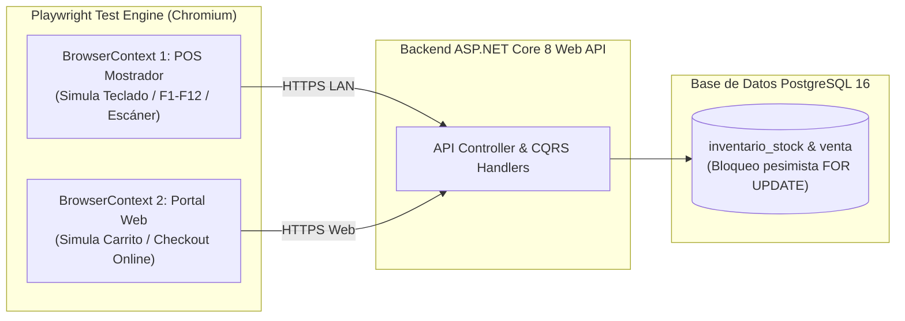

# Especificación y Arquitectura de Pruebas End-to-End (E2E) — SIGIC Ferretería v2.2

> **Documento:** `docs/entregables/sprint-2/02-pruebas-e2e.md`  
> **Sistema:** SIGIC Ferretería v2.2  
> **Asignatura:** IS-488 Arquitectura de Software (UNSCH)  
> **Criterio Oficial de Evaluación:** **Criterio 6 — Pruebas End-to-End (E2E)**  
> **Herramienta Automatizada:** Playwright (Microsoft) sobre Chromium Headless  
> **Suite de Prueba:** [tests/e2e/checkout-omnicanal.spec.ts](../../../tests/e2e/checkout-omnicanal.spec.ts)

---

## 1. Propósito y Alcance de las Pruebas E2E

Las **Pruebas End-to-End (E2E)** en SIGIC Ferretería v2.2 tienen como objetivo certificar el comportamiento holístico del sistema simulando la interacción humana real sobre los dos canales comerciales principales:
1. **Canal Mostrador POS (LAN):** Interfaz SPA React 18 operada exclusivamente por teclado (`F1` a `F12`) y lector de código de barras sin mouse.
2. **Canal Portal Web (Internet):** Portal e-commerce Next.js 14 que compite de forma asíncrona por el mismo inventario central.



---

## 2. Herramientas Tecnológicas y Entorno de Ejecución

| Componente | Tecnología Seleccionada | Justificación Técnica de Arquitectura |
| :--- | :--- | :--- |
| **Framework E2E** | **Playwright Test (TypeScript)** | Soporte nativo para múltiples contextos aislados de navegador en paralelo (`browser.newContext()`), permitiendo simular colisiones multicanal (POS vs Web) en una sola corrida. |
| **Motor de Renderizado** | **Chromium Headless** | Emulación idéntica del motor Blink presente en las terminales de caja física de la tienda ferretera. |
| **Selectores Robustos** | `data-testid` normalizados | Desacopla las pruebas de los estilos CSS y clases dinámicas de Tailwind/CSS Modules (`data-testid="input-scanner-sku"`). |
| **Integración CI/CD** | GitHub Actions Workflow | Ejecución desatendida en contenedores Ubuntu con generación de reportes HTML y captura de video/trazas ante fallas. |

---

## 3. Matriz de Escenarios de Prueba Automatizados

La suite implementada en [tests/e2e/checkout-omnicanal.spec.ts](../../../tests/e2e/checkout-omnicanal.spec.ts) cubre los dos flujos operativos críticos del negocio:

| ID Escenario | Canal Principal | Objetivo de Verificación | Comportamiento Esperado | Criterio de Éxito |
| :---: | :--- | :--- | :--- | :--- |
| **E2E-01** | Mostrador POS (LAN) | **Flujo Feliz de Venta Rápida sin Ratón:**<br>1. Login cajero con PIN.<br>2. Escaneo SKU Fierro 1/2".<br>3. Cálculo automático IGV 18%.<br>4. Cobro en efectivo con F9.<br>5. Emisión de boleta electrónica con F10. | Venta completada en $< 2.0\text{ s}$, cursor listo en input de escáner para nueva venta, persistencia atómica en base de datos. | Toast de éxito visible con correlativo `B001-XXXX`, cálculo de vuelto exacto (`S/ 8.00`) y foco activo retenido. |
| **E2E-02** | Omnicanal (POS + Web) | **Colisión Concurrente y Rechazo Amigable:**<br>1. Cliente web prepara carrito con últimas 5 varillas.<br>2. Cajero POS vende físicamente las 5 varillas.<br>3. Cliente web confirma pedido simultáneo. | El backend rechaza la transacción web por violación de la invariante `RNF-CON-003` ($\text{Disponible} < \text{Solicitado}$). La UI web muestra alerta amigable de stock agotado. | Alerta visual clara `HTTP 409 Conflict` en pantalla web; **0% errores internos 500** y sin páginas en blanco. |

---

## 4. Comandos de Ejecución y Automatización en CI/CD

### 4.1. Ejecución Local (Terminal Linux / Fish)

```bash
# Instalación de dependencias y navegadores Playwright
pnpm install
npx playwright install --with-deps chromium

# Ejecución de la suite E2E en modo headless
npx playwright test tests/e2e/checkout-omnicanal.spec.ts

# Ejecución en modo interactivo con UI para depuración visual
npx playwright test --ui
```

### 4.2. Integración en el Pipeline de GitHub Actions

```yaml
- name: Run Playwright E2E Tests
  run: |
    npx playwright test
  env:
    SIGIC_POS_URL: "http://localhost:3000"
    SIGIC_WEB_URL: "http://localhost:3001"
    SIGIC_API_URL: "http://localhost:5000"

- name: Upload Playwright Artifacts on Failure
  if: failure()
  uses: actions/upload-artifact@v4
  with:
    name: playwright-report
    path: playwright-report/
    retention-days: 7
```

## Contrato de API — plan vigente 2026-11-19


Crear `tests/postman/sigic-sprint-2.postman_collection.json`. Variables `baseUrl=http://localhost:5000/api/v1`, credenciales efímeras, tokens distintos staff/web/tesorería, almacenes, caja, turno, cliente, dos productos, pedido, venta y guía. Inyectar valores privados al ejecutar. Carpeta Setup toma usuarios del seed, hace login y guarda token/userId; usar `pm.collectionVariables.set("pedidoId", pm.response.json().pedidoId)` y aserciones de estado + estructura en cada transición. Ejecutar sobre BD nueva por ejecución y prefijar datos con ID de corrida. Distribuir un voucher sintético válido mediante fixture y resolver la ruta multipart desde el directorio de trabajo de Newman. Todos los paths siguientes son relativos a baseUrl.

| Carpeta | Secuencia y oráculo |
|---|---|
| Acceso | POST `/auth/register-web` (201) o `/auth/login-web` (200), POST `/auth/login-staff` (200), cuerpos `username,password`. Un GET protegido sin token devuelve 401 y el token de audiencia cruzada devuelve 403. |
| Catálogo y tarifa | GET `/public/catalogo/productos?almacenId=…&search=…`, GET `/public/catalogo/productos/{id}`, POST `/public/catalogo/calcular-precio` con productoId,cantidad,unidadMedida y perfil. Validar precio y conversión contra el seed, stock disponible y ausencia/404 del oculto. |
| Caja y POS | POST `/caja/turnos/apertura` {cajaId,cajeroId,almacenId,fondoInicial} → 201 turnoId; GET `/caja/turnos/actual?cajeroId=…`. POST `/pos/ventas` {turnoCajaId,clienteId,items:[{productoId,cantidad,unidadMedida,precioUnitario}],pagos:[{metodoPago:"Efectivo",monto}],tipoComprobante} → 201 ventaId. GET `/pos/ventas/{ventaId}` y GET `/inventario/stock?almacenId=…&productoId=…` → 200. Agotamiento controlado → 409 y saldo intacto. |
| Pedido y voucher | POST `/web/pedidos/reservar` {clienteId,metodoPago,modalidadEntrega,tiendaDestinoId,items:[{productoId,cantidad,precioUnitario,unidadMedida,factorConversion}]} → 201 pedidoId. Contrastar pasarela `PasarelaTarjeta` 20 min con manual `Yape` u otra modalidad aceptada, 240/60; GET `/web/pedidos/{pedidoId}`. POST `/web/pedidos/{pedidoId}/voucher` multipart campo `voucher` → 200; rechazo por extensión no válida, vacío o más de 5 MiB → 400. Publicar casos límite de tiempo con reloj de pruebas. |
| Tesorería y despacho | POST `/caja/vouchers/{pedidoId}/validar` con {aprobado,motivoRechazo} como Tesoreria/Superadmin. En aprobación comprobar `PagadoConfirmado`; en retiro en tienda guardar código real de guía, GET `/inventario/guias-traslado/{idOrCode}`, POST `/inventario/guias-traslado/{idOrCode}/entregar` {dniReceptor,codigoRetiro}. Verificar persistencia y tratamiento de repetición. |
| Auditoría | GET `/inventario/kardex/{productoId}`; POST `/caja/turnos/cierre` con turnoCajaId,desgloseFisico de {valorUnitario,cantidad},totalDigitalDeclarado,justificacion. Comprobar que el cajero no ve saldo teórico al declarar. Probar 42501 contra PostgreSQL con rol app en la suite de infraestructura. |

Cierre exige reporte Newman con fallos bloqueantes: `newman run tests/postman/sigic-sprint-2.postman_collection.json -e "$SIGIC_POSTMAN_ENV" --bail --reporters cli,junit --reporter-junit-export /tmp/sigic-postman.xml`. Corregir también `tests/e2e/checkout-omnicanal.spec.ts`: usa hosts de despliegue, PIN, selectores y ruta `/producto/…` que requieren conciliación con login staff por credenciales y PDP real `/pdp/[id]`. Añadir runner Playwright y configuración reproducibles al validar ese entregable. Evaluar de forma defensiva vinculación de pedidos con el principal: el controlador acepta clienteId del body y sus lecturas/carga precisan comprobación de titularidad explícita. Incluir aceptación de aislamiento entre clientes y reparar antes de declarar cerrado el flujo.


La [colección Postman v2.1](../../../tests/postman/sigic-sprint-2.postman_collection.json)
materializa los contratos como entregable de pruebas. Requiere seed aislado y
variables privadas; su existencia no acredita ejecución ni cierra Sprint 2.
